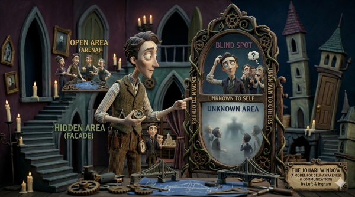
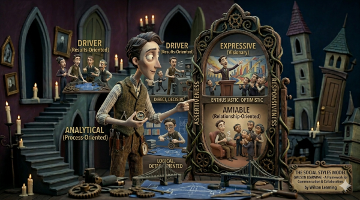

There’s a certain irony in leadership development. You can master stakeholder matrices, project communication plans, and conflict resolution frameworks; and still be the reason your team is quietly updating their LinkedIn profiles.

The missing ingredient, more often than not, is self-awareness. It’s not a soft skill. It’s the skill everything else is built on, before you lead others, you need to understand yourself.

## The Two Tools

### 1. Johari Window

Developed by psychologists Joseph *Luft and Harry Ingham in 1955*, the Johari Window divides what we know about ourselves into **four quadrants**:

|  | **Known to Self** | **Unknown to Self** |
| --- | --- | --- |
| **Known to Others** | **Open** – the public you | **Blind Spot** – what others see that you don’t |
| **Unknown to Others** | **Hidden** – what you keep to yourself | **Unknown** – yet to be discovered by anyone |

The exercise involves selecting words that describe yourself, then asking others to do the same. The **overlap** becomes your Open quadrant. Words **others chose** that you didn’t? That’s your Blind Spot. Words **only you chose**? Your Hidden area.

The most valuable – and frequently most uncomfortable; output is the **Blind Spot**. It’s the gap between the person you think you’re projecting and the person everyone else is experiencing.

### 2. Social Styles (Wilson Learning)

The Social Styles model maps behavioral tendencies across two dimensions:

- Assertiveness: How much you tell vs ask
- Responsiveness: How task focused vs people-focused you are.

This gives 4 styles

|  | **Less Assertive (Ask)** | **More Assertive (Tell)** |
| --- | --- | --- |
| **Task-Oriented** | **Analytical** – thoughtful, reserved, slow-paced | **Driver** – decisive, controlling, fast-paced |
| **People-Oriented** | **Amiable** – friendly, supportive, relationship-driven | **Expressive** – enthusiastic, emotional, spontaneous |

Each style comes with strengths, blind spots, and a “growth action”; the one thing that style tends to avoid but needs to develop.

- Drivers need to listen.
- Analyticals need to declare.
- Amiables need to initiate.
- Expressives need to check.

## Key Takeaways

**Awareness ≠ Change.** Neither tool is asking you to become a different person. They’re asking you to understand your defaults; so you can choose when to work with them and when to dial them back.

**Your blind spot is real, whether you see it or not.** The people around you have already noticed. The Johari Window just gives you a structured way to catch up.

**Style ≠ Personality.** Social Styles describe *behaviour*, not identity. They’re context-dependent and can shift. More importantly, they can be adapted; especially when you understand what the person across the table needs from you.

**Small sample sizes matter.** If only three people filled in your Johari feedback, treat the results as a directional signal, not a verdict. The pattern is interesting. The certainty should be modest.

## Why Self-Awareness Is the Foundation – Not Just a Nice-to-Have

Leadership frameworks – Triple Catalyst, Emotional Intelligence, Thomas-Kilmann, Tuckman; are all useful. But they are only as useful as the person applying them is honest with themselves.

Goleman’s Emotional Intelligence model begins with self-awareness for good reason. You cannot regulate emotions you haven’t identified. You cannot build genuine empathy if you’re operating from unchecked assumptions about how you come across. You cannot manage conflict constructively if you don’t know whether your default mode is Competing or Avoiding.

MacKay’s Triple Catalyst makes the same point from a different angle: Insight – the first catalyst – begins not with organizational data, but with the leader’s own self-awareness. Nokia’s story illustrates what happens when leaders skip that step. They had the data. They lacked the honest internal reckoning to act on it.

The Johari Window and Social Styles aren’t exercises you complete once and file away. They’re checkpoints. A good leader returns to them especially when something isn’t working, when a team is stuck in Storming, or when a stakeholder relationship has inexplicably gone cold.

Often, the answer starts with the quadrant you’d rather not look at.

---

## A Final Thought

### Why psychological safety matters?

One good answer: because without it, people’s blind spots stay blind. Teams don’t surface uncomfortable truths. Leaders don’t hear what they need to hear.

Self-awareness is the individual version of that same principle. It’s the permission you give yourself to be wrong about yourself – and to do something useful with that information.

Which, when you think about it, is exactly what good leadership requires.
