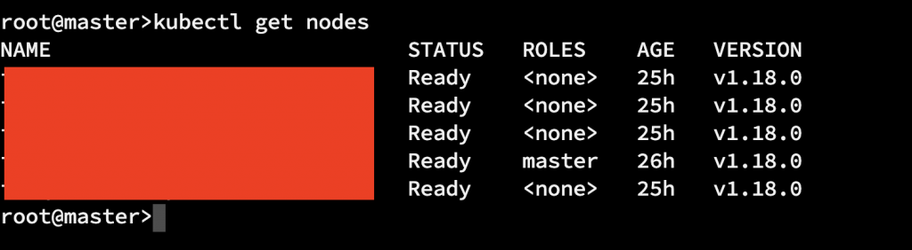
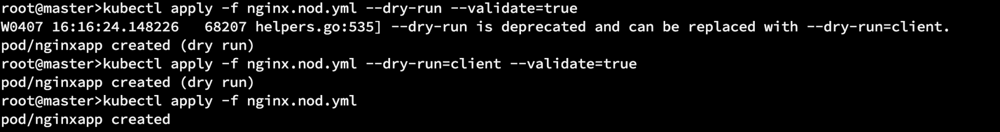

It is always fun learning and trying out some new tech. In this blog, I will try and capture my experience of running my first pod using `kubectl`.

If you wish to learn how to install a typical master, worker cluster of K8S I recommend going through this [blog](https://www.tecmint.com/install-kubernetes-cluster-on-centos-7/).

> A Kubernetes cluster can be deployed on either physical or virtual machines.

My setup looks something like this.



The `**setup`** has 1 master and few slaves as shown in image above.

## Point to remember

`Kubectl` uses the `Kubernetes API` to interact with the cluster.

## Terminologies

### Master

**The Master is responsible for managing the cluster.** The master coordinates all activities in your cluster, such as scheduling applications, maintaining applications' desired state, scaling applications, and rolling out new updates. (from official [documentation](https://kubernetes.io/docs/tutorials/kubernetes-basics/create-cluster/cluster-intro/))

### Nodes

**A node is a VM or a physical computer that serves as a worker machine in a Kubernetes cluster.** Each node has a `Kubelet`, which is an agent for managing the node and communicating with the `Kubernetes` master.

> When you deploy applications on Kubernetes, you tell the master to start the application containers.

- https://kubernetes.io/docs/concepts/overview/kubernetes-api/
- https://kubernetes.io/docs/tutorials/kubernetes-basics/create-cluster/cluster-intro/

### Deployment

Declarative management for pods and replicaset. One can describe a *desired state* in a Deployment, and the [Controller](https://kubernetes.io/docs/concepts/architecture/controller/) changes the actual state to the desired state at a controlled rate.

## Pre-requisites

> Once you have a running `Kubernetes` cluster, you can deploy your containerized applications on top of it.

The primary way of executing commands is the `kubectl` which exposes multiple options that helps the developer orchestration.

## YAML

(YAML a'int markup [language](https://docs.ansible.com/ansible/latest/reference_appendices/YAMLSyntax.html)) This is the chosen syntax to write the configuration files that will provide the necessary instructions to do the required.

## No deep dive...

This blog I will not cover all the concepts of Containers, Kubernetes (K8s) resources etc. It is just a quick and dirt start to using K8S to launch a pod and see it running.

## POD

Pod is essentials the smallest building block in the K8S universe, and I will define a quick pod as following.

```text
apiVersion: v1
kind: Pod
metadata:
 name: nginxapp
labels:
 app: nginx
 rel: stable
spec:
 containers:
  - name: nginxapp
  image: nginx:alpine
  ports:
   - containerPort: 80
```

Indentation is quite important while you are writing YML's and space is the preferred way of indenting.

Once this YML is defined time to call the `kubectl apply`



Once you call `kubectl apply -f nginx.file.yml` you can call get pods to see the contents.

```text
root@master>kubectl get pods
NAME READY STATUS RESTARTS AGE
nginxapp 0/1 ContainerCreating 0 6s
```

If I use

```text
kubectl create -f nginx.pod.yml
```

and see the pod by calling

```text
kubectl get pod nginxapp -o yaml
```

I can see the output as under

```text
root@master>kubectl get pod nginxapp -o yaml
apiVersion: v1
kind: Pod
metadata:
creationTimestamp: "2020-04-07T16:42:41Z"
labels:
app: nginx
rel: stable
managedFields:
apiVersion: v1
fieldsType: FieldsV1
fieldsV1:
.................
```

but if I do

```text
ubectl create -f nginx.pod.yml --save-config
```

and then see the pod I will see the difference

```text
root@master>kubectl get pod nginxapp -o yaml
apiVersion: v1
kind: Pod
metadata:
annotations:
kubectl.kubernetes.io/last-applied-configuration: |
{"apiVersion":"v1","kind":"Pod","metadata":{"annotations":{},"labels":{"app":"nginx","rel":"stable"},"name":"nginxapp","namespace":"default"},"spec":{"containers":[{"image":"nginx:alpine","name":"nginxapp","ports":[{"containerPort":80}]}]}}
creationTimestamp: "2020-04-07T16:43:12Z"
labels:
app: nginx
rel: stable
managedFields:
apiVersion: v1
fieldsType: FieldsV1
fieldsV1:
f:metadata:
f:annotations:
.........................................
```

A similar output can be seen if you use apply instead of create.

If you want to look at the running pod and its contents we can do a SH to connect to the pod and see a directory listing

```text
root@master>kubectl exec nginxapp -it sh
kubectl exec [POD] [COMMAND] is DEPRECATED and will be removed in a future version. Use kubectl kubectl exec [POD] -- [COMMAND] instead.
/ # ls
bin etc lib mnt proc run srv tmp var
dev home media opt root sbin sys usr
/ #
```

#### -- THE - END --
