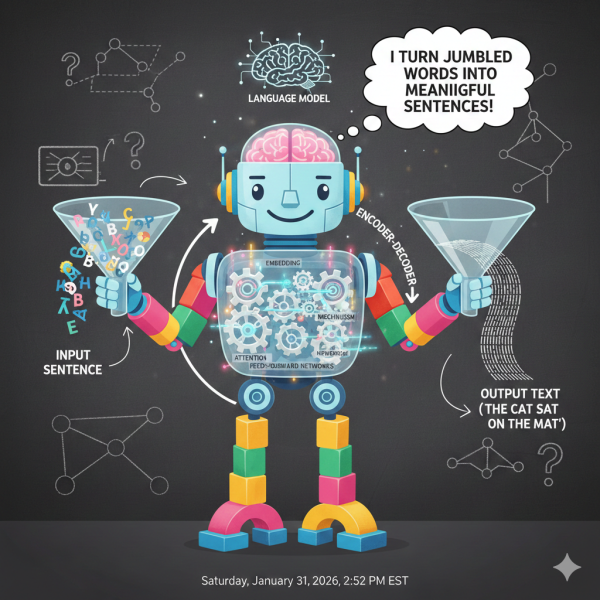

Think of a language model as a really sophisticated autocomplete system. You know how your phone suggests the next word when you’re texting? A language model works on that same principle, but at a much more advanced level.

At its core, a language model is a program that has read millions of books, articles, and websites to learn the patterns of human language. It learns things like “after the word ‘peanut,’ the word ‘butter’ often comes next” or “when someone asks a question starting with ‘what,’ they’re probably looking for a definition or explanation.”

The model doesn’t truly “understand” language the way humans do—it doesn’t have experiences or emotions. Instead, it’s become incredibly good at recognizing patterns and predicting what words should come next based on what it’s seen before. When you ask it a question, it’s essentially generating a response by continuously predicting “what’s the most likely next word?” over and over until it forms a complete answer.

---

# **Transformers: The Engine Behind Modern AI**

If you’ve used ChatGPT, Claude, or any modern AI assistant, you’ve interacted with a transformer. Despite the sci-fi name, transformers aren’t robots in disguise—they’re a **revolutionary way of teaching computers to understand language**.

## The Old Problem

Before transformers came along in 2017, AI systems read text the way you might read a book: word by word, left to right, trying to remember what came before. This created a problem. Imagine trying to understand a sentence where the most important context is at the beginning, but you’re already 50 words in. The computer would struggle to “remember” that earlier detail because it could only hold so much information in its working memory.

## The Breakthrough: Attention

Transformers introduced something called “**attention**,” which is exactly what it sounds like. Instead of reading sequentially, a transformer can look at all the words in a sentence simultaneously and decide which words are most important to understanding each other word.

Think about the sentence: “The animal didn’t cross the street because it was too tired.” What does “it” refer to? Humans instantly know “it” means “the animal,” not “the street,” because we pay attention to the context. A transformer does something similar—it creates connections between words, figuring out that “it” and “animal” are strongly related while “it” and “street” are not.

## Why It Matters

This attention mechanism is incredibly powerful because it scales beautifully. You can train transformers on massive amounts of text, and they get better at finding subtle patterns in language. They can handle long documents, maintain context across paragraphs, and even learn different tasks simultaneously.

Today’s AI systems—from translation tools to coding assistants—are built on transformers because they’re efficient, parallelizable (meaning they can process lots of data at once), and surprisingly effective at capturing the nuances of human communication.

The next time you ask an AI a question and get a coherent response, remember: there’s a transformer working behind the scenes, paying attention to every word to figure out exactly what you need.
