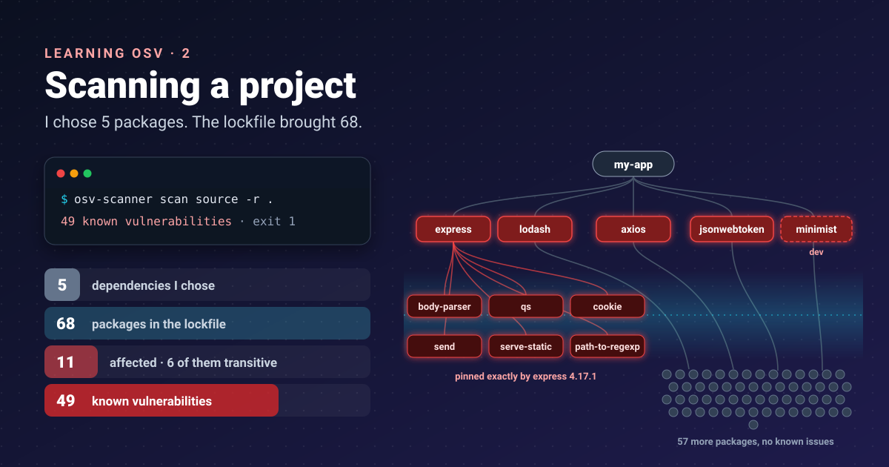


I picked four dependencies. The scanner found problems in eleven packages. That gap is the whole reason to scan
lockfiles and not just `package.json`.




[Part 1]() was about the OSV database. This part runs the
scanner against a small project and reads the result.

## Install, and check what you installed

OSV-Scanner is a single binary. I downloaded **v2.7.0** (12 October 2026) from the
[releases page](https://github.com/google/osv-scanner/releases) and checked it against the published checksums
before running it. It is a security tool; treat its supply chain like one.

```bash
gh release download v2.7.0 -R google/osv-scanner \
  -p "osv-scanner_linux_amd64" -p "osv-scanner_SHA256SUMS"
sha256sum -c --ignore-missing osv-scanner_SHA256SUMS
chmod +x osv-scanner_linux_amd64 && mv osv-scanner_linux_amd64 osv-scanner
./osv-scanner --version     # osv-scanner version: 2.7.0
```

Other options are on the [installation page](https://google.github.io/osv-scanner/installation/).

## The test project

A deliberately old Node app, `my-app`: four runtime dependencies and one dev dependency. I generated only the
lockfile, with `npm install --package-lock-only --ignore-scripts`, so no package code ran on my machine.

```json
{
  "dependencies": {
    "express": "^4.17.1",
    "lodash": "^4.17.15",
    "axios": "^0.21.1",
    "jsonwebtoken": "^8.5.1"
  },
  "devDependencies": { "minimist": "1.2.5" }
}
```

The lockfile resolves these five to **68 packages**.

## The scan

```bash
osv-scanner scan source -r .
```

`scan source` looks for lockfiles, SBOMs and git submodules; `-r` goes into subdirectories
([scan source docs](https://google.github.io/osv-scanner/usage/scan-source)). The result, trimmed:

```text
Scanned ./package-lock.json file and found 68 packages

Total 11 packages affected by 49 known vulnerabilities
(1 Critical, 21 High, 23 Medium, 3 Low, 1 Unknown) from 1 ecosystem.
49 vulnerabilities can be fixed.

| OSV URL                             | CVSS | PACKAGE        | VERSION | FIXED VERSION |
|-------------------------------------|------|----------------|---------|---------------|
| https://osv.dev/GHSA-cph5-m8f7-6c5x | 7.5  | axios          | 0.21.1  | 0.21.2        |
| https://osv.dev/GHSA-27r3-jxmh-p828 | 7.5  | body-parser    | 1.19.0  | 1.20.9        |
| https://osv.dev/GHSA-8cf7-32gw-wr33 | 8.1  | jsonwebtoken   | 8.5.1   | 9.0.0         |
| https://osv.dev/GHSA-35jh-r3h4-6jhm | 7.2  | lodash         | 4.17.15 | 4.17.21       |
| https://osv.dev/GHSA-xvch-5gv4-984h | 9.8  | minimist (dev) | 1.2.5   | 1.2.6         |
| https://osv.dev/GHSA-37ch-88jc-xwx2 | 7.7  | path-to-regexp | 0.1.7   | 0.1.13        |
| https://osv.dev/GHSA-hrpp-h998-j3pp | 7.5  | qs             | 6.7.0   | 6.7.3         |
| ...                                 |      |                |         |               |
```

## How to read it

- **Most findings are transitive.** `body-parser`, `qs`, `path-to-regexp`, `send`, `serve-static` and `cookie`
  are not in my `package.json`. They come with Express. Six of the eleven affected packages are ones I never
  chose.
- **One package, many rows.** axios 0.21.1 alone has 24 entries. Count packages to fix, not rows.
- **`(dev)` is marked.** The only Critical is in a dev dependency. That changes its priority, but it does not make
  it zero: dev tools run in CI, with access to secrets.
- **FIXED VERSION is the target**, taken from the record's `fixed` event, as in part 1.
- **Every row links to osv.dev**, so the next click is the record.

**Exit codes:** `1` means findings, `0` means none ([output docs](https://google.github.io/osv-scanner/output/)).
One more is worth knowing for CI: **`128` means no packages were found**. A job that scans the wrong directory
should fail loudly, not pass quietly, so treat 128 as an error.

## Machine-readable output

`--format json` gives one entry per package with its vulnerabilities grouped by alias, which is handy for a
findings store:

```json
{ "ids": ["GHSA-3g43-6gmg-66jw"], "aliases": ["CVE-2026-44495", "GHSA-3g43-6gmg-66jw"], "max_severity": "7.0" }
```

Other formats include `sarif` for GitHub code scanning, `markdown` for PR comments, `html`, and SBOM formats
(`spdx-2-3`, `cyclonedx-1-5`).

## Accepting a risk, on the record

Sometimes the right answer is "not now". OSV-Scanner reads an `osv-scanner.toml` next to the lockfile
([configuration docs](https://google.github.io/osv-scanner/configuration/)):

```toml
[[IgnoredVulns]]
id = "GHSA-xvch-5gv4-984h"
ignoreUntil = 2026-12-31
reason = "minimist is a devDependency used only by a local build script; not shipped"
```

The scanner then says so, out loud:

```text
GHSA-xvch-5gv4-984h and 1 alias have been filtered out because: minimist is a devDependency used only by a local build script; not shipped
Filtered 1 vulnerability from output
Total 10 packages affected by 48 known vulnerabilities (0 Critical, ...)
```

Two details I like: ignoring an ID also ignores its aliases, so the CVE does not sneak back in under another name;
and `ignoreUntil` makes the exception **expire**, so a "temporary" decision cannot become permanent by accident.

## What I took from this part

- Scan the **lockfile**: 5 dependencies became 68 packages and 11 affected ones.
- Read by **package**, not by row, and look at the **fixed version** first.
- Exit code 1/0 is enough for a CI gate; treat 128 (nothing scanned) as a failure.
- Every accepted risk gets a **reason and an expiry date**, in a file reviewed like code.

## References

- [OSV-Scanner releases](https://github.com/google/osv-scanner/releases): GitHub, v2.7.0 binary and SHA256SUMS
- [Installation](https://google.github.io/osv-scanner/installation/): OSV-Scanner docs
- [Project source scanning](https://google.github.io/osv-scanner/usage/scan-source): OSV-Scanner docs, `scan source`, `-r`, what is detected
- [Output](https://google.github.io/osv-scanner/output/): OSV-Scanner docs, output formats and exit codes
- [Configuration](https://google.github.io/osv-scanner/configuration/): OSV-Scanner docs, `osv-scanner.toml`, `IgnoredVulns`, `ignoreUntil`, aliases

Previous: [part 1](). Next:
[part 3, guided remediation]().
