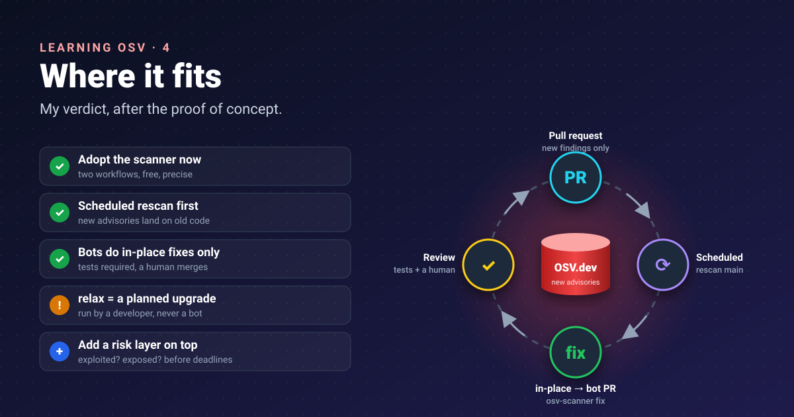


Three parts of trying things. This one is the verdict: what I would actually switch on, in what order, and what I
would still look elsewhere for.




Quick recap of the proof of concept:
[part 1]() read the database,
[part 2]() scanned a project (5 dependencies,
68 packages, 49 vulnerabilities), and [part 3]() fixed
it (7 of 50 safely, 50 of 50 with a major upgrade).

## Where each piece fits


flowchart LR
  PR["Pull request<br/>scan the diff"] --> M["Merge to main<br/>full scan + SARIF"]
  M --> N["Weekly / nightly<br/>rescan main"]
  N --> F["Findings<br/>osv-scanner fix<br/>in-place → bot PR"]
  F --> R["Human review<br/>tests + merge"]
  R --> PR
  DB[("OSV.dev<br/>updated continuously")] -.-> PR
  DB -.-> N


| Stage | OSV piece | Why |
|---|---|---|
| Pull request | Scanner, PR mode | Shows only what *this* change adds, while the author still has context |
| Main branch, on a schedule | Scanner, full mode | New advisories arrive for code nobody touched |
| Remediation | `fix --strategy=in-place` | Safe, lockfile-only changes a bot can propose |
| Bigger upgrades | `fix --strategy=relax` | Run by a person, with the test suite |
| Investigation | osv.dev and its API | Aliases, ranges and fixed versions for one finding |

## Start with two workflows

The [OSV-Scanner GitHub Action](https://google.github.io/osv-scanner/github-action/) provides two reusable
workflows. The PR workflow reports only vulnerabilities the pull request introduces; the scheduled one reports
everything and uploads SARIF to the Security tab.

```yaml
# .github/workflows/osv-scanner-pr.yml
name: OSV-Scanner PR Scan
on:
  pull_request:
    branches: [main]
permissions:
  actions: read
  security-events: write
  contents: read
jobs:
  scan-pr:
    uses: "google/osv-scanner-action/.github/workflows/osv-scanner-reusable-pr.yml@v2.7.0"
```

```yaml
# .github/workflows/osv-scanner-scheduled.yml
name: OSV-Scanner Scheduled Scan
on:
  schedule:
    - cron: "30 12 * * 1"
  push:
    branches: [main]
permissions:
  actions: read
  security-events: write
  contents: read
jobs:
  scan-scheduled:
    uses: "google/osv-scanner-action/.github/workflows/osv-scanner-reusable.yml@v2.7.0"
```

By default the PR workflow only warns. I would keep it that way for a few weeks, fix the backlog, then make it
blocking.

## What it does well

- **Precise matching.** Ecosystem-native version ranges mean few "maybe affected" findings.
- **Breadth.** Language packages, OS packages, GitHub Actions, and `MAL-` records for known malware.
- **Free and open.** Open-source code, a public database, an API, and a downloadable dataset for
  offline use ([offline mode](https://google.github.io/osv-scanner/usage/offline-mode/)).
- **Built for pipelines.** Clear exit codes, JSON and SARIF, and an ignore file with reasons and expiry dates.
- **A fix proposal, not just a list.** Even the small in-place win is work a person no longer has to do.

## What it does not do (yet)

- **It does not prioritise by risk.** CVSS is there; whether a CVE is being exploited (CISA KEV) or likely to be
  (EPSS) is not. Join those yourself.
- **Remediation is narrow and experimental.** npm and Maven only; no Python, Go or containers in `fix` today.
- **It finds known issues in dependencies.** Not your own code (that is SAST), not secrets, not misconfiguration.
- **Reachability is partial.** Call analysis exists, on by default for Go only; for the rest, "affected" means
  "present", not "exploitable".

## My recommendation

1. **Adopt the scanner now.** Add the two workflows; it costs nothing and the signal is precise.
2. **Make the scheduled scan the priority**, not the PR scan. New advisories land on old code; that is where the
   surprises are.
3. **Automate only in-place fixes** as bot pull requests, with tests required and a human approving the merge.
4. **Treat `relax` as a planned upgrade**, run by a developer, never by a bot.
5. **Keep accepted risks in `osv-scanner.toml`**, each with a reason and an `ignoreUntil` date, reviewed like code.
6. **Add a risk layer on top** (exploitation and exposure) before you let findings set deadlines.

## Conclusion

OSV is the most precise free answer I have found to "which of my dependencies are vulnerable, and to what version
do I move?". The database is the real asset; the scanner makes it usable in a pipeline; the fix command is a
promising, honest helper that shows its trade-offs instead of hiding them. It does not replace judgement about
*what matters first*, and it does not cover your own code. As one layer of a secure development life cycle, it
earns its place on day one.

## References

- [GitHub Action](https://google.github.io/osv-scanner/github-action/): OSV-Scanner docs, the two reusable workflows, permissions, PR mode warn-only default, SARIF upload
- [Offline mode](https://google.github.io/osv-scanner/usage/offline-mode/): OSV-Scanner docs, scanning without network access
- [Guided remediation](https://google.github.io/osv-scanner/experimental/guided-remediation/): OSV-Scanner docs, supported ecosystems and experimental status
- [Project source scanning](https://google.github.io/osv-scanner/usage/scan-source): OSV-Scanner docs, call analysis defaults
- [OSV-Scanner](https://google.github.io/osv-scanner/): OSV-Scanner docs, overview

Previous: [part 3](). Start:
[part 1]().
