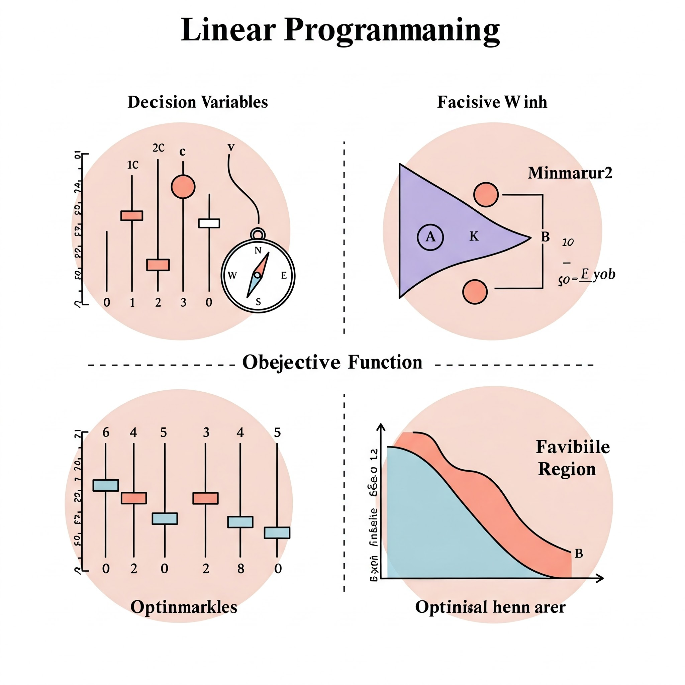

## **What is Linear Programming?**

Linear programming is a mathematical technique used to find the best possible outcome (maximum profit or minimum cost) in a situation where the relationships between the factors involved are linear. It’s like finding the sweet spot where you get the most out of what you have, given certain limitations.

### **Example: A Furniture Company**

Let’s say a furniture company makes chairs and tables. Each chair takes 2 hours to assemble and 1 hour to finish. Each table takes 3 hours to assemble and 2 hours to finish. The company has a total of 40 hours available for assembly and 30 hours for finishing each week. If each chair sells for $50 and each table sells for $75, how many chairs and tables should the company make each week to maximize its revenue?

### **Components of Linear Programming**

1. **Decision Variables:** These are the things you’re trying to decide. In our example:
   - `x` = number of chairs to make
   - `y` = number of tables to make
2. **Objective Function:** This is what you’re trying to maximize or minimize. Here, it’s the revenue:
   - Revenue = 50x + 75y (We want to make this as big as possible)
3. **Constraints:** These are the limitations you have. In our case:
   - Assembly time: 2x + 3y ≤ 40 (Can’t use more than 40 hours of assembly time)
   - Finishing time: 1x + 2y ≤ 30 (Can’t use more than 30 hours of finishing time)
   - Non-negativity: x ≥ 0, y ≥ 0 (Can’t make a negative number of chairs or tables)
