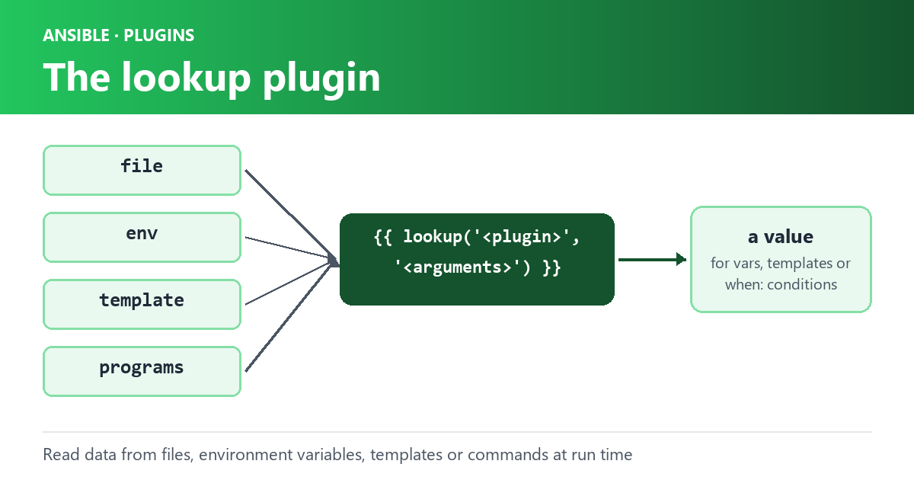

Ansible’s `lookup` plugin allows you to access data from a variety of sources, including files, templates, and external programs. You can use `lookup` to fetch data dynamically at runtime and use it in your playbooks and roles.



The `lookup` plugin is used in the following format:

```text
{{ lookup('<plugin>', '<plugin arguments>') }}
```

Here, `<plugin>` is the name of the plugin you want to use, and `<plugin arguments>` are any arguments that the plugin requires. The result of the plugin is then returned as a variable.

In this blog post, we will explore how to use the `lookup` plugin in `Ansible`, along with some examples of when and how to use it.

### Using Lookup with When Condition

One of the most common use cases of the `lookup` plugin is to conditionally execute a task based on the value of a variable. You can use the `when` keyword to specify a condition that determines whether or not the task should be executed.

Here’s an example of how to use `lookup` with a `when` condition:

```text
- name: Copy file based on OS
  copy:
    src: "{{ lookup('env', 'HOME') }}/file.{{ 'exe' if ansible_os_family == 'Windows' else 'sh' }}"
    dest: /path/to/file
  when: ansible_os_family == 'Windows' or ansible_os_family == 'Linux'
```

In this example, we use `lookup` to retrieve the value of the `HOME` environment variable, and then concatenate it with the appropriate file extension based on the operating system. We then use this value as the source file for the `copy` module. The task is conditionally executed based on the value of the `ansible_os_family` variable.

### Using Lookup to Read Data from a File

Another common use case of the `lookup` plugin is to read data from a file and use it in a task. You can use the `file` plugin to read data from a file and store it as a variable.

Here’s an example of how to use `lookup` with the `file` plugin:

```text
- name: Read data from file
  set_fact:
    data: "{{ lookup('file', '/path/to/file') }}"
```

In this example, we use `lookup` to read the contents of a file located at `/path/to/file`. The contents of the file are then stored as a variable named `data`.

### Using Lookup with Loop

You can also use the `lookup` plugin with a loop to iterate over a list of values and perform a task for each value. The `with_items` keyword is used to specify the list of values.

Here’s an example of how to use `lookup` with a loop:

```text
- name: Create users
  user:
    name: "{{ item }}"
  with_items: "{{ lookup('file', '/path/to/userlist.txt').split('\n') }}"
```

In this example, we use `lookup` to read the contents of a file located at `/path/to/userlist.txt`, split the contents into a list of values, and then iterate over each value using a loop. For each value in the list, we create a user account using the `user` module.

### Using Lookup with Templating

You can also use the `lookup` plugin with templating to dynamically generate values at runtime. You can use variables, filters, and other Jinja2 templating features to customize the output of the `lookup` plugin.

Here’s an example of how to use `lookup` with templating:

```text
- name: Create directories
  file:
    path: "{{ lookup('env', 'HOME') }}/{{ item }}/{{
```
