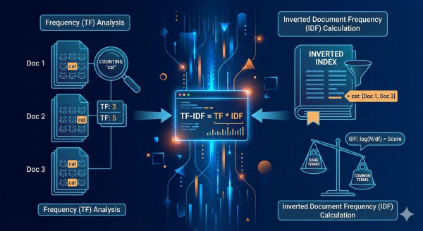



Understanding how computers “read” and understand text is a fascinating field. One of the most fundamental techniques for identifying important keywords in a document, relative to a collection of documents, is **TF-IDF (Term Frequency-Inverse Document Frequency)**.

I recently embarked on a gamified learning challenge to demystify TF-IDF, breaking it down into its core components. This post summarizes my adventure!

---

### **The Core Idea: Why TF-IDF Matters**

Imagine you have a huge library of books. If you want to find out what a specific book is *really* about, just looking at words that appear frequently isn’t enough. “The” or “is” might appear often, but they tell you nothing unique. TF-IDF helps us find words that are:

1. **Frequent within a specific document (TF)**
2. **Rare across the entire collection of documents (IDF)**

When a word meets both criteria, it’s likely a powerful keyword that defines that document’s content.

---

### Level 1: Term Frequency (TF) – How Often Does a Word Appear?

Term Frequency is the simplest part. It’s just a count of how often a word (term) appears in a document, normalized by the total number of words in that document.

Formula:

$$
\text{TF}(t, d) = \frac{\text{Number of times term } t \text{ appears in document } d}{\text{Total number of words in document } d}
$$

#### **Example:**

Let’s say we have **Document A**:

> “The cat sat on the mat. The cat is black.”

- **Total words in Document A:** 10
- **Term ‘cat’ appears:** 2 times

Calculation:

$$
\text{TF}(\text{cat}, \text{A}) = \frac{2}{10} = \mathbf{0.2}
$$

A higher TF means the word is more important *to that specific document*.

---

### Level 2: Inverse Document Frequency (IDF) – How Unique is a Word Across Documents?

Here’s where TF-IDF gets clever. IDF helps us ignore common words (like “the”) that appear in almost every document. It assigns a higher score to words that are rare across our entire collection of documents (our “corpus”).

Formula (General form):

$$
\text{IDF}(t, D) = \log \left( \frac{\text{Total number of documents } N}{\text{Number of documents containing term } t} \right)
$$

**Our Corpus (4 Documents):**

- **D1:** “The **cat** sat on the mat.”
- **D2:** “The dog chased the **frisbee**.”
- **D3:** “I like my **cat**.”
- **D4:** “My neighbor’s **cat** is cute.”

**Calculations (using natural logarithm):**

- For ‘cat’: Appears in D1, D3, D4 (3 documents out of 4)

$$
\text{IDF}(\text{cat}, D) = \ln(4/3) \approx \mathbf{0.287}
$$

- For ‘frisbee’: Appears in D2 (1 document out of 4)

$$
\text{IDF}(\text{frisbee}, D) = \ln(4/1) \approx \mathbf{1.386}
$$

Notice: ‘frisbee’ (rare) gets a much higher IDF than ‘cat’ (relatively common).

---

### Level 3: The TF-IDF Score – Combining Frequency and Uniqueness

The final TF-IDF score is simply the product of TF and IDF. This score highlights words that are both frequent in a document *and* unique across the corpus.

Formula:

$$
\text{TF-IDF}(t, d, D) = \text{TF}(t, d) \times \text{IDF}(t, D)
$$

#### **Putting it Together:**

- **TF for ‘cat’ in Document A:** 0.2
- **IDF for ‘cat’ in Corpus:** 0.287

$$
\text{TF-IDF}(\text{cat}, \text{A}, D) = 0.2 \times 0.287 \approx \mathbf{0.0574}
$$

- **Hypothetical TF for ‘frisbee’ in a document:** 0.1 (e.g., if ‘frisbee’ appeared once in a 10-word document)
- **IDF for ‘frisbee’ in Corpus:** 1.386

$$
\text{TF-IDF}(\text{frisbee}, \text{hypothetical doc}, D) = 0.1 \times 1.386 \approx \mathbf{0.1386}
$$

**Result:** Even with a lower term frequency, ‘frisbee’ has a higher overall TF-IDF score because its uniqueness (high IDF) boosts its importance.

This is the magic of TF-IDF!
