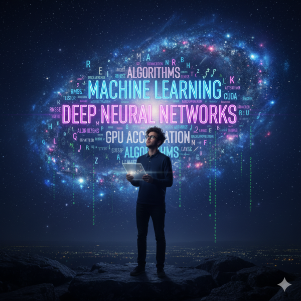

If you are like me, you must have stumbled on this question – Why is matrix multiplication so significant – especially in the AI/ML universe.

## How I arrived to this question?

When I first dove into **Machine Learning (ML)** and **Deep Learning**, I hit a wall. Terms like “backpropagation,” “Transformer models,” and “convolutional layers” flew past, making the whole process feel like abstract magic. I was proficient at *running* the high-level Python code in frameworks like PyTorch, but I wasn’t truly *understanding* what was happening under the hood. I felt like a technician blindly operating a complex machine, not an engineer who knew its blueprint.

My initial struggle was with the sheer complexity. I needed to find the single, fundamental **building block** that all modern AI rested on.

## Aha! Moment

My breakthrough came with the stark realization that despite all the fancy names, the single most critical, repeated operation in a neural network is simply **Matrix Multiplication** (often seen as a Generalized Matrix Multiplication, or GEMM).

Why is this operation so central?

- **The Neuron’s Math:** In a neural network, a single artificial **neuron** takes a set of inputs and multiplies each one by its corresponding **weight** before summing them up. Every step of a neural network’s forward pass—from input to output—is a weighted sum. In a fully connected layer, this is represented by multiplying the **input data matrix** (X) by the layer’s **weight matrix** (W) to get a pre-activation output.
  - **Input Data:** Your image pixels, words, or feature data (represented as a **vector** or a **matrix**).
  - **Weights:** The parameters the network learns during training. These are typically organized into a large **Weight Matrix**.
- **The Learning:** Even during the learning process (**`backpropagation`**), the calculation of gradients (the adjustments for the weights) requires the extensive use of matrix transposes and products.
  - When a neural network learns, it adjusts its weights to minimize error. This process, called **`backpropagation`**, involves calculating how much each weight contributed to the final error using calculus (specifically, the chain rule).

I learned that every image classification, language generation, and stock prediction was, at its core, the result of **billions of these matrix operations** being executed in sequence. The challenge shifted from “What is a neural network?” to “How do we do these billions of matrix multiplications *fast*?”


Matrix multiplication is the fundamental mathematical operation behind every layer of a neural network. Understanding this is key to understanding AI’s computational needs.


Because AI models need to perform this operation *billions* of times on massive matrices (sometimes involving trillions of parameters for Large Language Models), an operation that is slow on a sequential CPU becomes instantly accelerated on a parallel GPU.

The nature of matrix multiplication is **perfectly parallelizable**: each element in the output matrix can be computed independently, making it an ideal task for the GPU’s thousands of cores and specialized **Tensor Cores**.

---

## The Need for Speed: From CPU to Parallel GPU

The sheer volume of these matrix calculations quickly became the performance bottleneck. A traditional **Central Processing Unit (CPU)**, with its handful of powerful, complex cores, is excellent for sequential, logic-heavy tasks. However, it’s inefficient for matrix multiplication because the operation is so **`parallelizable`**.

This insight paved the way for the **Graphics Processing Unit (GPU)**. Originally designed to calculate the color and position of thousands of pixels for gaming graphics at the same time, the GPU has an architecture with **thousands of smaller, simpler cores** optimized for parallel work. Researchers realized this architecture was a perfect fit for the repetitive, parallel nature of matrix algebra in deep learning.

### The Revolution Culminates: The NVIDIA CUDA Ecosystem

The hardware was ready, but it needed a software bridge. That’s where **NVIDIA CUDA** comes in.

Launched in 2007, CUDA (Compute Unified Device Architecture) is not just a chip; it’s a **parallel computing platform and programming model** that unlocked the GPU’s potential for general-purpose computing (GPGPU).

- **CUDA’s Role:** It provides the framework, tools, and optimized libraries (like **cuBLAS** for linear algebra and **cuDNN** for deep learning) that allow ML developers to easily divide their massive matrix multiplication tasks among the thousands of cores on an NVIDIA GPU.
- **The Impact:** The CUDA ecosystem is the main reason NVIDIA dominates the AI hardware market. It created a powerful, accessible, and established platform that allows a CPU to offload the compute-intensive task of matrix multiplication to the GPU, dramatically accelerating both model training and inference.

### The Cutting Edge: Specialized Tensor Cores

The progression didn’t stop with CUDA. In recent years, NVIDIA has introduced specialized hardware units within their GPUs to accelerate this core operation even further: **Tensor Cores**.

- **What they do:** Tensor Cores are dedicated processing units engineered to perform large-scale **matrix multiply-accumulate** operations at breakneck speeds. They are optimized for the data formats common in AI, such as mixed-precision calculations (e.g., performing the multiplication in the faster 16-bit floating point, or FP16, but accumulating the result in the more precise 32-bit floating point, or FP32).
- **The Significance:** By using these specialized cores, modern AI hardware can achieve an order of magnitude increase in performance for matrix operations compared to using the standard CUDA cores alone. This specialization is what enables the training of today’s enormous, state-of-the-art models like large language models (LLMs).

**CUDA** (Compute Unified Device Architecture) is not just a driver or hardware component; it is a **complete software and hardware platform** that enables developers to harness the parallel power of NVIDIA GPUs for general-purpose computing, including AI.

| **Feature** | **Description** | **Why it Matters for AI** |
| --- | --- | --- |
| **Programming Model** | CUDA provides extensions to standard programming languages like C, C++, and Python. Developers write a function called a **kernel** that executes simultaneously across thousands of GPU cores. | Allows complex AI algorithms to be broken down into massive numbers of small, identical tasks, perfectly suited for the GPU. |
| **The Parallel Hierarchy** | CUDA organizes computation into a hierarchy: **Threads** (smallest unit, one for each data point), grouped into **Thread Blocks**, which are then organized into a **Grid** to cover the entire problem. | This structure maps directly to the GPU hardware, ensuring every core is utilized efficiently to process the huge datasets of AI. |
| **CUDA-Accelerated Libraries** | NVIDIA provides specialized libraries built on CUDA, such as **cuDNN** (for Deep Neural Networks) and **cuBLAS** (for Basic Linear Algebra Subprograms). | These libraries contain pre-optimized code for the most common AI operations (like matrix multiplication), meaning AI frameworks (PyTorch, TensorFlow) don’t have to reinvent the wheel, getting instant, world-class performance. |
| **The Ecosystem** | The platform is mature, well-documented, and universally adopted by the AI research community. | It made the process of developing and accelerating AI models vastly simpler and faster, helping to drive the deep learning revolution. |

### Still Navigating the Water

My journey continues, but the anxiety is gone. I’m still learning, but now I know the engine. Understanding the progression from a single mathematical operation to a global hardware and software ecosystem—from a simple matrix multiply to a powerful Tensor Core—has fundamentally changed how I view and approach machine learning.

If you’re struggling to understand ML, take a step back and find your building block. You might find that the key to the future of AI is a simple piece of math from your college days.

---

## Helpful links

- <https://medium.com/@danailkhan1999/why-matrix-multiplication-matters-in-deep-learning-bb4ac0d9f356>
- <https://developer.nvidia.com/cuda-toolkit>
