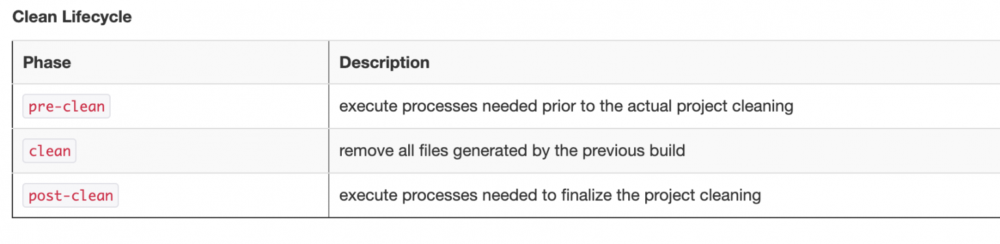

If you have worked with big projects you must have encountered `pom.xml` the central configuration for your projects that helps you build, test, and define your CI pipeline. There are other options that are available too, but that is for some other day.


POM = Project Object Model


## Version: `mvn --version`

```text
mvn --version
Apache Maven 3.6.2 (40f52333136460af0dc0d7232c0dc0bcf0d9e117; 2019-08-27T20:36:16+05:30)
Maven home: /usr/local/Cellar/maven/3.6.2/libexec
Java version: 12.0.2, vendor: Oracle Corporation, runtime: /Library/Java/JavaVirtualMachines/jdk-12.0.2.jdk/Contents/Home
Default locale: en_IN, platform encoding: UTF-8
OS name: "mac os x", version: "10.15.7", arch: "x86_64", family: "mac"
```

## Build lifecycle

> Maven is based around the central concept of a build lifecycle.

[Lifecycle](https://maven.apache.org/guides/introduction/introduction-to-the-lifecycle.html#Lifecycle_Reference) is process for building and distributing artifacts, it can be loosely termed as sequence of steps required to perform some actions.

> There are three built-in build lifecycles
>
> 1. default
>
> 2. clean and
>
> 3. site.

## Clean Lifecycle



## **Default Lifecycle**

| Phase | Description |
| --- | --- |
| `validate` | validate the project is correct and all necessary information is available. |
| `initialize` | initialize build state, e.g. set properties or create directories. |
| `generate-sources` | generate any source code for inclusion in compilation. |
| `process-sources` | process the source code, for example to filter any values. |
| `generate-resources` | generate resources for inclusion in the package. |
| `process-resources` | copy and process the resources into the destination directory, ready for packaging. |
| `compile` | compile the source code of the project. |
| `process-classes` | post-process the generated files from compilation, for example to do bytecode enhancement on Java classes. |
| `generate-test-sources` | generate any test source code for inclusion in compilation. |
| `process-test-sources` | process the test source code, for example to filter any values. |
| `generate-test-resources` | create resources for testing. |
| `process-test-resources` | copy and process the resources into the test destination directory. |
| `test-compile` | compile the test source code into the test destination directory |
| `process-test-classes` | post-process the generated files from test compilation, for example to do bytecode enhancement on Java classes. |
| `test` | run tests using a suitable unit testing framework. These tests should not require the code be packaged or deployed. |
| `prepare-package` | perform any operations necessary to prepare a package before the actual packaging. This often results in an unpacked, processed version of the package. |
| `package` | take the compiled code and package it in its distributable format, such as a JAR. |
| `pre-integration-test` | perform actions required before integration tests are executed. This may involve things such as setting up the required environment. |
| `integration-test` | process and deploy the package if necessary into an environment where integration tests can be run. |
| `post-integration-test` | perform actions required after integration tests have been executed. This may including cleaning up the environment. |
| `verify` | run any checks to verify the package is valid and meets quality criteria. |
| `install` | install the package into the local repository, for use as a dependency in other projects locally. |
| `deploy` | done in an integration or release environment, copies the final package to the remote repository for sharing with other developers and projects. |

default lifecycle

A build life cycle is made up of phases, where each phase has a plugin goal attached to it. Each phase represents a stage in the lifecycle and execute in order. E.g. for clean lifecycle (as shown in image above) it will execute first `pre-clean` then `clean` & lastly `post-clean`.

Let's look at the `maven-clean-plugin` for some details

```text
mvn help:describe -Dplugin=org.apache.maven.plugins:maven-clean-plugin
```

```text
[INFO] --- maven-help-plugin:3.2.0:describe (default-cli) @ restmon-parent ---
[INFO] org.apache.maven.plugins:maven-clean-plugin:3.0.0

Name: Apache Maven Clean Plugin
Description: The Maven Clean Plugin is a plugin that removes files generated
  at build-time in a project's directory.
Group Id: org.apache.maven.plugins
Artifact Id: maven-clean-plugin
Version: 3.0.0
Goal Prefix: clean

This plugin has 2 goals:

clean:clean
  Description: Goal which cleans the build.
    This attempts to clean a project's working directory of the files that were
    generated at build-time. By default, it discovers and deletes the
    directories configured in project.build.directory,
    project.build.outputDirectory, project.build.testOutputDirectory, and
    project.reporting.outputDirectory.
    
    Files outside the default may also be included in the deletion by
    configuring the filesets tag.

clean:help
  Description: Display help information on maven-clean-plugin.
    Call mvn clean:help -Ddetail=true -Dgoal=<goal-name> to display parameter
    details.

For more information, run 'mvn help:describe [...] -Ddetail'
```

if you use the `-Ddetail` some more information with respect to the two goals will be shown.

```text
[INFO] 
[INFO] --- maven-help-plugin:3.2.0:describe (default-cli) @ restmon-parent ---
[INFO] org.apache.maven.plugins:maven-clean-plugin:3.0.0

Name: Apache Maven Clean Plugin
Description: The Maven Clean Plugin is a plugin that removes files generated
  at build-time in a project's directory.
Group Id: org.apache.maven.plugins
Artifact Id: maven-clean-plugin
Version: 3.0.0
Goal Prefix: clean

This plugin has 2 goals:

clean:clean
  Description: Goal which cleans the build.
    This attempts to clean a project's working directory of the files that were
    generated at build-time. By default, it discovers and deletes the
    directories configured in project.build.directory,
    project.build.outputDirectory, project.build.testOutputDirectory, and
    project.reporting.outputDirectory.
    
    Files outside the default may also be included in the deletion by
    configuring the filesets tag.
  Implementation: org.apache.maven.plugins.clean.CleanMojo
  Language: java

  Available parameters:

    excludeDefaultDirectories (Default: false)
      User property: maven.clean.excludeDefaultDirectories
      Disables the deletion of the default output directories configured for a
      project. If set to true, only the files/directories selected via the
      parameter filesets will be deleted.
      Starting with 3.0.0 the property has been renamed from
      clean.excludeDefaultDirectories to maven.clean.excludeDefaultDirectories.

    failOnError (Default: true)
      User property: maven.clean.failOnError
      Indicates whether the build will continue even if there are clean errors.

    filesets
      The list of file sets to delete, in addition to the default directories.
      For example:
      <filesets>
       <fileset>
       <directory>src/main/generated</directory>
       <followSymlinks>false</followSymlinks>
       <useDefaultExcludes>true</useDefaultExcludes>
       <includes>
       <include>*.java</include>
       </includes>
       <excludes>
       <exclude>Template*</exclude>
       </excludes>
       </fileset>
      </filesets>

    followSymLinks (Default: false)
      User property: maven.clean.followSymLinks
      Sets whether the plugin should follow symbolic links while deleting files
      from the default output directories of the project. Not following
      symlinks requires more IO operations and heap memory, regardless whether
      symlinks are actually present. So projects with a huge output directory
      that knowingly does not contain symlinks can improve performance by
      setting this parameter to true.
      Starting with 3.0.0 the property has been renamed from
      clean.followSymLinks to maven.clean.followSymLinks.

    retryOnError (Default: true)
      User property: maven.clean.retryOnError
      Indicates whether the plugin should undertake additional attempts (after
      a short delay) to delete a file if the first attempt failed. This is
      meant to help deleting files that are temporarily locked by third-party
      tools like virus scanners or search indexing.

    skip (Default: false)
      User property: maven.clean.skip
      Disables the plugin execution.
      Starting with 3.0.0 the property has been renamed from clean.skip to
      maven.clean.skip.

    verbose
      User property: maven.clean.verbose
      Sets whether the plugin runs in verbose mode. As of plugin version 2.3,
      the default value is derived from Maven's global debug flag (compare
      command line switch -X).
      Starting with 3.0.0 the property has been renamed from clean.verbose to
      maven.clean.verbose.

clean:help
  Description: Display help information on maven-clean-plugin.
    Call mvn clean:help -Ddetail=true -Dgoal=<goal-name> to display parameter
    details.
  Implementation: org.apache.maven.plugins.clean.HelpMojo
  Language: java

  Available parameters:

    detail (Default: false)
      User property: detail
      If true, display all settable properties for each goal.

    goal
      User property: goal
      The name of the goal for which to show help. If unspecified, all goals
      will be displayed.

    indentSize (Default: 2)
      User property: indentSize
      The number of spaces per indentation level, should be positive.

    lineLength (Default: 80)
      User property: lineLength
      The maximum length of a display line, should be positive.
```

The plugin goal is executed when the phase executes as part of the life cycle.


You can read more from the official documentation available [here](https://maven.apache.org/guides/introduction/introduction-to-the-lifecycle.html).


## Effective POM

My dummy POM is as under

```text
<project>
 <modelVersion>4.0.0</modelVersion>
 <groupId>me.samarthya</groupId>
 <artifactId>art-one</artifactId>
 <version>1</version>
</project>
```

```text
mvn help:effective-pom -Dverbose
```

```text
[INFO] Scanning for projects...
[INFO]                                                                         
[INFO] ------------------------------------------------------------------------
[INFO] Building art-one 1
[INFO] ------------------------------------------------------------------------
[INFO] 
[INFO] --- maven-help-plugin:3.2.0:effective-pom (default-cli) @ art-one ---
[INFO] 
Effective POMs, after inheritance, interpolation, and profiles are applied:

<?xml version="1.0" encoding="UTF-8"?>
<!-- ====================================================================== -->
<!--                                                                        -->
<!-- Generated by Maven Help Plugin on 2020-12-24T08:18:00Z                 -->
<!-- See: http://maven.apache.org/plugins/maven-help-plugin/                -->
<!--                                                                        -->
<!-- ====================================================================== -->
<!-- ====================================================================== -->
<!--                                                                        -->
<!-- Effective POM for project 'me.samarthya:art-one:jar:1'                 -->
<!--                                                                        -->
<!-- ====================================================================== -->
<project xmlns="http://maven.apache.org/POM/4.0.0" xmlns:xsi="http://www.w3.org/2001/XMLSchema-instance" xsi:schemaLocation="http://maven.apache.org/POM/4.0.0 http://maven.apache.org/xsd/maven-4.0.0.xsd">
  <modelVersion>4.0.0</modelVersion>  <!-- me.samarthya:art-one:1, line 2 -->
  <groupId>me.samarthya</groupId>  <!-- me.samarthya:art-one:1, line 3 -->
  <artifactId>art-one</artifactId>  <!-- me.samarthya:art-one:1, line 4 -->
  <version>1</version>  <!-- me.samarthya:art-one:1, line 5 -->
  <repositories>
    <repository>
      <snapshots>
        <enabled>false</enabled>
      </snapshots>
      <id>central</id>
      <name>Central Repository</name>
      <url>https://repo.maven.apache.org/maven2</url>
    </repository>
  </repositories>
  <pluginRepositories>
    <pluginRepository>
      <releases>
        <updatePolicy>never</updatePolicy>
      </releases>
      <snapshots>
        <enabled>false</enabled>
      </snapshots>
      <id>central</id>
      <name>Central Repository</name>
      <url>https://repo.maven.apache.org/maven2</url>
    </pluginRepository>
  </pluginRepositories>
  <build>
    <sourceDirectory>/root/Downloads/pom/src/main/java</sourceDirectory>
    <scriptSourceDirectory>/root/Downloads/pom/src/main/scripts</scriptSourceDirectory>
    <testSourceDirectory>/root/Downloads/pom/src/test/java</testSourceDirectory>
    <outputDirectory>/root/Downloads/pom/target/classes</outputDirectory>
    <testOutputDirectory>/root/Downloads/pom/target/test-classes</testOutputDirectory>
    <resources>
      <resource>
        <directory>/root/Downloads/pom/src/main/resources</directory>
      </resource>
    </resources>
    <testResources>
      <testResource>
        <directory>/root/Downloads/pom/src/test/resources</directory>
      </testResource>
    </testResources>
    <directory>/root/Downloads/pom/target</directory>
    <finalName>art-one-1</finalName>
    <pluginManagement>
      <plugins>
        <plugin>
          <artifactId>maven-antrun-plugin</artifactId>
          <version>1.3</version>
        </plugin>
        <plugin>
          <artifactId>maven-assembly-plugin</artifactId>
          <version>2.2-beta-5</version>
        </plugin>
        <plugin>
          <artifactId>maven-dependency-plugin</artifactId>
          <version>2.1</version>
        </plugin>
        <plugin>
          <artifactId>maven-release-plugin</artifactId>
          <version>2.0</version>
        </plugin>
      </plugins>
    </pluginManagement>
    <plugins>
      <plugin>
        <artifactId>maven-clean-plugin</artifactId>
        <version>2.4.1</version>
        <executions>
          <execution>
            <id>default-clean</id>
            <phase>clean</phase>
            <goals>
              <goal>clean</goal>
            </goals>
          </execution>
        </executions>
      </plugin>
      <plugin>
        <artifactId>maven-resources-plugin</artifactId>
        <version>2.5</version>
        <executions>
          <execution>
            <id>default-testResources</id>
            <phase>process-test-resources</phase>
            <goals>
              <goal>testResources</goal>
            </goals>
          </execution>
          <execution>
            <id>default-resources</id>
            <phase>process-resources</phase>
            <goals>
              <goal>resources</goal>
            </goals>
          </execution>
        </executions>
      </plugin>
      <plugin>
        <artifactId>maven-jar-plugin</artifactId>
        <version>2.3.2</version>
        <executions>
          <execution>
            <id>default-jar</id>
            <phase>package</phase>
            <goals>
              <goal>jar</goal>
            </goals>
          </execution>
        </executions>
      </plugin>
      <plugin>
        <artifactId>maven-compiler-plugin</artifactId>
        <version>2.3.2</version>
        <executions>
          <execution>
            <id>default-compile</id>
            <phase>compile</phase>
            <goals>
              <goal>compile</goal>
            </goals>
          </execution>
          <execution>
            <id>default-testCompile</id>
            <phase>test-compile</phase>
            <goals>
              <goal>testCompile</goal>
            </goals>
          </execution>
        </executions>
      </plugin>
      <plugin>
        <artifactId>maven-surefire-plugin</artifactId>
        <version>2.10</version>
        <executions>
          <execution>
            <id>default-test</id>
            <phase>test</phase>
            <goals>
              <goal>test</goal>
            </goals>
          </execution>
        </executions>
      </plugin>
      <plugin>
        <artifactId>maven-install-plugin</artifactId>
        <version>2.3.1</version>
        <executions>
          <execution>
            <id>default-install</id>
            <phase>install</phase>
            <goals>
              <goal>install</goal>
            </goals>
          </execution>
        </executions>
      </plugin>
      <plugin>
        <artifactId>maven-deploy-plugin</artifactId>
        <version>2.7</version>
        <executions>
          <execution>
            <id>default-deploy</id>
            <phase>deploy</phase>
            <goals>
              <goal>deploy</goal>
            </goals>
          </execution>
        </executions>
      </plugin>
      <plugin>
        <artifactId>maven-site-plugin</artifactId>
        <version>3.0</version>
        <executions>
          <execution>
            <id>default-site</id>
            <phase>site</phase>
            <goals>
              <goal>site</goal>
            </goals>
            <configuration>
              <outputDirectory>/root/Downloads/pom/target/site</outputDirectory>
              <reportPlugins>
                <reportPlugin>
                  <groupId>org.apache.maven.plugins</groupId>
                  <artifactId>maven-project-info-reports-plugin</artifactId>
                </reportPlugin>
              </reportPlugins>
            </configuration>
          </execution>
          <execution>
            <id>default-deploy</id>
            <phase>site-deploy</phase>
            <goals>
              <goal>deploy</goal>
            </goals>
            <configuration>
              <outputDirectory>/root/Downloads/pom/target/site</outputDirectory>
              <reportPlugins>
                <reportPlugin>
                  <groupId>org.apache.maven.plugins</groupId>
                  <artifactId>maven-project-info-reports-plugin</artifactId>
                </reportPlugin>
              </reportPlugins>
            </configuration>
          </execution>
        </executions>
        <configuration>
          <outputDirectory>/root/Downloads/pom/target/site</outputDirectory>
          <reportPlugins>
            <reportPlugin>
              <groupId>org.apache.maven.plugins</groupId>
              <artifactId>maven-project-info-reports-plugin</artifactId>
            </reportPlugin>
          </reportPlugins>
        </configuration>
      </plugin>
    </plugins>
  </build>
  <reporting>
    <outputDirectory>/root/Downloads/pom/target/site</outputDirectory>
  </reporting>
</project>

[INFO] ------------------------------------------------------------------------
[INFO] BUILD SUCCESS
[INFO] ------------------------------------------------------------------------
[INFO] Total time: 0.723s
[INFO] Finished at: Thu Dec 24 08:18:00 UTC 2020
[INFO] Final Memory: 15M/605M
[INFO] ------------------------------------------------------------------------
```

## Example: `inheritance`

### Parent POM

Please note the `packaging` and the `name` defined

```text
<project>
   <modelVersion>4.0.0</modelVersion>

 <groupId>me.samarthya</groupId>
 <artifactId>art-one</artifactId>
 <version>1</version>

 <packaging>pom</packaging>

 <name>parent-pom</name>
</project>
```

### Child POM

```text
<project>

  <parent>
    <relativePath>../pom.xml</relativePath>
    <groupId>me.samarthya</groupId>
    <artifactId>art-one</artifactId>
    <version>1</version>
  </parent>

 <modelVersion>4.0.0</modelVersion>

 <groupId>me.samarthya</groupId>
 <artifactId>art-two</artifactId>
 <version>1.0</version>

 <packaging>jar</packaging>

 <name>child-pom</name>
</project>
```

If you request for effective pom `help:effective-pom`

```text
<project xmlns="http://maven.apache.org/POM/4.0.0" xmlns:xsi="http://www.w3.org/2001/XMLSchema-instance" xsi:schemaLocation="http://maven.apache.org/POM/4.0.0 http://maven.apache.org/xsd/maven-4.0.0.xsd">
  <modelVersion>4.0.0</modelVersion>
  <parent>
    <groupId>me.samarthya</groupId>
    <artifactId>art-one</artifactId>
    <version>1</version>
  </parent>
  <groupId>me.samarthya</groupId>
  <artifactId>art-two</artifactId>
  <version>1.0</version>
  <name>child-pom</name>
  <repositories>
    <repository>
      <snapshots>
        <enabled>false</enabled>
      </snapshots>
      <id>central</id>
      <name>Central Repository</name>
      <url>https://repo.maven.apache.org/maven2</url>
    </repository>
  </repositories>
  <pluginRepositories>
    <pluginRepository>
      <releases>
        <updatePolicy>never</updatePolicy>
      </releases>
      <snapshots>
        <enabled>false</enabled>
      </snapshots>
      <id>central</id>
      <name>Central Repository</name>
      <url>https://repo.maven.apache.org/maven2</url>
    </pluginRepository>
  </pluginRepositories>
  <build>
    <sourceDirectory>/root/Downloads/pom/child/src/main/java</sourceDirectory>
    <scriptSourceDirectory>/root/Downloads/pom/child/src/main/scripts</scriptSourceDirectory>
    <testSourceDirectory>/root/Downloads/pom/child/src/test/java</testSourceDirectory>
    <outputDirectory>/root/Downloads/pom/child/target/classes</outputDirectory>
    <testOutputDirectory>/root/Downloads/pom/child/target/test-classes</testOutputDirectory>
    <resources>
      <resource>
        <directory>/root/Downloads/pom/child/src/main/resources</directory>
      </resource>
    </resources>
    <testResources>
      <testResource>
        <directory>/root/Downloads/pom/child/src/test/resources</directory>
      </testResource>
    </testResources>
    <directory>/root/Downloads/pom/child/target</directory>
    <finalName>art-two-1.0</finalName>
    <pluginManagement>
      <plugins>
        <plugin>
          <artifactId>maven-antrun-plugin</artifactId>
          <version>1.3</version>
        </plugin>
        <plugin>
          <artifactId>maven-assembly-plugin</artifactId>
          <version>2.2-beta-5</version>
        </plugin>
        <plugin>
          <artifactId>maven-dependency-plugin</artifactId>
          <version>2.1</version>
        </plugin>
        <plugin>
          <artifactId>maven-release-plugin</artifactId>
          <version>2.0</version>
        </plugin>
      </plugins>
    </pluginManagement>
    <plugins>
      <plugin>
        <artifactId>maven-clean-plugin</artifactId>
        <version>2.4.1</version>
        <executions>
          <execution>
            <id>default-clean</id>
            <phase>clean</phase>
            <goals>
              <goal>clean</goal>
            </goals>
          </execution>
        </executions>
      </plugin>
      <plugin>
        <artifactId>maven-resources-plugin</artifactId>
        <version>2.5</version>
        <executions>
          <execution>
            <id>default-testResources</id>
            <phase>process-test-resources</phase>
            <goals>
              <goal>testResources</goal>
            </goals>
          </execution>
          <execution>
            <id>default-resources</id>
            <phase>process-resources</phase>
            <goals>
              <goal>resources</goal>
            </goals>
          </execution>
        </executions>
      </plugin>
      <plugin>
        <artifactId>maven-jar-plugin</artifactId>
        <version>2.3.2</version>
        <executions>
          <execution>
            <id>default-jar</id>
            <phase>package</phase>
            <goals>
              <goal>jar</goal>
            </goals>
          </execution>
        </executions>
      </plugin>
      <plugin>
        <artifactId>maven-compiler-plugin</artifactId>
        <version>2.3.2</version>
        <executions>
          <execution>
            <id>default-compile</id>
            <phase>compile</phase>
            <goals>
              <goal>compile</goal>
            </goals>
          </execution>
          <execution>
            <id>default-testCompile</id>
            <phase>test-compile</phase>
            <goals>
              <goal>testCompile</goal>
            </goals>
          </execution>
        </executions>
      </plugin>
      <plugin>
        <artifactId>maven-surefire-plugin</artifactId>
        <version>2.10</version>
        <executions>
          <execution>
            <id>default-test</id>
            <phase>test</phase>
            <goals>
              <goal>test</goal>
            </goals>
          </execution>
        </executions>
      </plugin>
      <plugin>
        <artifactId>maven-install-plugin</artifactId>
        <version>2.3.1</version>
        <executions>
          <execution>
            <id>default-install</id>
            <phase>install</phase>
            <goals>
              <goal>install</goal>
            </goals>
          </execution>
        </executions>
      </plugin>
      <plugin>
        <artifactId>maven-deploy-plugin</artifactId>
        <version>2.7</version>
        <executions>
          <execution>
            <id>default-deploy</id>
            <phase>deploy</phase>
            <goals>
              <goal>deploy</goal>
            </goals>
          </execution>
        </executions>
      </plugin>
      <plugin>
        <artifactId>maven-site-plugin</artifactId>
        <version>3.0</version>
        <executions>
          <execution>
            <id>default-site</id>
            <phase>site</phase>
            <goals>
              <goal>site</goal>
            </goals>
            <configuration>
              <outputDirectory>/root/Downloads/pom/child/target/site</outputDirectory>
              <reportPlugins>
                <reportPlugin>
                  <groupId>org.apache.maven.plugins</groupId>
                  <artifactId>maven-project-info-reports-plugin</artifactId>
                </reportPlugin>
              </reportPlugins>
            </configuration>
          </execution>
          <execution>
            <id>default-deploy</id>
            <phase>site-deploy</phase>
            <goals>
              <goal>deploy</goal>
            </goals>
            <configuration>
              <outputDirectory>/root/Downloads/pom/child/target/site</outputDirectory>
              <reportPlugins>
                <reportPlugin>
                  <groupId>org.apache.maven.plugins</groupId>
                  <artifactId>maven-project-info-reports-plugin</artifactId>
                </reportPlugin>
              </reportPlugins>
            </configuration>
          </execution>
        </executions>
        <configuration>
          <outputDirectory>/root/Downloads/pom/child/target/site</outputDirectory>
          <reportPlugins>
            <reportPlugin>
              <groupId>org.apache.maven.plugins</groupId>
              <artifactId>maven-project-info-reports-plugin</artifactId>
            </reportPlugin>
          </reportPlugins>
        </configuration>
      </plugin>
    </plugins>
  </build>
  <reporting>
    <outputDirectory>/root/Downloads/pom/child/target/site</outputDirectory>
  </reporting>
</project>
```

## Helpers

- https://maven.apache.org/xsd/maven-4.0.0.xsd
- http://maven.apache.org/ref/3.6.3/maven-model-builder/super-pom.html
