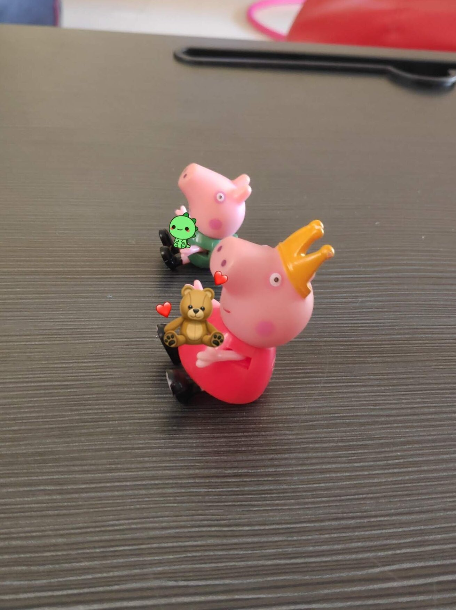

The concept of profiles let's a developer define what he wants to build and what to do in specific cases. In this blog I will talk about the problem that I solved using profiles.



### Multiple Modules

In my source code there were around 8 sub-projects that were part of the same code base

```text
Module Parent
\-Module Schemas
  Module Binary/War
  Module DockerImage
  Module Simulators Binaries
  Module MainAppChart
  Module Simulator Docker Images
  Module Simulator Charts
  \- Module Simulator1
```

The building was a nightmare as you would have imagined considering people coming and going out in an organisation (not specific to any particular work-exp) people added and due lack of awareness or guidelines we ended up in this nightmare.

First thing to do was define parent-pom and child-pom relationship for all the modules. Parent pom had it is `artifactId` and `groupId`

#### Parent

```text
<modelVersion>4.0.0</modelVersion>
<groupId>me.samarthya</groupId>
<artifactId>module-parent</artifactId>
<version>20.0.0-SNAPSHOT</version>
<packaging>pom</packaging>
```

#### Child

```text
<modelVersion>4.0.0</modelVersion>
<artifactId>module-main-war</artifactId>
<name>My web app</name>
<packaging>war</packaging>

<parent>
   <groupId>me.samarthya</groupId>
   <artifactId>module-parent</artifactId>
   <version>20.0.0-SNAPSHOT</version>
</parent>
```

Repeating these for modules helped me define the required relationship which was easy to view using

```text
mvn -q -Dexec.executable='echo' -Dexec.args='${project.groupId} ${project.version} ${project.artifactId} ${project.packaging}' exec:exec
```

```text
me.samarthya 20.0.0-SNAPSHOT module-parent pom
me.samarthya 20.0.0-SNAPSHOT module-schemas pom
me.samarthya 20.0.0-SNAPSHOT module-main-war war
me.samarthya 20.0.0-SNAPSHOT module-main-chart helm
me.samarthya 20.0.0-SNAPSHOT module-main-docker pom
me.samarthya 20.0.0-SNAPSHOT module-simulator pom
me.samarthya 20.0.0-SNAPSHOT module-all-simulators war
me.samarthya 20.0.0-SNAPSHOT module-simulator-charts pom
me.samarthya 20.0.0-SNAPSHOT module-simulator1 helm
```

## Coming to profiles...

Essentially all I learnt is from the official [documentation](https://maven.apache.org/guides/introduction/introduction-to-profiles.html).

Profiles are specified using a subset of the elements available in the POM itself (plus one extra section), and are triggered in any of a variety of ways.


"Profiles modify the POM at build time, and are meant to be used in complementary sets to give equivalent-but-different parameters for a set of target environments (providing, for example, the path of the appserver root in the development, testing, and production environments)."
— official documentation


- The kind of profiles
  - Global
  - Per user
  - Per project
- How you trigger a profile through command line
  - From the command line (using `-P profileName`)
  - Through Maven settings (`<settings> <activeProfiles> <activeProfile>profile</activeProfile></activeProfiles></settings>`)
  - Based on environment variables
  - OS settings

## How I used them?

For me the convenience was to allow grouping specific modules under a profile to allow activation from command line or CI/CD which can help generate `artifacts` just by manipulating one argument

```text
mvn clean install deploy -P profile1
```

This I achieved by defining the profiles in the `parent pom`

```text
 <profiles>
        <profile>
            <id>dev</id>
            <modules>
                <module>module-schemas</module>
                <module>module-main-war</module>
            </modules>
        </profile>
        <profile>
            <id>helm</id>
            <modules>
                <module>module-main-chart</module>
                <module>module-simulator1</module>
            </modules>
        </profile>
</profiles>
```
