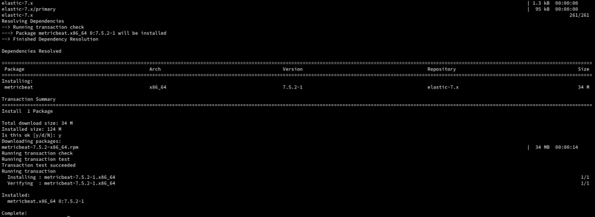
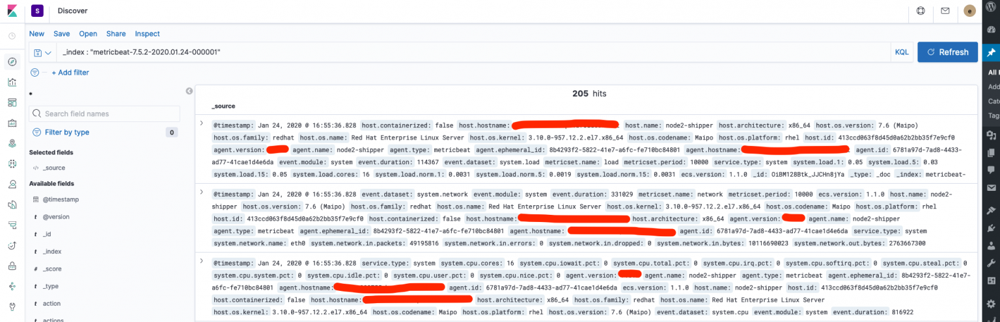

All right, its been a busy week and finally some time at hand to write about something I have been doing.

Mostly I am working on ELK stack these days, securing, validating, data analytics etc. Today, had the opportunity to go the Secure Elastic way, by enabling the TLS for secure communication within Nodes (Elastic cluster) and finally setup a Metric beat to get the status of the node.

This blog will be my explanation of how to go about it.

## Helpful Links

- <https://www.elastic.co/guide/en/beats/metricbeat/7.5/setup-repositories.html#_yum>

## Step 1

Installing the MetricBeat on my local system

### System specs

```text
cat /etc/redhat-release
>> CentOS Linux release 7.7.1908 (Core)

uname -a 
>> Linux Nodename 3.10.0-957.12.2.el7.x86_64 #1 SMP Tue May 14 21:24:32 UTC 2019 x86_64 x86_64 x86_64 GNU/Linux
```

### Download and install the public signing key

> sudo rpm –import https://packages.elastic.co/GPG-KEY-elasticsearch
>
> If success no message only prompt should appear

### Create a elastic.repo at /etc/yum/repos.d

```text
sudo vi /etc/yum.repos.d/elastic.repo

[elastic-7.x]
name=Elastic repository for 7.x packages
baseurl=https://artifacts.elastic.co/packages/7.x/yum
gpgcheck=1
gpgkey=https://artifacts.elastic.co/GPG-KEY-elasticsearch
enabled=1
autorefresh=1
type=rpm-md
```

### Install metricbeat

> sudo yum install `metricbeat`



- Check the installation locations

```text
whereis metricbeat 
>> metricbeat: /usr/bin/metricbeat /etc/metricbeat /usr/share/metricbeat
```

- Helpful link for [directory layout](https://www.elastic.co/guide/en/beats/metricbeat/7.5/directory-layout.html).

### Default paths location

Metricbeat uses the following default (paths can be changed).

| Type | Description | Location |
| --- | --- | --- |
| **home** | Home of the Metricbeat installation. | `/usr/share/metricbeat` |
| **bin** | The location for the binary files. | `/usr/share/metricbeat/bin` |
| **config** | The location for configuration files. | `/etc/metricbeat` |
| **data** | The location for persistent data files. | `/var/lib/metricbeat` |
| **logs** | The location for the logs created by Metricbeat. | `/var/log/metricbeat` |

### Configuring for the secured elasticsearch

The steps below allows to configure the metricbeat for a secured elastic instance.

> metricbeat keystore create
>
>  >> Created metricbeat keystore

It creates the keystore in the data folder. To validate

```text
ls /var/lib/metricbeat/ 
meta.json  metricbeat.keystore
```

Metricbeat provides a couple of different ways to enable modules and metricsets

- Enable module configs in module.d directory
- Enable module config in metricbeat.yml

### metricbeat.yml

```text
setup.kibana:

  # Kibana Host
  # Scheme and port can be left out and will be set to the default (http and 5601)
  # In case you specify and additional path, the scheme is required: http://localhost:5601/path
  # IPv6 addresses should always be defined as: https://[2001:db8::1]:5601
  host: "https://myhost.com.localhost:5601"

  # Kibana Space ID
  # ID of the Kibana Space into which the dashboards should be loaded. By default,
  # the Default Space will be used.
  space.id: samarthya
```

```text
output.elasticsearch:
  # Array of hosts to connect to.
  hosts: ["myhost.com.localhost:9200"]

  # Optional protocol and basic auth credentials.
  protocol: "https"
  username: "elastic"
  password: "EXTRAsecuredPassword"
```

```text
metricbeat modules enable elasticsearch
```

Enable the elasticsearch module for collection of metrics

```text
metricbeat setup 
or
systemctl start metricbeat
```

```text
Exiting: Couldn't connect to any of the configured Elasticsearch hosts. Errors: [Error connection to Elasticsearch https://myhost.com.localhost:9200: Get https://myhost.com.localhost:9200: x509: certificate is not valid for any names, but wanted to match myhost.com.localhost]
```

```text
metricbeat modules list
```

On my local system the output is as under.

```text
Enabled:
elasticsearch
system

Disabled:
aerospike
apache
appsearch
aws
azure
beat
beat-xpack
ceph
cockroachdb
consul
coredns
couchbase
couchdb
docker
dropwizard
elasticsearch-xpack
envoyproxy
etcd
golang
graphite
haproxy
http
jolokia
kafka
kibana
kibana-xpack
kubernetes
kvm
logstash
logstash-xpack
memcached
mongodb
mssql
munin
mysql
nats
nginx
oracle
php_fpm
postgresql
prometheus
rabbitmq
redis
statsd
tomcat
traefik
uwsgi
vsphere
windows
zookeeper
```

Since the elastic is a secure instance I need to modify the elastic instance to include the certificate and key entries.

```text
  protocol: "https"
  username: "elastic"
  password: "EXTRAsecuredPassword"
  ssl.certificate_authorities: ["/etc/metricbeat/ca.pem"]
  ssl.certificate: "/etc/metricbeat/instance.crt"
  ssl.key: "/etc/metricbeat/instance.key"
```

and for kibana as well

```text
  setup.kibana.ssl.enabled: true
  ssl.kibana.ssl.certificate_authorities: ["/etc/metricbeat/ca.pem"]
  ssl.kibana.ssl.certificate: "/etc/metricbeat/instance.crt"
  ssl.kibana.ssl.key: "/etc/metricbeat/instance.key"
```



### — THE – END —
