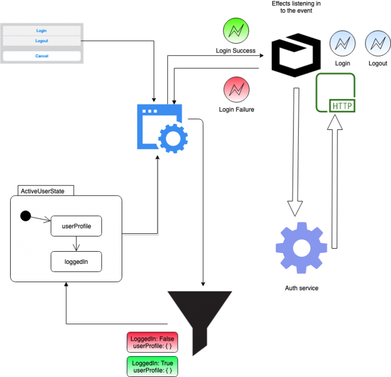
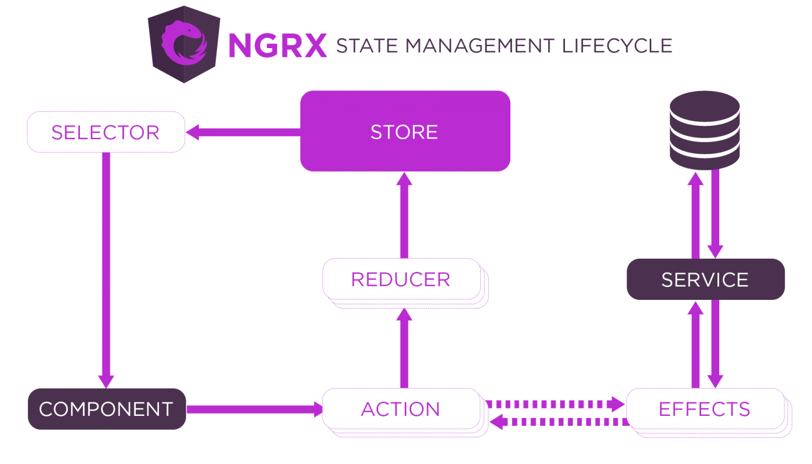

Inspired by Redux, Store is RxJS powered state management for Angular applications. Store is a container for state of the application.

> Refer to documentation at – <https://ngrx.io/guide/store>

## Key components

I have a sample application posted at [https://www.github.com](https://github.com/samarthya/free.time)

### Actions

Unique events generated from components and services.

```text
#v8 Onwards
export const login = createAction('[Login Initiatied] Login',
  props<{ principal: IPrincipal }>()
)
```

```text
#Older way of creating actions is still valid.
import { Action } from '@ngrx/store';

export class Login implements Action {
  readonly type = '[Login Page] Login';
  constructor(public principal: IPrincipal) {}
}
```

You can dispatch an action like below

```text
import * as appActions from '../actions/login.action';
```

```text
principal = {
      email: this.username.value,
      password: this.password.value
    };

this.store.dispatch(appActions.login({ principal }));
```

#### Example Actions



```text
export const login = createAction('[Login Initiatied] Login',
  props<{ principal: IPrincipal }>()
);

export const loginSuccess = createAction('[Login Success] Login',
  props<{ userProfile: IUserProfile }>()
);

export const loginFailure = createAction('[Login Failure] Login',
  props<{ message: any }>()
);

export const logout = createAction('[Logout initiated] logout', 
props<{ userName: string}>()
);
```

### Reducers

Pure functions that manipulate the state.

```text
const loginReducer =
  createReducer(
    null,
    on(LoginActions.login, (state, { principal }) => {
      return {
          loggedIn: false,
          userProfile: {
            user: principal,
            details: null,
            profile: null
          }
      };
    }),
.
.
.
```

### Selectors

Selectors are pure functions to select, derive, compose pieces of state.

```text
export const selectTheState = createSelector(selectState, state => state);
```

[](https://ngrx.io/guide/store)

Flow of state

## Example

### Installation

In my sample application my pacakge.json looks something like this for NGRX specific libraries

```text
"@ngrx/effects": "^8.2.0",
"@ngrx/router-store": "^8.2.0",
"@ngrx/store": "^8.2.0",
"@ngrx/store-devtools": "^8.2.0",
```

One has to first install the basic store

```text
npm install @ngrx/store --save
```
