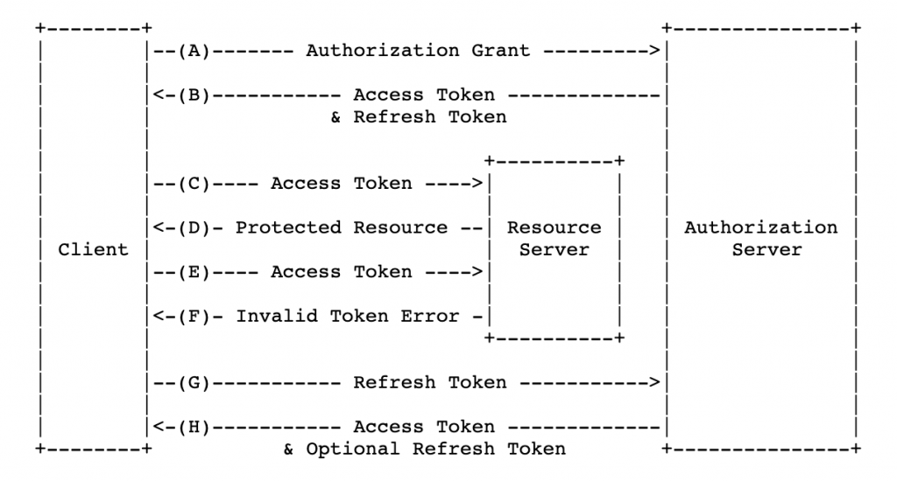
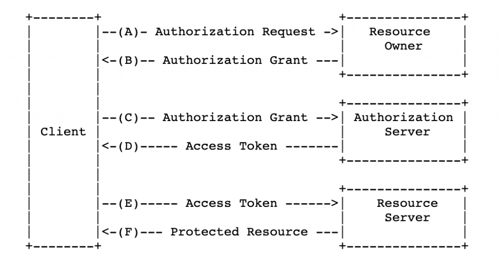
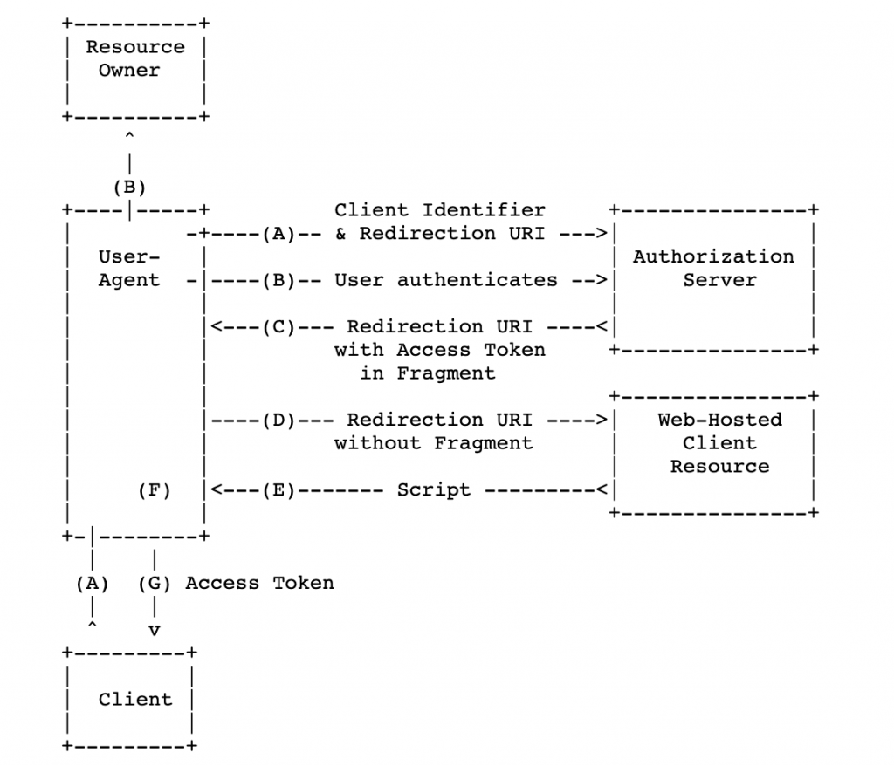
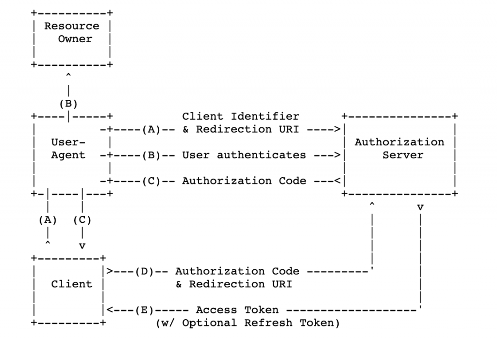
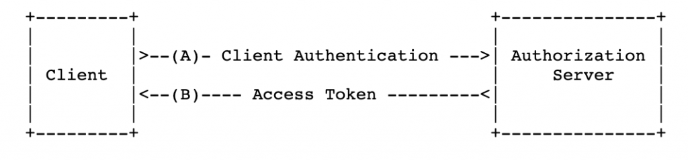

# What is OAuth?

From the official [definition](https://oauth.net/2/)


It is protocol for Authorization


It allows authorization flows for web applications, desktop applications, mobile apps etc.

## Key components

The 3 key components of OAuth are as under

### A. Roles/Actors

oAuth RFC defines 4 roles

#### 1. resource owner

An entity capable of granting access to a protected resource. When the resource owner is a person, it is referred to as an end-user. It can be a company as well.

#### 2. resource server

The server hosting the protected resources, capable of accepting and responding to protected resource requests using access tokens.

### 3. client

An application making protected resource requests on behalf of the resource owner and with its *`authorization`*. The term "client" does not imply any particular implementation characteristics (e.g., whether the application executes on a server, a desktop, or other devices).

OAuth defines two client types, based on their ability to authenticate securely with the `authorization server` (i.e., ability to maintain the confidentiality of their client credentials):

#### confidential

Clients capable of maintaining the confidentiality of their credentials (e.g., client implemented on a secure server with restricted access to the client credentials), or capable of secure client authentication using other means.

#### public

Clients incapable of maintaining the confidentiality of their credentials (e.g., clients executing on the device used by the resource owner, such as an installed native application or a web browser-based application), and incapable of secure client authentication via any other means.

#### 4. authorization server

The server issuing access tokens to the client after successfully authenticating the resource owner and obtaining `authorization`.

### B. Scopes and Consent

Scopes is what you see when you are shown a confirmation dialog while requesting service from a provider that initiates the flow. These are coded by the application developer when writing the application. Scopes decouple `authorization` policy decisions from `enforcement`.

### C. Tokens

To request an access token, the client obtains `authorization` from the `resource owner`. The authorization is expressed in the form of an `authorization grant`, which the client uses to request the `access token`. OAuth defines four grant types:

- `authorization code`,
- `implicit`,
- `resource owner` `password credentials`
- `client credentials`.

It also provides an extension mechanism for defining additional `grant types`.

#### Access tokens

Access tokens are credentials used to access protected resources.

An access token is a string representing an `authorization` issued to the client. Tokens represent specific `scopes` and `durations` of access, granted by the resource owner, and enforced by the resource server and authorization server. The access token provides an abstraction layer, replacing different `authorization` constructs (e.g., username and password) with a single token understood by the resource server.

#### Refresh Tokens

Refresh tokens are credentials used to obtain access tokens.

Refresh tokens are issued to the client by the `authorization server` and are used to obtain a new access token when the current access token becomes invalid or expires, or to obtain additional access tokens with identical or narrower scope.

## Flows

Obtaining authorization and subsequent token has 4 main flows

### Implicit flow/grant

- All communication happens through browser
- Optimized for public clients
- An access token is returned directly from the `authorization request` (front channel only).
- Does not support issuance of refresh tokens.
- These clients are typically implemented in a browser using a scripting language such as `JavaScript`. (SPA's)
- The implicit grant type does not include `client authentication` and relies on the presence of the `resource owner` and the registration of the `redirection URI`.

### Authorization code flow/3 legged flow

- The authorization code grant type is used to obtain both `access tokens` and `refresh tokens` and is optimized for `confidential clients`.
- Uses the front channel for `authorization` and the `back channel` for `tokens`.

### Client credential flow

- For server to server scenarios
- Client is confidential

### Resource Owner Password flow

- The resource owner password credentials is suitable in cases where the resource owner has a trust relationship with the client, such as the device operating system or a highly privileged application
- It is suitable for clients capable of obtaining the resource owner's credentials (username and password, typically using an interactive form).

## Help

- <https://tools.ietf.org/html/rfc6749>
- <https://developer.okta.com/blog/2017/06/21/what-the-heck-is-oauth>
