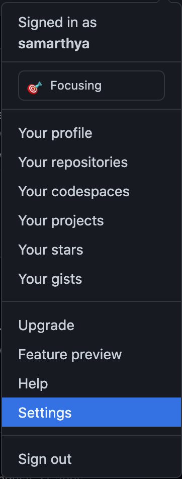
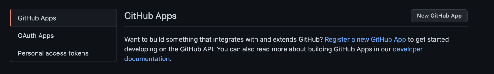
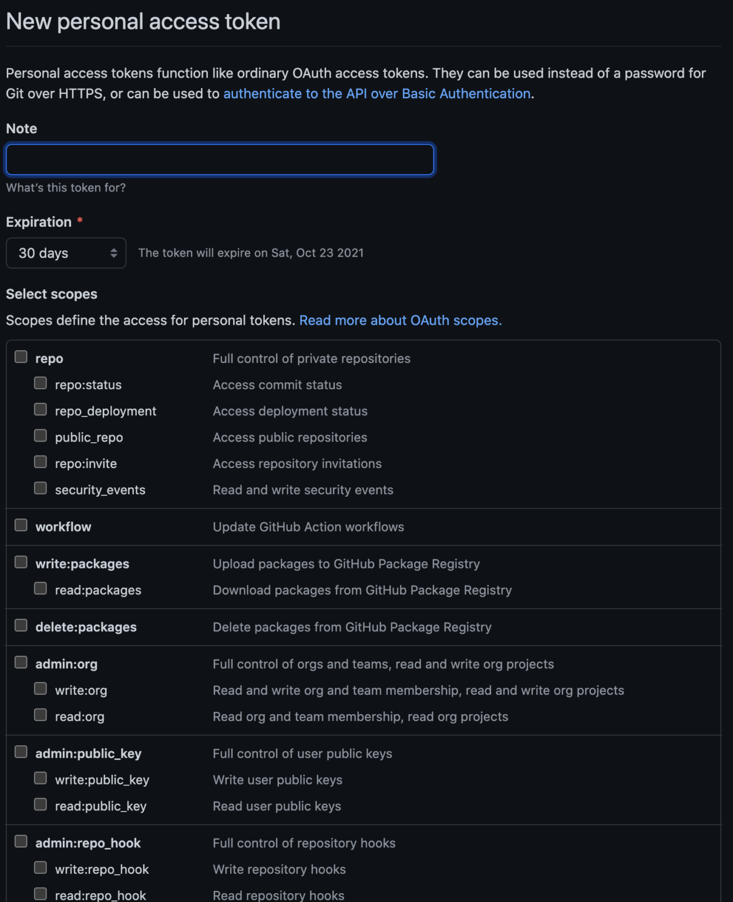
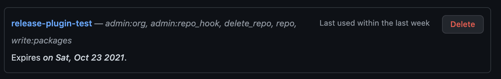

In case you are still using the basic/auth it is time to move to personal access token.


[Official documentation](https://docs.github.com/en/enterprise-server@3.1/authentication/keeping-your-account-and-data-secure/creating-a-personal-access-token) is the best guide.


Personal access tokens (PATs) are an alternative to using `passwords` for authentication to GitHub Enterprise Server when using the [GitHub API](https://docs.github.com/en/enterprise-server@3.1/rest/overview/other-authentication-methods#via-oauth-and-personal-access-tokens) or the [command line](https://docs.github.com/en/enterprise-server@3.1/authentication/keeping-your-account-and-data-secure/creating-a-personal-access-token#using-a-token-on-the-command-line).

## Step 1:

Go to the settings from the




Once you navigate into settings, you have to select




Select Personal access tokens, and then click `Generate new token` in the next scren


Select the appropriate name and scope for the token.



Once you are done click `Generate`



Once added you can use that as part of the `scm` plugin in the main pom, or use it in the `settings.xml`. In my case I am using it in `server.xml` but need to add the property `project.scm.id` so that you refer the credentials.

```text
<project.scm.id>github.com</project.scm.id>
```
