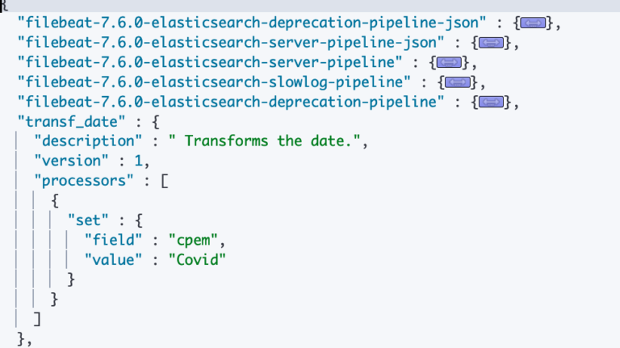

Pipelines is a smooth way of processing some incoming data. In this blog, I will walk through some of the items I have tried my hands on.

## Pipeline

A pipeline is a definition of a series of processors that are to be executed in the same order as they are declared.

Consists of two main fields

1. `description` Description or purpose of the pipeline
2. `processors` List of processors. Each processor transforms the document in some specific way.

- You might hear or ingest node, bulk api these concepts are not similar but do overlap.
- To use a pipeline, simply specify the pipeline parameter on an index or bulk request.

## Ingest Node

Ingest node pre-process's documents before the actual document indexing happens. The ingest node intercepts bulk and index requests, it applies transformations, and it then passes the documents back to the index or bulk APIs.

> All nodes in a cluster `enable ingest by default`, so any node can handle ingest tasks.

To pre-process documents before indexing `PIPELINES` are used.

Some key considerations

- An [index]() may also declare a default pipeline that will be used in the absence of the pipeline parameter.
- Index may also declare a [final pipeline](https://www.elastic.co/guide/en/elasticsearch/reference/master/index-modules.html#dynamic-index-settings) that will be executed after any request or default pipeline (if any).

### How can we use it?

It is as simple as specifying a parameter in the URL

> PUT my-index/\_doc/my-id?`pipeline=my_pipeline_id`  
> {  
>         "foo": "bar"  
> }

## Ingest API's

There are specifically 4 kinds of \_ingest API's

1. PUT pipeline
2. GET pipeline
3. Delete pipeline
4. Simulate pipeline

## PUT Pipeline

Allows to put create, or update a pipeline

> PUT \_ingest/pipeline/fix\_my\_locales {
>
> "description": " My first pipeline",
>
> "processors": []
>
> }

Official documentation [here](https://www.elastic.co/guide/en/elasticsearch/reference/master/put-pipeline-api.html).

`fix_my_locales` is the pipeline id that you wish to provide.

`Input Parameters`

`description` : string - Description of the ingest pipeline.

`processors`   : array of [processor objects](https://www.elastic.co/guide/en/elasticsearch/reference/master/ingest-processors.html "Processors") - Array of processors (in order) used to pre-process documents before indexing.

`version` :  integer - Optional version number used by external systems to manage ingest pipelines.

> PUT \_ingest/pipeline/transf\_date  
> {  
>      "description": " Transforms the date.",  
>      "version": 1,   
>      "processors": [  
>             {
>
>                     "set": {  
>                         "field": "cpem",  
>                        "value": "Covid"  
>                     }
>
>             }  
>        ]  
> }

Unsetting the version is as simple as removing the version from the above request and reissuing the request.

A successful execution will be acknowledged by the node.

> {  
>       "acknowledged" : true  
> }

### Processors

- The processors in a pipeline have **read** and **write** access to documents that pass through the pipeline.
- The processors can access fields in the source of a document and the document’s metadata fields.

### Accessing Data

In the different type of processors that can be defined you can use fields defined in the index (mapping), the metadata fields, or the fields within the \_source (if enabled)

#### Example

```text
PUT _ingest/pipeline/transf_date
{
  "description": " Transforms the date.",
  "version": 1, 
  "processors": [
    {
      "set": {
        "field": "recieved",
        "value": "{{_ingest.timestamp}}"
      }
    },
    {
      "set": {
        "field": "firstname",
        "value": "{{_source.name}}"
      }
    }
  ]
}
```

Let's simulate the pipeline to check the results

```text
POST _ingest/pipeline/transf_date/_simulate?verbose
{
  "docs": [
    {
      "_index": "rama",
      "_id": 1,
      "_source": {
        "name": "abar"
      }
   } 
  ]
}
```

The pipeline defines a field `recieved` which will be populated with the `time` at which the data is ingested & field `firstname` will be populated with the `name` field in the `_source`

```text
{
  "docs" : [
    {
      "processor_results" : [
        {
          "doc" : {
            "_index" : "rama",
            "_type" : "_doc",
            "_id" : "1",
            "_source" : {
              "name" : "abar",
              "recieved" : "2020-04-23T16:03:23.213722Z"
            },
            "_ingest" : {
              "timestamp" : "2020-04-23T16:03:23.213722Z"
            }
          }
        },
        {
          "doc" : {
            "_index" : "rama",
            "_type" : "_doc",
            "_id" : "1",
            "_source" : {
              "name" : "abar",
              "firstname" : "abar",
              "recieved" : "2020-04-23T16:03:23.213722Z"
            },
            "_ingest" : {
              "timestamp" : "2020-04-23T16:03:23.213722Z"
            }
          }
        }
      ]
    }
  ]
}
```

Metafields that can be accessed are

- \_index
- \_id
- \_routing

Beyond metadata fields and source fields, ingest also adds ingest metadata to the documents that it processes like the `_ingest.timestamp`.

## DELETE Pipeline

Is invoked when you wish to delete a pipeline

> `DELETE` \_ingest/pipeline/Testing

## GET Pipeline

Returns a mentioned pipeline

> `GET` \_ingest/pipeline

Returns all the pipelines that are active in the cluster.



> `GET _ingest/pipeline/transf_date`

For information on a specific pipeline you can specify the name in the request and it should return the information

> {  
>       "transf\_date" : {  
>              "description" : " Transforms the date.",  
>              "version" : 1,  
>              "processors" : [  
>                       {  
>                              "set" : {  
>                                   "field" : "cpem",  
>                                   "value" : "Covid"  
>                               }  
>                       }  
>              ]  
>        }  
> }

If we just want to see the Version information we can utilise the [response filtering](https://www.elastic.co/guide/en/elasticsearch/reference/master/common-options.html#common-options-response-filtering).

> `GET` \_ingest/pipeline/transf\_date?`filter_path=*.version`
>
> or
>
> GET \_xpack?filter\_path=license

All `REST APIs` accept a `filter_path` parameter that can be used to reduce the response returned by Elasticsearch.

## Simulate Pipeline

Simulate and validate the pipeline for the processors used in the Pipeline

> POST \_ingest/pipeline/fix\_locales/\_simulate  
> {  
> "docs": []  
> }

Simulate allows you to validate the logic that the pipeline executes against simulated docs.

POST /\_ingest/pipeline/<pipeline>/\_simulate

GET /\_ingest/pipeline/<pipeline>/\_simulate

POST /\_ingest/pipeline/\_simulate

GET /\_ingest/pipeline/\_simulate

```text
POST _ingest/pipeline/transf_date/_simulate?verbose
{
     "docs": [
                     {
                         "_index": "rama",
                         "_id": 1,
                        "_source": {
                               "foo": "abar"
                          }
                     }
                 ]
}
```

## -- THE - END --
