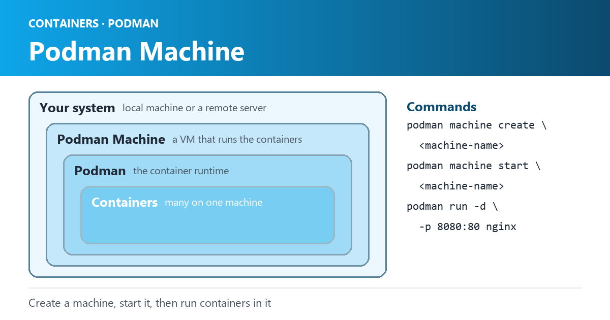

Podman

Podman Machine is a tool that allows you to manage multiple Linux containers on your local system or on remote servers. It provides a way to run and manage containers without the need for a full-blown container orchestration platform like Kubernetes. In this blog, we’ll explore what Podman Machine is, how to use it, and why you might want to use it.

## What is `Podman`

Podman is a Linux container management tool that provides a way to create, run, and manage containers without the need for a full-blown container orchestration platform like Kubernetes. It is an alternative to Docker and uses the same container images and commands as Docker, making it easy to switch from Docker to Podman. It uses the same container images and commands as Docker, but does not require a daemon to be running in the background, making it more secure and lightweight than Docker.

### History of Podman

Podman was created by Red Hat as an alternative to Docker. It was first released in 2018 and has since gained popularity as a lightweight and secure container management tool. Podman is part of the larger container ecosystem that includes tools like `Buildah` and `Skopeo`, which provide additional container management capabilities.

### What is Podman Machine?

Podman Machine is a command-line tool that allows you to create, manage, and run multiple containers on your local machine or on remote servers. It works by creating a virtual machine (VM) that runs the containers, similar to how Docker Machine works. However, `Podman` Machine uses `Podman` as the container runtime instead of Docker, giving you access to the full power of Podman’s container management capabilities.

### How to use Podman Machine?

To use Podman Machine, you first need to install it on your system. You can do this by downloading the Podman Machine binary from the official website and adding it to your system’s PATH.

Once installed, you can create a new Podman Machine by running the following command:

```text
podman machine create <machine-name>
```

This will create a new VM and configure it to run Podman as the container runtime. You can then start the machine by running:

```text
podman machine start <machine-name>
```

To run a container on the machine, you can use the Podman command-line interface just as you would on a local system. For example, to run a containerized version of Nginx, you can run:

```text
podman run -d -p 8080:80 nginx
```

This will start the Nginx container and map port 8080 on the host to port 80 in the container.

### Why use Podman Machine?

There are several reasons why you might want to use Podman Machine:

1. `Local development`: If you’re developing containerized applications, Podman Machine provides a way to run and test your containers locally without the need for a full-blown container orchestration platform.
2. `Remote management`: Podman Machine allows you to manage containers on remote servers, making it easier to deploy and manage your containers in production environments.
3. `Multi-container management`: With Podman Machine, you can manage multiple containers on a single VM, providing a way to test and run complex multi-container applications.
4. `Podman integration`: Podman Machine uses `Podman` as the container runtime, which means you get access to all of Podman’s advanced container management features, such as rootless containers and OCI-compliant container images.

### Security?

`Podman` is considered more secure than `Docker` for several reasons:

1. `No daemon`: Podman does not require a daemon to be running in the background, which means that there is no central point of attack for hackers to exploit. This makes Podman more secure by design, as there are fewer vulnerabilities that can be exploited.
2. `Rootless containers`: Podman allows for rootless containers, which means that containers are run as non-root users by default. This reduces the attack surface and makes it more difficult for attackers to gain root access to the host system.
3. `Integration with SELinux`: Podman is integrated with SELinux (Security-Enhanced Linux), which is a set of security extensions for the Linux kernel that provides mandatory access control. This adds an additional layer of security to containerized applications running on Podman.

In conclusion, Podman is more secure than Docker due to its design, which eliminates the need for a central daemon and provides rootless containers by default. Developers who are concerned about security have several other options, including Kata Containers, CRI-O, and LXC. Each of these tools provides unique features and advantages, so it’s important to choose the one that best fits your needs.

In conclusion, `Podman Machine` is a useful tool for managing containers on your local system or on remote servers. It provides a way to run and manage containers without the need for a full-blown container orchestration platform, making it ideal for local development and remote management of containers. If you’re looking to get started with containerization and want a lightweight way to manage your containers, Podman Machine is definitely worth checking out.
