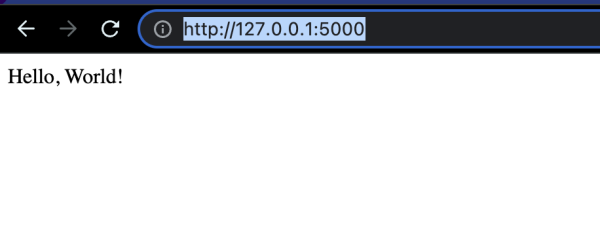

Building a simple hello world using `Flask`. (The code is available [here](https://github.com/samarthya/pysample-three))

## What is Flask and why use it?

Flask is a lightweight web framework for Python, but there are certain cases when you may want to consider using an alternative. Here are some of the cases when you might not want to use Flask:

1. Complex projects: Flask is great for small to medium-sized projects, but if you are building a complex web application with many components and features, you may want to consider using a more robust framework like Django.
2. Performance: Flask is not designed for high-performance applications, so if you are building an application that requires a lot of resources or has high-traffic demands, you may want to consider using another framework.
3. Security: Flask provides some basic security features, but if you need more robust security for your web application, you may want to consider using a framework that has built-in security features.
4. Scalability: Flask is not designed for scalability, so if you are building an application that is expected to grow in popularity, you may want to consider using another framework.
5. Community support: Flask has a growing community, but it is not as large as the communities for other web frameworks, so if you need a lot of support and resources, you may want to consider using another framework.

These are just a few examples of when you may want to consider using an alternative to Flask. Ultimately, the decision to use Flask or another framework will depend on your specific needs and requirements.

```text
from flask import Flask

class MyFlaskApp:
    def __init__(self, name):
        self.app = Flask(name)

    def run(self):
        @self.app.route('/')
        def index():
            return "Hello, World!"
        self.app.run()

if __name__ == '__main__':
    app = MyFlaskApp(__name__)
    app.run()
```

This example creates a Flask application as a class `MyFlaskApp` and defines a single endpoint `'/'` that returns “Hello, World!”. The `run` method starts the Flask server.

The code can be run with `python filename.py` and the server will be started at `http://localhost:5000/`.

Other options of Flask include:

- Django: a high-level Python web framework for rapid development and pragmatic design.
- Pyramid: a lightweight and flexible Python web framework.
- Tornado: a Python web framework for high-performance and scalable web applications.
- FastAPI: a modern, fast and easy to use web framework for building APIs with Python.
- Bottle: a fast, simple and lightweight Python web framework.
- CherryPy: a minimalist Python web framework that aims to make web development simple.
- Flask-RESTful: an extension for Flask that adds support for building REST APIs.
- Flask-SQLAlchemy: an extension for Flask that adds support for SQLAlchemy to your application.
- Flask-MongoEngine: an extension for Flask that adds support for MongoDB to your application.
