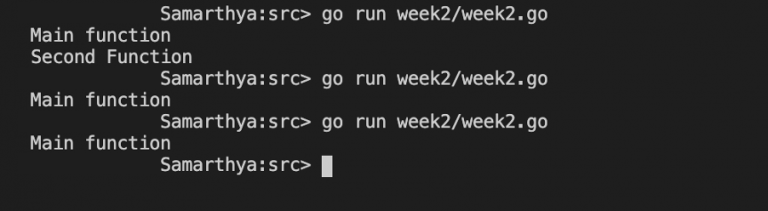

When two processes are executing concurrently, the exact order of execution of instructions is not deterministic. Without explicit synchronization instructions it is difficult to predict the outcome of these concurrent execution of process.

## Example 1

```text
package main

import "fmt"

func secondFunction() {
  fmt.Println(" Second Function")
}

func main() {
  go secondFunction()
  fmt.Print(" Main function")
}
```

As evident in the example above, we define a GO module secondFunction that is called as the first instruction of the main routine.

In some conditions the line “Second Function” should appear immediately before “ Main Function” and in some cases only the “ Main function” gets printed.

There is no sure shot way of knowing what will be the exact outcome of the execution. This is due to the race condition, where the CPU cycles are shared between the two threads (interleavings of instructions)

## Example 2

```text
package main

import "fmt"

func secondFunction() {
    fmt.Println(" Second Function")
}

func thirdFunction() {
    fmt.Println(" Third Function")
}

func main() {
    go secondFunction()
    fmt.Print(" Main function\n")
    go thirdFunction()
}
```

 tried execution three times as evident in the output below.



You can see the different output each time, which displays the race condition aptly, as we can never be sure of what will be the output each time.
