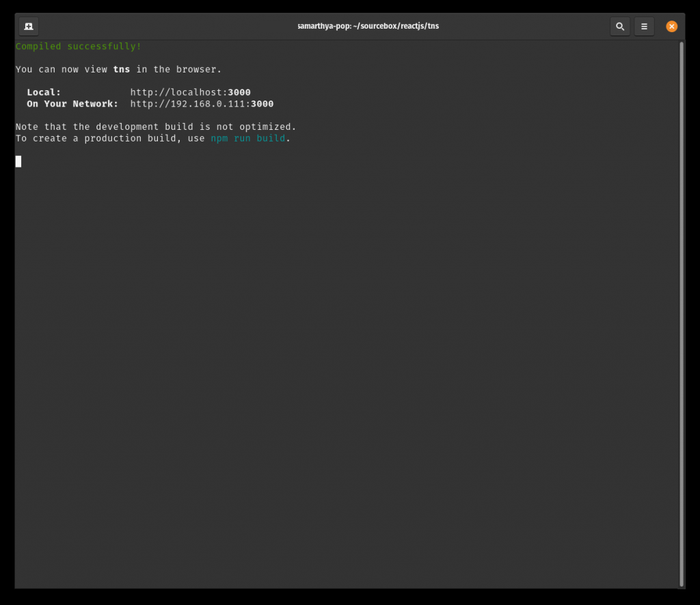
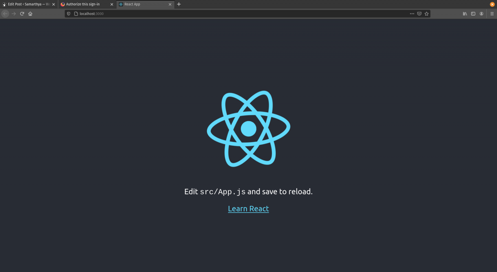
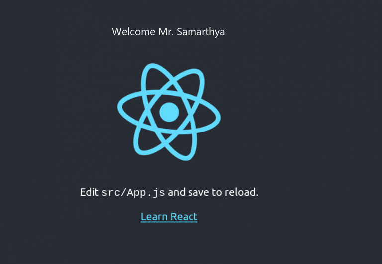

I need to write an app for a friend and what better way to brush up old concepts and write a fresh blog in doing so. So here I am, trying to put together some old and new skills together to help create a simple webapp that will have a dashboard and basic login enabled.

## Step - 1:

`create-react-app tns`

```text
success! Created tns at /home/samarthya/sourcebox/reactjs/tns
Inside that directory, you can run several commands:

  npm start
    Starts the development server.

  npm run build
    Bundles the app into static files for production.

  npm test
    Starts the test runner.

  npm run eject
    Removes this tool and copies build dependencies, configuration files
    and scripts into the app directory. If you do this, you can’t go back!

We suggest that you begin by typing:

  cd tns
  npm start

Happy hacking!
```

as suggested let's `cd` into `tns` and do `npm start`





The code files that it generates are as under

```text
drwxrwxr-x    6 samarthya samarthya   4096 Apr 17 18:03 ./
drwxrwxr-x    3 samarthya samarthya   4096 Apr 17 17:41 ../
drwxrwxr-x    8 samarthya samarthya   4096 Apr 17 18:04 .git/
-rw-rw-r--    1 samarthya samarthya    310 Apr 17 17:43 .gitignore
drwxrwxr-x 1061 samarthya samarthya  36864 Apr 17 17:50 node_modules/
-rw-rw-r--    1 samarthya samarthya    807 Apr 17 17:43 package.json
-rw-rw-r--    1 samarthya samarthya 692900 Apr 17 17:43 package-lock.json
drwxrwxr-x    2 samarthya samarthya   4096 Apr 17 17:43 public/
-rw-rw-r--    1 samarthya samarthya   3369 Apr 17 17:43 README.md
drwxrwxr-x    2 samarthya samarthya   4096 Apr 17 17:43 src/
```

## `Folder` `src/`

```text
.
├── App.css
├── App.js
├── App.test.js
├── index.css
├── index.js
├── logo.svg
├── reportWebVitals.js
└── setupTests.js
```

## Main component

The boiler plate code generates the first component for us.

```text
function App() {
  return (
    <div className="App">
      <header className="App-header">
        
        <p>
          Edit <code>src/App.js</code> and save to reload.
        </p>
        <a
          className="App-link"
          href="https://reactjs.org"
          target="_blank"
          rel="noopener noreferrer"
        >
          Learn React
        </a>
      </header>
    </div>
  );
}

export default App;
```

## Index.html

It defines the binding where to put in the component

```text
 <body>
    <noscript>You need to enable JavaScript to run this app.</noscript>
    <!-- The main root element -->
    <div id="root"></div>
  </body>
```

## Adding some `Welcome Name`

```text
function Welcome({ myName }) {
  return <p> Welcome {myName}</p>
}
```

`myName` is an attribute that I will be passing to this element, which will be referenced from the main app.

```text
<Welcome myName="Mr. Samarthya"></Welcome>
```



## Help

- React official documentation ([link](https://reactjs.org/docs/getting-started.html))
