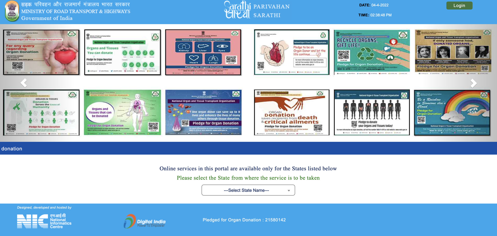
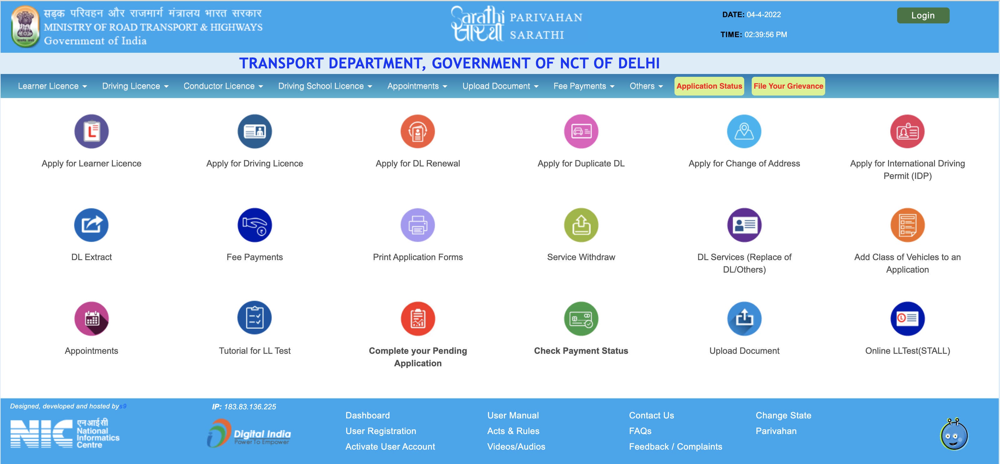
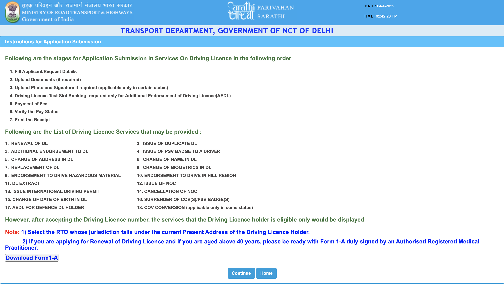
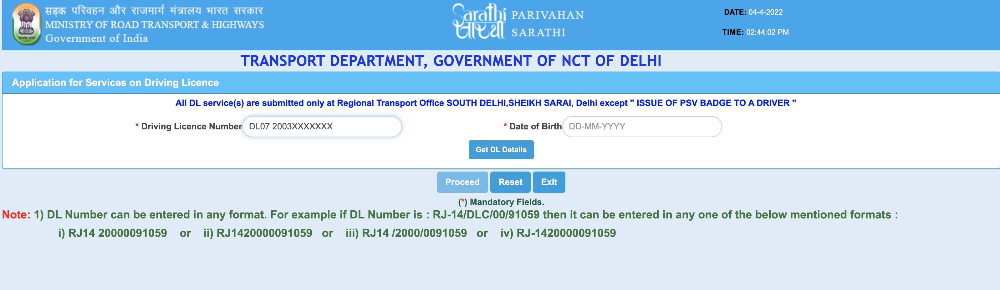
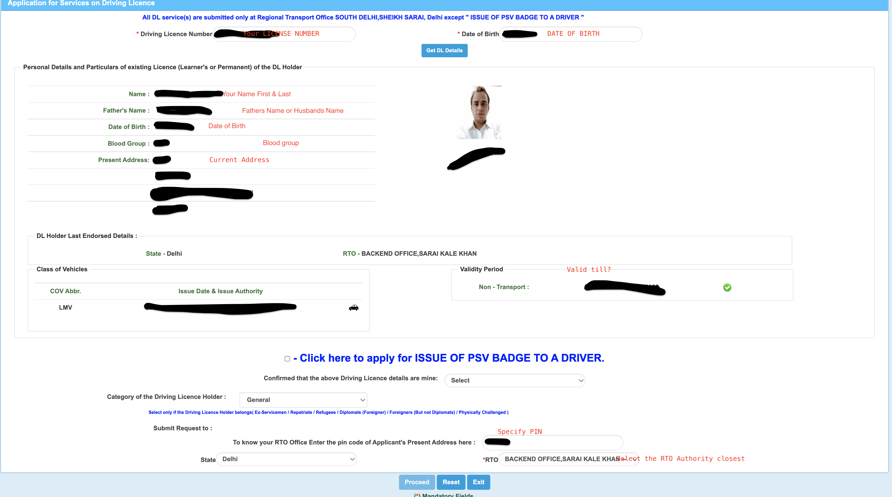
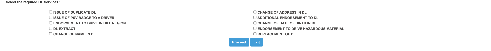

I never thought the process could be this simple in the year 2022. Thanks to Mr. Gadkari for taking the initiative that the states (some) have already implemented.

It starts of by signing on the portal – https://sarathi.parivahan.gov.in/sarathiservice/stateSelection.do

## Step 1

Once you have selected the state from the dropdown, in my case `Delhi`. You will be prompted for the service you wish to avail

## Step 2

Once you have identified which service you can navigate that option.

My intention was to renew the driver license so I choose Apply for `DL Renewal`

Select the service

## Step 3

The instructions are pretty self explanatory, but do read them carefully. As for folks above 40 you would need Form 1A which is duly signed by a recognised medical officer.

## Step 4

Specify the license number (Existing) and use the date of birth for fetching the current details.

## Step 5

Look at the details, for the current license. You do not need PSV badge if you drive a private vehicle. Do select the category and confirmation, which allows you to move to the next step.

## Step 6

Select the check box applicable like `renew`.

As the final few steps you would be required to upload self signed documents and submit for scrutiny, the process takes a day at most as once you upload correct documents the online validation is usually done once a day. So be careful of the clarity of documents. Prefer PDF as JPEG, and JPG do not work.
