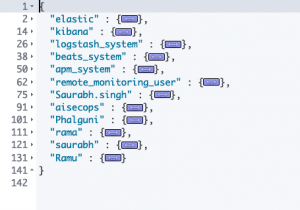
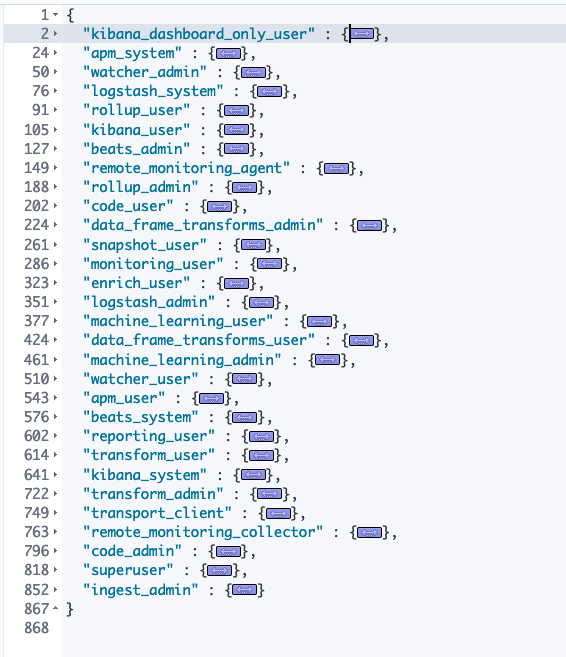

Security is integral to every and all the tasks in a shared environment. In ELK if you have setup a cluster which is accessible to all; anyone can make modifications which may or may not impact the other users.

> [Security Privileges (XPACK)](https://www.elastic.co/guide/en/elasticsearch/reference/7.5/security-privileges.html)

## Elastic cluster

The nodes that form the cluster, Kibana instances, Beats agents and clients all together form a cluster.

## Why secure it?

In basic licensing (default), elastic comes with minimal security and it is accessible to all who know the URL or the machine location. To prevent this unauthorized access to your elastic cluster you need to authenticate user.

> The Elasticsearch security features enable you to authorize users, assign access privileges to roles, and assign those roles to users.

## Useful links

- <https://www.elastic.co/guide/en/elasticsearch/reference/current/setup-passwords.html>
- <https://www.elastic.co/guide/en/elasticsearch/reference/7.5/security-privileges.html>
- <https://www.elastic.co/guide/en/elasticsearch/reference/7.5/built-in-users.html>
- <https://www.elastic.co/guide/en/elasticsearch/reference/7.5/built-in-users.html#bootstrap-elastic-passwords>
- <https://www.elastic.co/guide/en/elasticsearch/reference/current/security-api.html>

## Securing the cluster

Elasticsearch uses TLS to perform encryption of the messages and the authentication of different nodes.

### TLS for communication

You can generate your own certificates using a tool called `elasticsearch-certutil` which takes care of generating a CA and signing certificate with it.

## Example Cluster

```text
GET _cluster/health

{
   "cluster_name" : "samarthya",
   "status" : "green",
   "timed_out" : false,
   "number_of_nodes" : 3,
   "number_of_data_nodes" : 3,
   "active_primary_shards" : 7,
   "active_shards" : 14,
   "relocating_shards" : 0,
   "initializing_shards" : 0,
   "unassigned_shards" : 0,
   "delayed_unassigned_shards" : 0,
   "number_of_pending_tasks" : 0,
   "number_of_in_flight_fetch" : 0,
   "task_max_waiting_in_queue_millis" : 0,
   "active_shards_percent_as_number" : 100.0
 }
```

## RBAC : Role-Based Access Control

Using roles and users you can enable security in elastic cluster.

### Terms

```text
User: Authenticated user
Role: Named set of permissions
Permission: Set of one or more privileges against the secured resource. E.g. read, delete, manage
Privilege: Named group of one or more actions that a user may execute.
Secured resource: A limited access resource. E.g Indices, Aliases, documents, fields, users and the cluster itself.
```

## Security APIs

Elastic offers security (dedicated) api’s to

- Authenticate
- Clear Cache
- Delegate PKI authentication
- Privileges check
- SSL certificate

More details available [here](https://www.elastic.co/guide/en/elasticsearch/reference/current/security-api.html).

### API – Example

To create a user via API simply use

```text
POST _security/user/test
 {
   "password" : "testpassword",
   "roles" : [ "kibana_dashboard_only_user"],
   "full_name" : "API User",
   "email" : "test@test.com",
   "metadata" : {
     "hometown" : "Springfield",
     "age": 40,
     "description": "stop at nothing."
   }
 }
```

Returns

```text
{
   "created" : true
 }
```

To check the details of the created user

```text
GET _security/user/test
```

It should return the details we furnished while creating it.

```text
{
   "test" : {
     "username" : "test",
     "roles" : [
       "kibana_dashboard_only_user"
     ],
     "full_name" : "API User",
     "email" : "test@test.com",
     "metadata" : {
       "hometown" : "Springfield",
       "description" : "stop at nothing.",
       "age" : 40
     },
     "enabled" : true
   }
 }
```

When done deleting this user is as simple as issuing a command

```text
DELETE _security/user/test
```

## Realms

Authentication in the Elastic Stack security features is handled by one or more authentication services called *`realms`*. A *`realm`* is used to resolve and authenticate users based on authentication tokens.

Realms can be roughly two categories Internal & External.

### Internal

Requires no communication with external parties, completely internal to Elasticsearch. There can be maximum one configured internal realm type.

```text
E.g. NATIVE and FILE
```

## Index .security

Built in users are stored in `.security` index (inside Native realm; details above). These users (mentioned below) have fixed set of roles, and their passwords needs to be setup before they can be used. This index is internally maintained by Elasticsearch.

> The changes to any user (disabled, password change) are reflected across cluster automatically



### Basic details

`elastic` A built-in *superuser*. See [Built-in roles](https://www.elastic.co/guide/en/elasticsearch/reference/7.5/built-in-roles.html).

`kibana` The user Kibana uses to connect and communicate with Elasticsearch.

`logstash_system` The user Logstash uses when storing monitoring information in Elasticsearch.

`beats_system` The user the Beats use when storing monitoring information in Elasticsearch.

`apm_system` The user the APM server uses when storing monitoring information in Elasticsearch.

`remote_monitoring_user` The user Metricbeat uses when collecting and storing monitoring information in Elasticsearch. It has the `remote_monitoring_agent` and `remote_monitoring_collector` built-in roles.

### User – elastic

This is the default superuser and have full access to cluster. Avoid using it for regular operations; create a user for daily use.

### Roles



### External

Realms that require external (third party) interaction. There can be as many external realms as required.

```text
E.g. saml, kerberos, pki etc.
```

#### [Native Realm](https://www.elastic.co/guide/en/elasticsearch/reference/7.5/native-realm.html)

The default basic authentication – realm where the users are stored inside a dedicated index (`.security`). You can use the REST APIs or Kibana to add and remove users, assign user roles, and manage user passwords. The realm configurations are all done in `elastic.yml`

#### Other Realms

```text
ldap
active_directory
pki
file
saml
kerberos
oidc
```

## — THE – END —
