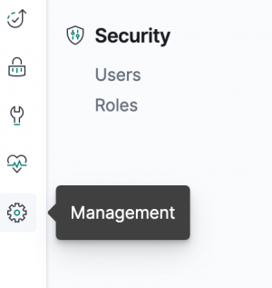
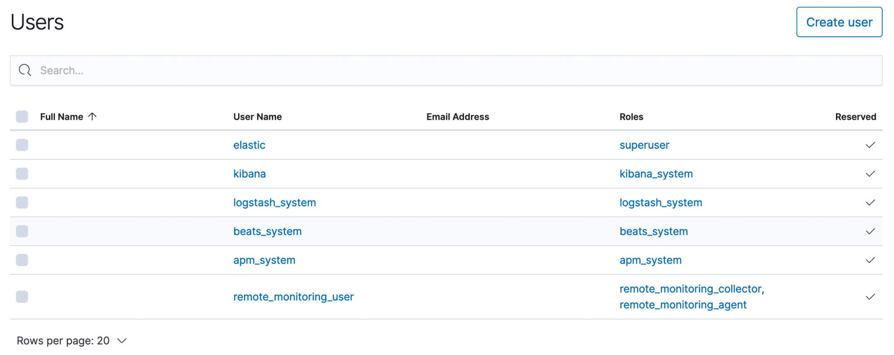

In this post I will try to enable security for the elasticsearch cluster. It would be simply penned as a sequence of steps you need to follow to enable security as part of the cluster.

## Helpful links

- https://www.elastic.co/guide/en/elasticsearch/reference/current/security-api.html#security-role-apis
- https://www.elastic.co/guide/en/elasticsearch/reference/current/certutil.html
- https://www.elastic.co/guide/en/elasticsearch/reference/current/security-api-put-user.html

```text
[elastic@samarthya ~]$ ./elasticsearch/bin/elasticsearch -V                                                                                                                                        
future versions of Elasticsearch will require Java 11; your Java version from [/usr/lib/jvm/java-1.8.0-openjdk-1.8.0.201.b09-2.el7_6.x86_64/jre] does not meet this requirement                  
Version: 7.3.1, Build: default/tar/4749ba6/2019-08-19T20:19:25.651794Z, JVM: 1.8.0_201
```

## Step 1

`xpack.security.enabled: true`

You need to open ‘config/elasticsearch.yml’ file and add the line shown above. In the console you can look at

```text
[2020-03-25T07:24:21,280][INFO ][o.e.x.s.s.SecurityStatusChangeListener] [node1] Active license is now [BASIC]; Security is enabled
```

### CURL – \_cat/nodes?pretty

Issuing a basic curl command to get the nodes you can see the following output.

```text
[elastic@samarthya ~]$ curl 'myserver:9200/_cat/nodes?pretty' 
{ 
"error" : { 
"root_cause" : [ 
{ 
"type" : "security_exception", 
"reason" : "missing authentication credentials for REST request [/_cat/nodes?pretty]", 
"header" : { 
"WWW-Authenticate" : "Basic realm=\"security\" charset=\"UTF-8\"" 
} 
} 
], 
"type" : "security_exception", 
"reason" : "missing authentication credentials for REST request [/_cat/nodes?pretty]", 
"header" : { 
"WWW-Authenticate" : "Basic realm=\"security\" charset=\"UTF-8\"" 
} 
}, 
"status" : 401 
}
```

## Step 2 – Internal password

`elasticsearch-setup-passwords` allows you to set password.

```text
Commands 
-------- 
auto - Uses randomly generated passwords 
interactive - Uses passwords entered by a user 

Non-option arguments: 
command 

Option Description 
------ ----------- 
-h, --help show help 
-s, --silent show minimal output 
-v, --verbose show verbose output
```

```text
[elastic@samarthya ~]$ ./elasticsearch/bin/elasticsearch-setup-passwords interactive                                                                                                               
future versions of Elasticsearch will require Java 11; your Java version from [/usr/lib/jvm/java-1.8.0-openjdk-1.8.0.201.b09-2.el7_6.x86_64/jre] does not meet this requirement                  
Initiating the setup of passwords for reserved users elastic,apm_system,kibana,logstash_system,beats_system,remote_monitoring_user.                                                              
You will be prompted to enter passwords as the process progresses.                                                                                                                               
Please confirm that you would like to continue [y/N]y                                                                                                                                            
                                                                                                                                                                                                 
                                                                                                                                                                                                 
Enter password for [elastic]:                                                                                                                                                                    
Reenter password for [elastic]:                                                                                                                                                                  
Enter password for [apm_system]:                                                                                                                                                                 
Reenter password for [apm_system]:                                                                                                                                                               
Enter password for [kibana]:                                                                                                                                                                     
Reenter password for [kibana]:                                                                                                                                                                   
Enter password for [logstash_system]:                                                                                                                                                            
Reenter password for [logstash_system]:                                                                                                                                                          
Enter password for [beats_system]:                                                                                                                                                               
Reenter password for [beats_system]:                                                                                                                                                             
Enter password for [remote_monitoring_user]:                                                                                                                                                     
Reenter password for [remote_monitoring_user]:                                                                                                                                                   
Passwords do not match.                                                                                                                                                                          
Try again.                                                                                                                                                                                       
Enter password for [remote_monitoring_user]:                                                                                                                                                     
Reenter password for [remote_monitoring_user]:                                                                                                                                                   
Passwords do not match.                                                                                                                                                                          
Try again.                                                                                                                                                                                       
Enter password for [remote_monitoring_user]:                                                                                                                                                     
Reenter password for [remote_monitoring_user]:                                                                                                                                                   
Passwords do not match.                                                                                                                                                                          
Try again.                                                                                                                                                                                       
Enter password for [remote_monitoring_user]:                                                                                                                                                     
Reenter password for [remote_monitoring_user]:                                                                                                                                                   
Passwords do not match.                                                                                                                                                                          
Try again.                                                                                                                                                                                       
Enter password for [remote_monitoring_user]:                                                                                                                                                     
Reenter password for [remote_monitoring_user]:                                                                                                                                                   
Changed password for user [apm_system]                                                                                                                                                           
Changed password for user [kibana]                                                                                                                                                               
Changed password for user [logstash_system]                                                                                                                                                      
Changed password for user [beats_system]                                                                                                                                                         
Changed password for user [remote_monitoring_user]                                                                                                                                               
Changed password for user [elastic]
```

### Check the CURL again

This time we will specify the user elastic for which we set the password above

```text
[elastic@server1 ~]$ curl -u elastic 'myserver:9200/_cat/nodes?pretty' 
Enter host password for user 'elastic': 
100.10.10.200 26 25 1 0.00 0.03 0.06 dim * node1
```

## Step – 3 Setup Kibana security

When you start Kibana without configuring the security, you will get an error like below.

```text
  log   [07:36:28.860] [warning][task_manager] PollError [security_exception] missing authentication credentials for REST request [/_template/.kibana_task_manager?filter_path=*.version], with { header={ WWW-Authenticate="Basic realm=\"security\" charset=\"UTF-8\"" } }
```

### kibana-keystore

We will be using the Keystore to create information placeholders to keep the value safe and not accessible to everyone except the intended process.

#### HELP

```text
[elastic@samarthya ~]$ ./kibana/bin/kibana-keystore --help 
Usage: bin/kibana-keystore [options] [command] 

A tool for managing settings stored in the Kibana keystore 

Options: 
-V, --version output the version number 
-h, --help output usage information 

Commands: 
create [options] Creates a new Kibana keystore 
list [options] List entries in the keystore 
add [options] <key> Add a string setting to the keystore 
remove [options] <key> Remove a setting from the keystore
```

#### Add Username and Password to the keystore

```text
[elastic@samarthya ~]$ ./kibana/bin/kibana-keystore create                                                                                                                                         
Created Kibana keystore in /home/elastic/kibana/data/kibana.keystore                                                                                                                             
[elastic@samarthya ~]$ ./kibana/bin/kibana-keystore add elasticsearch.username                                                                                                                     
Enter value for elasticsearch.username: ******                                                                                                                                                   
[elastic@samarthya ~]$ ./kibana/bin/kibana-keystore add elasticsearch.password                                                                                                                     
Enter value for elasticsearch.password: ********
```

Now when we restart Kibana and launch the URL to access the app you will be prompted for password.


## Kibana

Once we specify the user elastic for which we set the password and go to the management we can see the Users and roles section.



### Users

You can look at the users available for default.



## Role

Creating a new role is as simple as invoking an API as under

```text
POST _security/role/read_only_role_a
{
"cluster": [],
"indices": [{
   "names": [ "profile_record" ],
   "privileges": ["read", "view_index_metadata"]
  }]
}
```

It should return a response like below

```text
{
  "role" : {
  "created" : true
  }
}
```

## User

Creating a new user and assign the role

```text
POST /_security/user/samarthya
{
"password" : "password",
"roles" : [ "read_only_role_a" ],
"full_name" : "Samarthya Samarthya",
"email" : "samarthya@samarthya.com",
"metadata" : {
"intelligence" : 21,
"country": "India"
}
}
```

If the payload is all formatted it should return a response as under

```text
{
"created" : true
}
```

Every node that wants to join a secured cluster needs a certificate from the established CA. In the process below I will lay out the required steps to establish the same.

## Certificate Authority

Time to use certificates to secure the communication

### elasticsearch-certutil

We will be using the builtin certutil to generate the certificate

```text
Commands 
-------- 
csr - generate certificate signing requests 
cert - generate X.509 certificates and keys 
ca - generate a new local certificate authority 

Non-option arguments: 
command 

Option Description 
------ ----------- 
-h, --help show help 
-s, --silent show minimal output 
-v, --verbose show verbose output 

Will stick to the default name
```

```text
[elastic@samarthya ~]$ ./elasticsearch/bin/elasticsearch-certutil ca --pem                                                                                                                         
future versions of Elasticsearch will require Java 11; your Java version from [/usr/lib/jvm/java-1.8.0-openjdk-1.8.0.201.b09-2.el7_6.x86_64/jre] does not meet this requirement                  
This tool assists you in the generation of X.509 certificates and certificate                                                                                                                    
signing requests for use with SSL/TLS in the Elastic stack.                                                                                                                                      
                                                                                                                                                                                                 
The 'ca' mode generates a new 'certificate authority'                                                                                                                                            
This will create a new X.509 certificate and private key that can be used                                                                                                                        
to sign certificate when running in 'cert' mode.                                                                                                                                                 
                                                                                                                                                                                                 
Use the 'ca-dn' option if you wish to configure the 'distinguished name'                                                                                                                         
of the certificate authority                                                                                                                                                                     
                                                                                                                                                                                                 
By default the 'ca' mode produces a single PKCS#12 output file which holds:                                                                                                                      
    * The CA certificate                                                                                                                                                                         
    * The CA's private key                                                                                                                                                                       
                                                                                                                                                                                                 
If you elect to generate PEM format certificates (the -pem option), then the output will                                                                                                         
be a zip file containing individual files for the CA certificate and private key                                                                                                                 
                                                                                                                                                                                                 
Please enter the desired output file [elastic-stack-ca.zip]:
```

Unzipping the elastic-stack-ca.zip will give you two files

```text
[elastic@samarthya ca]$ ls 
ca.crt ca.key
```

The CA key and certificate are now available to generate node certificates.

```text
./elasticsearch/bin/elasticsearch-certutil cert --ca-cert /mycacertificate/ca/ca.crt --ca-key /mycacertificate/ca/ca.key
```

This command has to be used on each node, to generate the certificate. It will prompt for a password which you SHOULD REMEMBER as it will be utilised in subsequent steps.

### Truststore and Keystore

Keystore and Truststore are both important and essential for communication with an **SSL Certificate**. Both are very similar in terms of construct and structure.

Truststore is used for the storage of certificates from the trusted CA, which is used in the **verification of the certificate** provided by the server in an [SSL connection](https://dzone.com/articles/ssl-in-java). On the other hand, a Keystore is used to store the private key and own identity certificate to be identified for verification.

> In an SSL handshake, the work of Truststore is to verify the credentials, whereas the work of Keystore is to provide those credentials.

Commands to add the kesytore and trustore password (the one specified in the step above)

- `./elasticsearch/bin/elasticsearch-keystore add xpack.security.transport.ssl.keystore.secure_password`
- `./elasticsearch/bin/elasticsearch-keystore add xpack.security.transport.ssl.truststore.secure_password`

Adding certificate information to the node

```text
xpack.security.transport.ssl.enabled: true
xpack.security.transport.ssl.verification_mode: certificate
xpack.security.transport.ssl.keystore.path: elastic-certificates.p12
xpack.security.transport.ssl.truststore.path: elastic-certificates.p12
```
