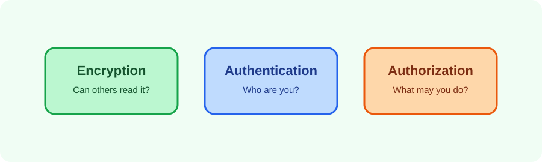

When I started looking at Kafka security, I found myself jumping straight to configuration properties. That was backwards. I found it easier to ask three questions first:


Written up in October 2026 from my notes at the time. The configuration snippets and verification output are illustrative and contain no real credentials.




1. Can the client prove who it is?
2. Can the client communicate privately with the broker?
3. Is that identity allowed to perform this operation?

These are authentication, encryption, and authorization. Configuring one does not automatically provide the others.

## Encrypt the connection

Use TLS for client-to-broker and broker-to-broker traffic where supported by the deployment. A broker listener should use a certificate whose name matches the address clients use. Keep private keys readable only by the Kafka service account.

Do not put real passwords or private keys in a playbook. Use a secret manager or an encrypted Ansible Vault file and provide placeholders in documentation:

```properties
ssl.keystore.password=<REPLACE-ME>
ssl.truststore.password=<REPLACE-ME>
```

Rotate certificates before expiry and monitor the complete chain, not only the leaf certificate.

## Authenticate clients

Common choices include mutual TLS, SASL/SCRAM, and SASL/OAUTHBEARER. Select one based on the identity system and Kafka client support you operate. Avoid sharing one credential across applications; separate identities make audit and revocation possible.

For a new client, document:

- the listener and protocol;
- the identity format;
- where credentials are stored;
- certificate or token rotation;
- the minimum permissions required.

## Authorize operations

Authentication says who a client is. Kafka authorization decides whether that identity can read, write, create, or alter a resource. Grant access to named topics and consumer groups rather than broad cluster permissions.

A useful design is to give a producer write access only to its topic and a consumer read access only to its topic and group. Administrative operations should use separate identities.

## Operational controls

Security also includes the surrounding system:

- restrict broker listeners with network controls;
- keep inter-broker credentials separate from application credentials;
- protect ZooKeeper or use the supported KRaft security model;
- audit authentication failures and authorization denials;
- avoid logging tokens, passwords, or full connection headers;
- test revocation and certificate rotation before an incident.

## Test the negative path

A secure configuration is not proven by a successful connection. Test that an unauthenticated client is rejected, an authenticated client without permission is denied, and an authorized client can perform only the intended operation.

Security is a set of explicit boundaries. Documenting those boundaries makes Kafka easier to operate than relying on a single setting named `security`.

Illustrative negative-path test:

```text
ProducerRecordException:
  TopicAuthorizationException: Not authorized to access topics: [events]
Expected result: application identity rejected until WRITE permission is granted.
```
