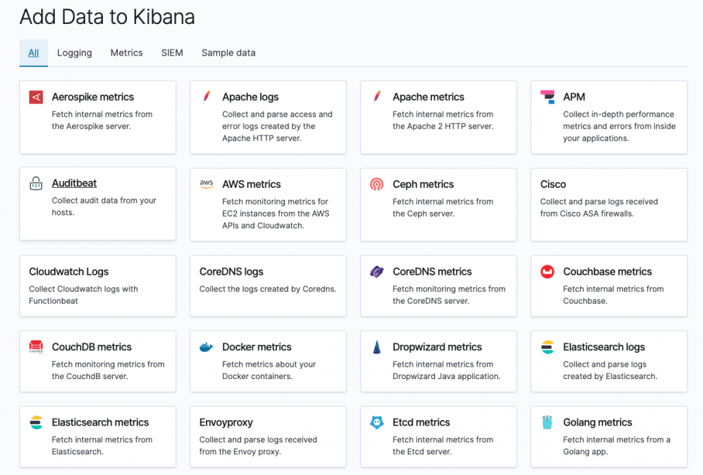
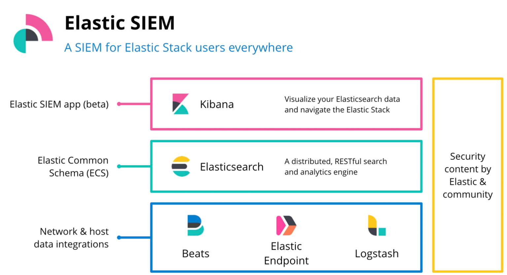

```text
* Header image from Elastic.co
```

As we move towards the micro-service/container economy where there are heaps of products available in form of applications to be downloaded & installed on primarily two platforms Android and IOS, we just cant underline the security implications enough.

> SIEM - Security information and Events management.

In this blog, I will walk through the enabling-platform that elastic is. Elastic enables data ingestion from multiple sources, and identifying/predicting threats.



## Data generators

The source of truth is always the activity information from an application

## ECS

Elastic common schema allows to normalize the data from multiple sources. Which allows correlation much easier and eventually more convenient searches for data retrieval and enrichment.

In version 7.2 SIEM was made available.



```text
* Image above is from from Elastic.co
```
