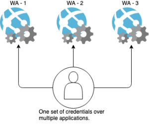
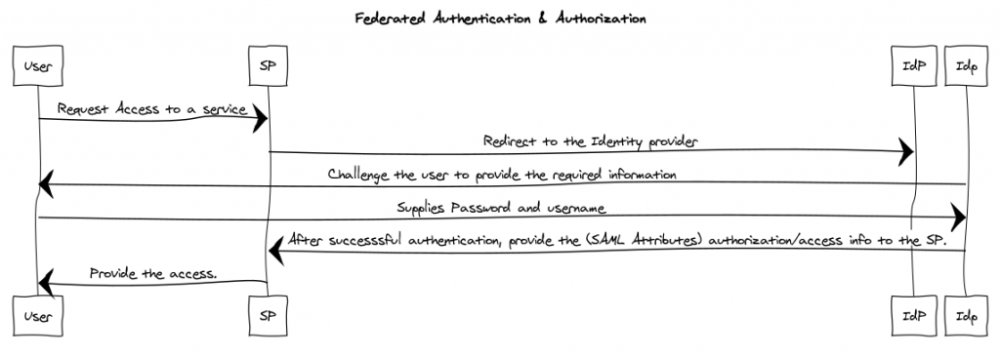

# What is SAML?

Security Assertion Markup Language (SAML) is an open standard that allows identity providers (IdP) to pass authorization credentials to service providers (SP). It implements a secure method of passing *user authentications and authorizations* (users, logins, and attributes) between the identity provider and service providers.

> SAML enables internet SSO and provides centralized user management.

## Main components

1. Identity Provider (IdP): It provides with access information to the service requesting, by challenging the user requesting for the access, to the Service Provider.
2. Service provider: It provides the user the authorization to access the service after getting the required authentication from IdP.
3. SAML Assertion: It is a formatted document that IdP send to the SP that contains the user authorization information.
4. Each identity provider and service provider need to agree upon the exact configuration for the SAML authentication to work.

