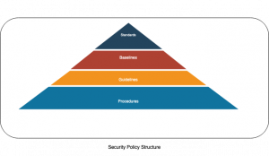

# 

# Standards

> Standards are `tactical documents` that define steps or methods to accomplish the goals and overall direction defined by the security policies.

1. They define compulsory requirements for homogeneous use of software hardware and security controls.
2. Provides for a uniform implementation throughout an organization.

# Baseline

> Defines a minimum level of security that every system within the organization should meet.

1. Establishes a common foundational secure state on which additional measures can be built.
2. Additional layers are more stringent and as per the organization needs.
3. Often are system specific and pertinent to an industry or government standard.

# Guidelines

> Recommends how standards and baselines should be implemented to serve as an operational guide for both security professionals and end users.

1. They are flexible
2. Stares security mechanisms rather than specific products and settings.
3. Not compulsory
4. Outline methodologies

The purpose of procedure is to ensure integrity of business process. It helps in standardization of security across systems in an organization.
