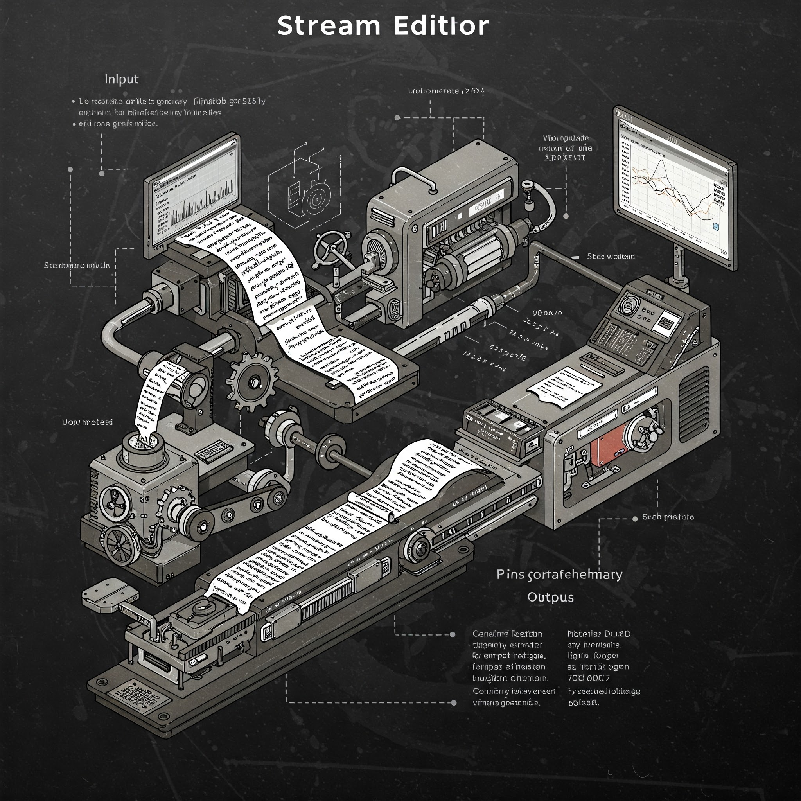

In the realm of Unix-like operating systems, where command-line prowess reigns supreme, `sed` stands tall as a versatile and indispensable tool. Born in the early 1970s at the legendary Bell Labs, `sed` (short for “stream editor”) emerged from the creative mind of Lee E. McMahon. Its creation was inspired by the need for a command-line utility capable of performing substitutions, akin to the functionality found in the `grep` command but with the added ability to modify the matched text.

`Sed` operates as a non-interactive stream editor, meaning it processes input line by line without requiring user intervention. This makes it ideal for automating text transformations within scripts or pipelines. Its core strength lies in its ability to apply a series of editing commands to an input stream, be it from a file or standard input, and produce a modified output stream.

Over the decades, `sed` has evolved into a powerful tool for a wide range of text manipulation tasks. From simple find-and-replace operations to complex pattern matching and substitutions, `sed` offers a concise and efficient way to handle text processing needs. Its enduring popularity stems from its simplicity, flexibility, and the ability to seamlessly integrate with other command-line utilities.

Whether you’re a system administrator automating configuration changes, a developer processing log files, or a data analyst cleaning and transforming data, `sed` is an invaluable tool to have in your arsenal. Its ability to perform complex text manipulations with minimal code makes it a true powerhouse of the command line

### Examples:

Normally the invocation of sed is as below

```text
sed SCRIPT INPUTFILE
```

#### I. Reading from stdin and replacing

```text
sed 's/hello/world/'  -
samarthya hello
samarthya world
```

#### II. Replacing

```text
> echo "Hello hello" | sed 's/hello/world/'
Hello world
```

#### iii. Replacing in file

```text
$ echo "hello samarthya" > test.txt 
$ cat test.txt 
hello samarthya
$ sed -i "s/hello/world/" test.txt 
$ cat test.txt 
world samarthya
```

#### iv. Script within script

```text
$ sed -i "s/hello/world/; s/world/World/" test.txt 
$ cat test.txt 
World samarthya
$ sed -i "s/samarthya/world/; s/World/word/" test.txt 
$ cat test.txt 
word world
$
```

## Help

- <https://www.gnu.org/software/sed/manual/sed.html#Introduction>
