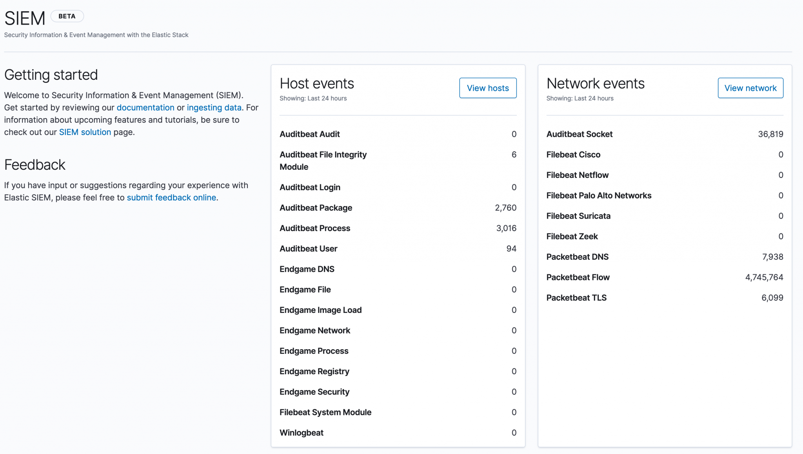

Data is key to any analytics, and if it can be **organized**, **normalized** and made available for correlated analysis, the results will be more concise. **Elastic.co** has a SIEM UI and the XPack security pack that helps the new age security analysts.

> Elastic SIEM is built on top of Elastic stack

## ECS : Elastic common schema

The key aspect is normalization of data from the disparate sources into one common schema called ECS - Elastic common schema.

- It is an [open source](https://github.com/elastic/ecs/) specification
- Defines common set of fields to record events (from log & metrics)
  - Defines field name & data type for each field
- Open for extension (permissive schema)

> The goal of ECS is to enable and encourage users of Elasticsearch to normalize their event data, so that they can better analyze, visualize, and correlate the data represented in their events.
>
> elastic.co

More details on guidelines can be found [here](https://www.elastic.co/guide/en/ecs/current/ecs-guidelines.html).

> Elastic end point security is the latest acquisition that furthers the security aspect in Elastic.

Some helpful links below

- <https://www.elastic.co/guide/en/ecs/current/ecs-field-reference.html>
- <https://www.elastic.co/endpoint-security>

Please note SIEM is only available on trial license, Platinum and Elastic cloud versions only.

#### ... to be continued.
