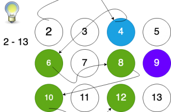

[Sieve](https://exercism.io/my/solutions/28fecb68ecea4dcaa19d899dfa38a1e2) is an ancient and an ingenious way of calculating primes. It recursively eliminates all the multiples of a particular number up till a range and the left overs are essentially primes.



It was just a matter of defining the right data structure and computing the final set of primes

```text
package sieve

import "sort"

// Sieve calculates prime
func Sieve(limit int) (out []int) {
    out = make([]int, 0)
    myMap := make(map[int]bool, 0)

    if limit <= 1 {
        return
    }

    // Populate all the numbers
    for i := 2; i <= limit; i++ {
        myMap[i] = true
    }

    // Check the numbers and false all the multiples
    for i := 2; i <= limit; i++ {
        for j := 2; (j * i) <= limit; j++ {
            if myMap[(i * j)] {
                myMap[(i * j)] = false
            }
        }
    }

    // Append only the positive found
    for k := range myMap {
        if myMap[k] {
            out = append(out, k)
        }
    }

    sort.Ints(out)

    return
}
```

I used a map of `(int, boolean)`to add all the element up to the limit (13 in my example above)

```text
Initial Map has

[2] = true
[3] = true
[4] = true. .... [13] = true
```

Then I ran a simple for loop to iterate till the limit `13` on the map and mark all the multiples as false.

So it starts with `2` till `13` checking for every multiple and marking it false.

```text
2*2 = 4
[4] = false
2*3 = 6
[6] = false
2*4 = 8
[8] = false
...
```

and finally for all elements which have a true against it I add it to the `int[]` and return it.

### — THE – END —
