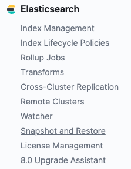
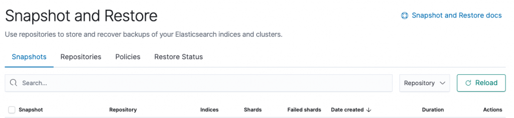
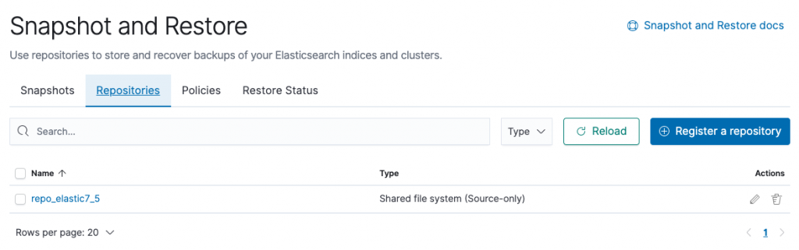
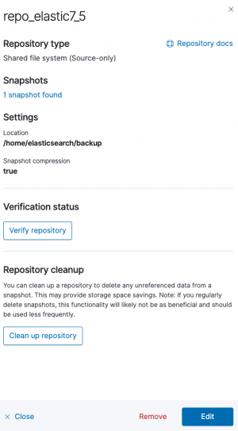
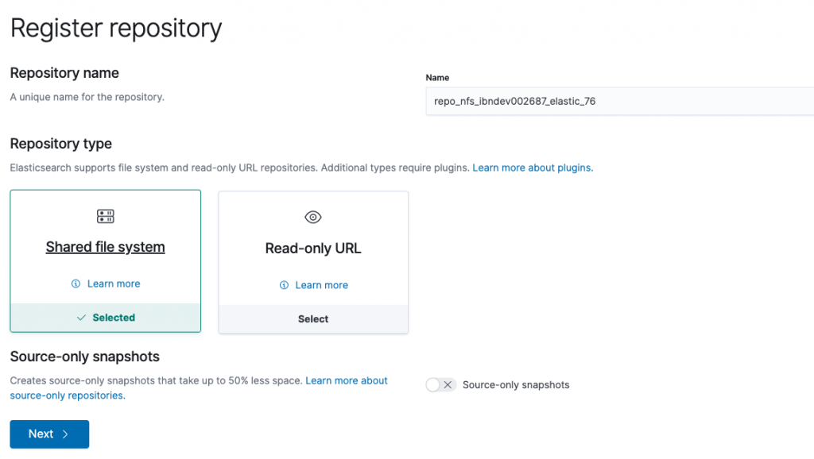
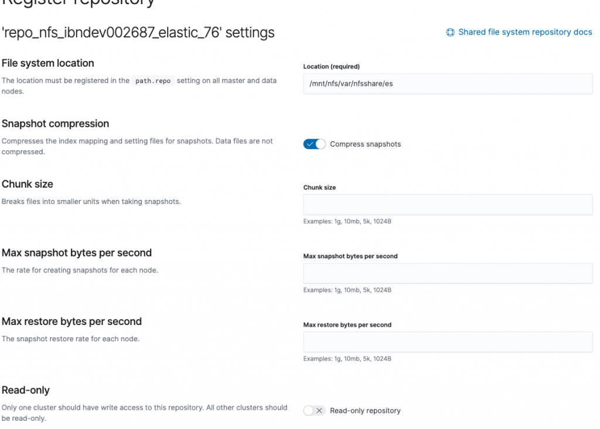
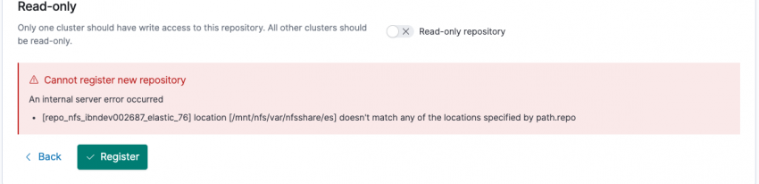
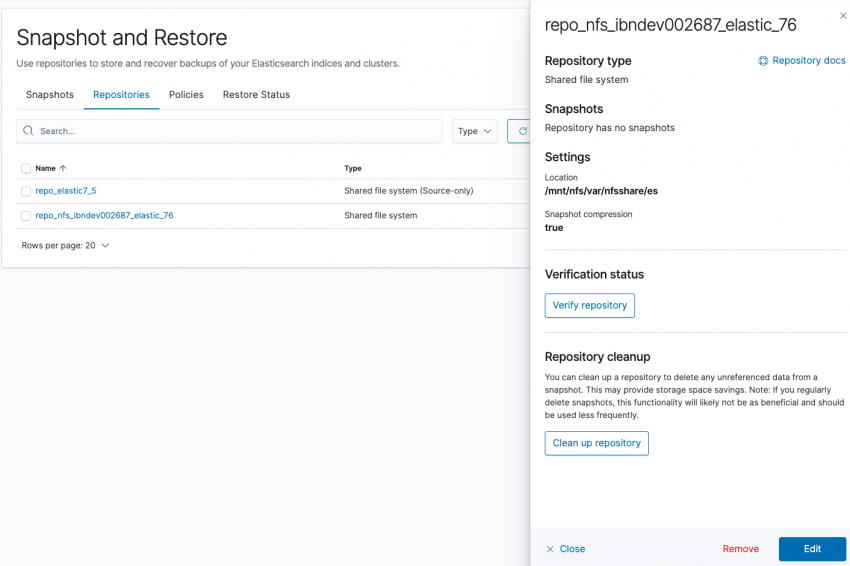

If you have a production grade elastic cluster it is always recommended to do a regular backup as a standard practice.

> Snapshot is a backup of information, that can be be used to restore the last known good state of the system

In the context of elasticsearch you can take snapshot of an individual index or the whole cluster and it be either stored on local file system or on remote repositories like google cloud.

If you navigate to Snapshot and Restore in Kibana-Management you are presented the UI to execute the backup.

## Points to remember

- Snapshots are incremental in nature, delta of data not available in the previous snapshot is only stored.
- Can restore snapshots to running clusters.
- Rest [Restore](https://www.elastic.co/guide/en/elasticsearch/reference/7.5/snapshots-restore-snapshot.html) - API interface can be used.
- All indices restore is the default option.
- Selective restore is also available.

## Snapshot repository

A snapshot repository is required before, any snapshot can be taken.

> It is always recommended to create a new snapshot for each major build version


**Note:** Snapshots written by one version may not be visible to the other and the repository could be corrupted.


### Example


GET \_snapshot



{  
  
 "repo\_elastic7\_5" : {  
  
 "type" : "source",  
  
 "settings" : {  
  
 "compress" : "true",  
  
 "delegate\_type" : "fs",  
  
 "location" : "/home/elasticsearch/backup"  
  
 }  
  
 }  
  
}


In the example above you can see the GET request returns the Snapshot repo Name and information about the location.

The information that the Rest API showed can also be viewed from Kibana by clicking the repo-name.

### Details

#### "type" : "fs"

FS is the shared file system to store the snapshots. The location is the exact location on system.

## New Repo

Let's try and add a new repo.

- In step one you need to click the register the Repository button on the top left and the dialog as above should be displayed.
- Specify a name and select the `Shared File System` and press next

- Add the location name - this location has to be present in the `path.repo`

In my example I have two paths set


ath.repo: ["/home/elasticsearch/backup","/mnt/nfs/var/nfsshare/es"]


In case you do not have the path set when you register it might fail like below

Otherwise

-- THE - END --
