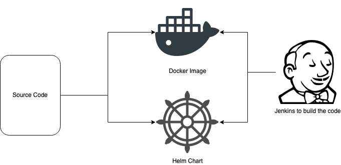

I have written a series of blogs to capture how you can deploy spinnaker on a `Kubernetes` cluster & manage a helm chart deployment via pipeline.

> The only way to enable more frequent changes is to invest in supporting people with better tooling, practices, and culture
>
> From the Book `Spinnaker`

Now once you have the docker/image or the helm chart published we can define automated deployment if you have a spinnaker.


Learn more about Spinnaker [here](https://spinnaker.io/docs/concepts/).
— Official documentation


## What is spinnaker?

Spinnaker is an open-source, multi-cloud continuous delivery platform that helps you release software changes with high velocity and confidence. It acts as a single pane of glass from which to manage your global deployments across multiple clouds.


Read more about installing Spinnaker [here]().
— Step 1


In Spinnaker world – *pipeline* is the key deployment management construct in Spinnaker. You can start a pipeline manually, or you can configure it to be automatically triggered by an event, such as a Jenkins job completing, a new Docker image appearing in your registry, a CRON schedule, or a stage in another pipeline.


You can download the [ebook](https://spinnaker.io/docs/concepts/ebook/ContinuousDeliveryWithSpinnaker.pdf) from here (Free of Cost)



Pipeline in action *(not published: its screenshots were lost)*
— Step 2



[Docker Provider configuration]() (Docker – registry)
— Step 3



[Helm registry]()
— Step 4


## Help

- It will be handy to read more about HALYARD ([official documentation](https://spinnaker.io/docs/reference/halyard/))
