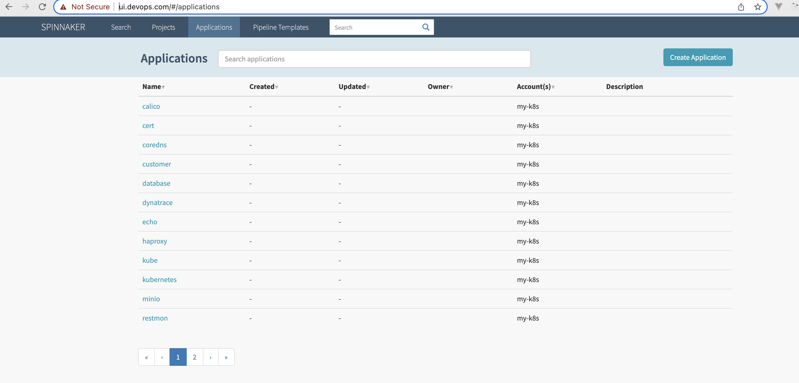
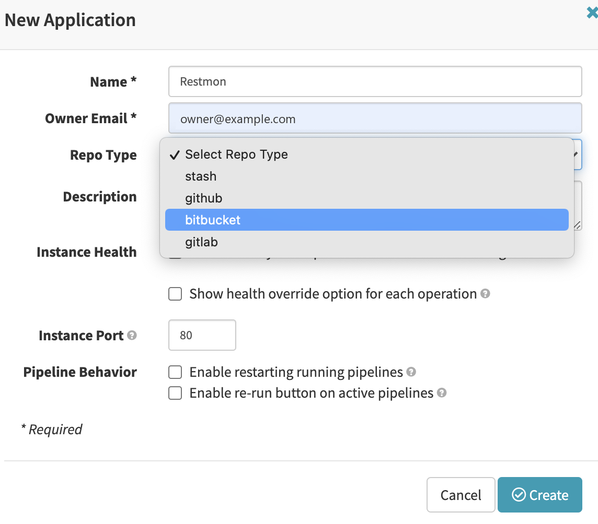

`Spinnaker` is an `open-source` ***continuous delivery*** platform which provides two core set of features

1. Application Management
2. Application deployment


## Key Concepts

Some of the key concepts in the spinnaker universe are covered as under

### Halyard

[Halyard](https://spinnaker.io/docs/reference/halyard/) is a tool for configuring, installing, and updating Spinnaker. This is one tool that you will utilize while setting up the Spinnaker itself for providers, configuration etc.

### Halconfig

The Halconfig is the source of all configuration for your Deployment of Spinnaker.

### Deployments

A Deployment within Halyard is a single, isolated, deployed/installed & configured Spinnaker. The deployments are referenced by name, and the default name for your first Deployment is `"default"`.

### Artifacts

Artifacts are unconfigured, versioned, prebuilt deployables consumed by Halyard.

### Services

Services are the combination of an Artifact, with a set of Profiles that apply to that Artifact.

### Profiles

Profiles are configuration files applied to Artifacts to make them run in some desired fashion.

### Application

A `Spinnaker` application represents a service that you are going to deploy (typically a `microservice`). It includes

- The pipeline that process the service through to deployment in production
- The infra on which the service runs
- Canary configs


An application *represents* the service which you are going to deploy using Spinnaker, all configuration for that service, and all the infrastructure on which it will run.
— from the official documentation


### Cluster

Clusters are logical groupings for `Server Groups`

### Server Group

Identifies the deployable artifact and basic configuration settings such as number of instances, auto scaling policies, metadata, etc.

### Load balancer

A *Load Balancer* is associated with an ingress protocol and port range.

### Pipeline

It is the key deployment management construct in `spinnaker`. It consists of sequence of actions known as `stages`. One can pass arguments from stage to stage along the pipeline.

You can start a pipeline manually, or you can configure it to be automatically triggered by an event, such as a Jenkins job completing, a new Docker image appearing in your registry, a CRON schedule, or a stage in another pipeline


### Stage

A *Stage* in `Spinnaker` is a collection of **sequential Tasks** and composed Stages that describe a higher-level action the Pipeline will perform either linearly or in parallel.


The work done by a pipeline can be divided into smaller, customizable blocks called stages.
— Spinnaker


*[image unavailable: Screenshot-2022-02-04-at-10.25.14-PM-1024x133.png — Example Pipeline: With two stages (Helm & Deploy)]*

### Task

An automatic function to perform.


## Installation: `spinnaker`

If you follow the official documentation you can follow the steps below

### Step 1: Make the local directory

This directory will contain persistent configuration for the docker instance

```text
mkdir ~/.hal
```


Make sure DOCKER CE is installed
— Official documentation


### Dry Run

Run the docker in console mode

```text
docker run -p 8084:8084 -p 9000:9000 \
>     --name halyard --rm \
>     -v ~/.hal:/home/spinnaker/.hal \
>     -it \
>     us-docker.pkg.dev/spinnaker-community/docker/halyard:stable
```

On your machine the output might differ, but on my machine it shows output like below

```text
Unable to find image 'us-docker.pkg.dev/spinnaker-community/docker/halyard:stable' locally
stable: Pulling from spinnaker-community/docker/halyard
ddad3d7c1e96: Pull complete 
b339b23b94dc: Pull complete 
bb8983c8f410: Pull complete 
ed37ba1fd206: Pull complete 
94b0a1cd90d7: Pull complete 
90b860836694: Pull complete 
2bccfaf2a897: Pull complete 
aeb9ec2e705a: Pull complete 
Digest: sha256:51bab15c373271f41db44bd5e9392e53183ab5238497339d3b36c065c0bb4039
Status: Downloaded newer image for us-docker.pkg.dev/spinnaker-community/docker/halyard:stable
WARNING: An illegal reflective access operation has occurred
WARNING: Illegal reflective access by org.codehaus.groovy.reflection.CachedClass (file:/opt/halyard/lib/groovy-2.5.11.jar) to method java.lang.Object.finalize()
WARNING: Please consider reporting this to the maintainers of org.codehaus.groovy.reflection.CachedClass
WARNING: Use --illegal-access=warn to enable warnings of further illegal reflective access operations
WARNING: All illegal access operations will be denied in a future release
 _           _                     _
| |__   __ _| |_   _  __ _ _ __ __| |
| '_ \ / _` | | | | |/ _` | '__/ _` |
| | | | (_| | | |_| | (_| | | | (_| |
|_| |_|\__,_|_|\__, |\__,_|_|  \__,_|
               |___/

2022-01-31 06:50:16.696  INFO 1 --- [           main] com.netflix.spinnaker.halyard.Main       : The following profiles are active: composite,test,local
2022-01-31 06:50:17.604  INFO 1 --- [           main] o.s.c.a.ConfigurationClassParser         : Properties location [file:/opt/spinnaker/hal.properties] not resolvable: /opt/spinnaker/hal.properties (No such file or directory)
2022-01-31 06:50:18.766  INFO 1 --- [           main] i.g.r.utils.RxJava2OnClasspathCondition  : RxJava2 related Aspect extensions are not activated, because RxJava2 is not on the classpath.
2022-01-31 06:50:18.768  INFO 1 --- [           main] i.g.r.utils.ReactorOnClasspathCondition  : Reactor related Aspect extensions are not activated because Reactor is not on the classpath.
2022-01-31 06:50:18.790  INFO 1 --- [           main] i.g.r.utils.RxJava2OnClasspathCondition  : RxJava2 related Aspect extensions are not activated, because RxJava2 is not on the classpath.
2022-01-31 06:50:18.791  INFO 1 --- [           main] i.g.r.utils.ReactorOnClasspathCondition  : Reactor related Aspect extensions are not activated because Reactor is not on the classpath.
2022-01-31 06:50:18.824  INFO 1 --- [           main] i.g.r.utils.RxJava2OnClasspathCondition  : RxJava2 related Aspect extensions are not activated, because RxJava2 is not on the classpath.
2022-01-31 06:50:18.825  INFO 1 --- [           main] i.g.r.utils.ReactorOnClasspathCondition  : Reactor related Aspect extensions are not activated because Reactor is not on the classpath.
2022-01-31 06:50:18.849  INFO 1 --- [           main] i.g.r.utils.RxJava2OnClasspathCondition  : RxJava2 related Aspect extensions are not activated, because RxJava2 is not on the classpath.
2022-01-31 06:50:18.850  INFO 1 --- [           main] i.g.r.utils.ReactorOnClasspathCondition  : Reactor related Aspect extensions are not activated because Reactor is not on the classpath.
2022-01-31 06:50:18.872  INFO 1 --- [           main] i.g.r.utils.RxJava2OnClasspathCondition  : RxJava2 related Aspect extensions are not activated, because RxJava2 is not on the classpath.
2022-01-31 06:50:18.873  INFO 1 --- [           main] i.g.r.utils.ReactorOnClasspathCondition  : Reactor related Aspect extensions are not activated because Reactor is not on the classpath.
2022-01-31 06:50:19.928  INFO 1 --- [           main] o.s.cloud.context.scope.GenericScope     : BeanFactory id=de0afe5b-913c-336b-9983-da4375d1e45e
2022-01-31 06:50:20.402  INFO 1 --- [           main] trationDelegate$BeanPostProcessorChecker : Bean 's3SecretEngine' of type [com.netflix.spinnaker.kork.secrets.engines.S3SecretEngine] is not eligible for getting processed by all BeanPostProcessors (for example: not eligible for auto-proxying)
2022-01-31 06:50:20.406  INFO 1 --- [           main] trationDelegate$BeanPostProcessorChecker : Bean 'secretsManagerSecretEngine' of type [com.netflix.spinnaker.kork.secrets.engines.SecretsManagerSecretEngine] is not eligible for getting processed by all BeanPostProcessors (for example: not eligible for auto-proxying)
2022-01-31 06:50:20.407  INFO 1 --- [           main] trationDelegate$BeanPostProcessorChecker : Bean 'gcsSecretEngine' of type [com.netflix.spinnaker.kork.secrets.engines.GcsSecretEngine] is not eligible for getting processed by all BeanPostProcessors (for example: not eligible for auto-proxying)
2022-01-31 06:50:20.407  INFO 1 --- [           main] trationDelegate$BeanPostProcessorChecker : Bean 'noopSecretEngine' of type [com.netflix.spinnaker.kork.secrets.engines.NoopSecretEngine] is not eligible for getting processed by all BeanPostProcessors (for example: not eligible for auto-proxying)
2022-01-31 06:50:20.411  INFO 1 --- [           main] trationDelegate$BeanPostProcessorChecker : Bean 'secretEngineRegistry' of type [com.netflix.spinnaker.kork.secrets.SecretEngineRegistry] is not eligible for getting processed by all BeanPostProcessors (for example: not eligible for auto-proxying)
2022-01-31 06:50:20.412  INFO 1 --- [           main] trationDelegate$BeanPostProcessorChecker : Bean 'secretManager' of type [com.netflix.spinnaker.kork.secrets.SecretManager] is not eligible for getting processed by all BeanPostProcessors (for example: not eligible for auto-proxying)
2022-01-31 06:50:21.591  INFO 1 --- [           main] o.s.b.w.embedded.tomcat.TomcatWebServer  : Tomcat initialized with port(s): 8064 (http)
2022-01-31 06:50:21.615  INFO 1 --- [           main] o.apache.catalina.core.StandardService   : Starting service [Tomcat]
2022-01-31 06:50:21.616  INFO 1 --- [           main] org.apache.catalina.core.StandardEngine  : Starting Servlet engine: [Apache Tomcat/9.0.31]
2022-01-31 06:50:21.964  INFO 1 --- [           main] o.a.c.c.C.[Tomcat].[localhost].[/]       : Initializing Spring embedded WebApplicationContext
2022-01-31 06:50:21.964  INFO 1 --- [           main] o.s.web.context.ContextLoader            : Root WebApplicationContext: initialization completed in 5248 ms
2022-01-31 06:50:23.929  INFO 1 --- [           main] c.g.a.oauth2.ComputeEngineCredentials    : Failed to detect whether we are running on Google Compute Engine.
2022-01-31 06:50:25.048  INFO 1 --- [           main] f.a.AutowiredAnnotationBeanPostProcessor : Autowired annotation should only be used on methods with parameters: public java.util.List com.netflix.spinnaker.halyard.deploy.spinnaker.v1.service.distributed.google.GoogleConsulServerService.getScopes()
2022-01-31 06:50:26.179  WARN 1 --- [           main] uration$JodaDateTimeJacksonConfiguration : Auto-configuration of Jackson's Joda-Time integration is deprecated in favor of using java.time (JSR-310).
2022-01-31 06:50:26.270  INFO 1 --- [           main] o.s.s.concurrent.ThreadPoolTaskExecutor  : Initializing ExecutorService 'applicationTaskExecutor'
2022-01-31 06:50:28.093  INFO 1 --- [           main] .s.s.UserDetailsServiceAutoConfiguration : 

Using generated security password: da34490b-87a2-4cbe-9688-db7dfec3f1ce

2022-01-31 06:50:28.364  INFO 1 --- [           main] o.s.s.web.DefaultSecurityFilterChain     : Creating filter chain: org.springframework.boot.actuate.autoconfigure.security.servlet.EndpointRequest$EndpointRequestMatcher@702a2c6e, [org.springframework.security.web.context.request.async.WebAsyncManagerIntegrationFilter@214ef199, org.springframework.security.web.context.SecurityContextPersistenceFilter@165e3835, org.springframework.security.web.header.HeaderWriterFilter@682f9202, org.springframework.security.web.csrf.CsrfFilter@2f9b24ae, org.springframework.security.web.authentication.logout.LogoutFilter@5fca8642, org.springframework.security.web.savedrequest.RequestCacheAwareFilter@1d0544b3, org.springframework.security.web.servletapi.SecurityContextHolderAwareRequestFilter@6b3decaa, org.springframework.security.web.authentication.AnonymousAuthenticationFilter@63d478a7, org.springframework.security.web.session.SessionManagementFilter@2453e3ce, org.springframework.security.web.access.ExceptionTranslationFilter@6f3059ad, org.springframework.security.web.access.intercept.FilterSecurityInterceptor@54f3fd30]
2022-01-31 06:50:28.370  INFO 1 --- [           main] o.s.s.web.DefaultSecurityFilterChain     : Creating filter chain: any request, [org.springframework.security.web.context.request.async.WebAsyncManagerIntegrationFilter@f5b079f, org.springframework.security.web.context.SecurityContextPersistenceFilter@2c127caf, org.springframework.security.web.header.HeaderWriterFilter@5d7b3a93, org.springframework.security.web.authentication.logout.LogoutFilter@77e03d01, org.springframework.security.web.savedrequest.RequestCacheAwareFilter@6c238208, org.springframework.security.web.servletapi.SecurityContextHolderAwareRequestFilter@680882bd, org.springframework.security.web.authentication.AnonymousAuthenticationFilter@cfdd1c4, org.springframework.security.web.session.SessionManagementFilter@26b01384, org.springframework.security.web.access.ExceptionTranslationFilter@47e0e23f, org.springframework.security.web.access.intercept.FilterSecurityInterceptor@48c2391]
2022-01-31 06:50:28.427  WARN 1 --- [           main] .b.a.g.t.GroovyTemplateAutoConfiguration : Cannot find template location: classpath:/templates/ (please add some templates, check your Groovy configuration, or set spring.groovy.template.check-template-location=false)
2022-01-31 06:50:28.952  INFO 1 --- [           main] o.s.b.a.e.web.EndpointLinksResolver      : Exposing 6 endpoint(s) beneath base path ''
2022-01-31 06:50:29.132  WARN 1 --- [           main] c.n.s.k.d.NoDiscoveryStatusPublisher     : No service discovery client is available, assuming application is UP
2022-01-31 06:50:29.134  INFO 1 --- [           main] c.n.s.k.d.DiscoveryStatusListener        : Instance status has changed to UP in service discovery
2022-01-31 06:50:29.172  INFO 1 --- [           main] o.s.b.w.embedded.tomcat.TomcatWebServer  : Tomcat started on port(s): 8064 (http) with context path ''
2022-01-31 06:50:29.178  INFO 1 --- [           main] com.netflix.spinnaker.halyard.Main       : Started Main in 15.719 seconds (JVM running for 16.719)
```

Press `Ctrl + c` to break to console and since we had used `--rm` the residue would be cleaned. and now run it in detached mode

```text
docker run -p 8084:8084 -p 9000:9000  --name halyard --rm  -v ~/.hal:/home/spinnaker/.hal  -d   us-docker.pkg.dev/spinnaker-community/docker/halyard:stable
```

To use a local `./kube/config` file you can copy that to the folder `~/.hal` and mount it before you run the pod.

```text
docker run -p 8084:8084 -p 9000:900 --name halyard --rm -v ~/.hal/config:/home/spinnaker/.kube/config -d us-docker.pkg.dev/spinnaker-community/docker/halyard:stable
```

You can validate by attaching the terminal to the container and running `kubectl get nodes` to check if it can show the output.

```text
docker exec -it halyard bash
```

```text
> kubectl get nodes
The connection to the server localhost:8080 was refused - did you specify the right host or port?
```

If you see the error as above that means the kubernetes configuration has issues. Check the logs & permission of the file before you proceed further.

## Time to choose the provider: (`k8s`)

In my case it is a local [K8S cluster](https://spinnaker.io/docs/setup/install/providers/kubernetes-v2/)

Kubernetes provider has 2 key requirements

- The `kubeconfig` file allows Spinnaker to authenticate against your cluster and to have read/write access to any resources you expect it to manage.
- Spinnaker relies on `kubectl` to manage all API access.

### Create a `Service Account`

When you access the cluster (for example, using `kubectl`), you are authenticated by the `apiserver` as a particular `User Account` (usually `admin`). Processes in containers inside pods can also contact the apiserver. When they do, they are authenticated as a particular Service Account.


A service account provides an identity for processes that run in a Pod.
— Service Account


```text
export CONTEXT=$(kubectl config current-context)
```

```text
echo $CONTEXT
kubernetes-admin@kubernetes
```

```text
kubectl apply --context $CONTEXT -f https://spinnaker.io/downloads/kubernetes/service-account.yml
```

```text
export TOKEN=$(kubectl get secret --context $CONTEXT \
>    $(kubectl get serviceaccount spinnaker-service-account \
>        --context $CONTEXT \
>        -n spinnaker \
>        -o jsonpath='{.secrets[0].name}') \
>    -n spinnaker \
>    -o jsonpath='{.data.token}' | base64 --decode)

root@master>echo $TOKEN
<REDACTED-TOKEN>
```

```text
>kubectl config set-credentials ${CONTEXT}-token-user --token $TOKEN
User "kubernetes-admin@kubernetes-token-user" set.

>kubectl config set-context $CONTEXT --user ${CONTEXT}-token-user
Context "kubernetes-admin@kubernetes" modified.
```

### Accounts

A Spinnaker [Account](https://spinnaker.io/docs/concepts/concepts-providers/#accounts) maps to a credential that can authenticate against your Kubernetes Cluster.


Spinnaker’s Kubernetes provider fully supports Kubernetes-native, manifest-based deployments and is the recommended provider for deploying to Kubernetes with Spinnaker.
— Official documentation


Adding account

```text
hal config provider kubernetes enable
```

```text
hal config provider kubernetes account add my-k8s --provider-version v2 --context $(kubectl config current-context)
```

You can view the account added by doing a listing

```text
bash-5.0$ hal config provider kubernetes account list
+ Get current deployment
  Success
+ Get the kubernetes provider
  Success
+ Accounts for kubernetes:
  - my-k8s
  - my-k8s-account
```

### Ingress

I will expose the deck & gate over ingress so had to first publish an ingress

```text
apiVersion: networking.k8s.io/v1
kind: Ingress
metadata:
  annotations:
    haproxy.org/cors-allow-origin: "*.devops.com"
    haproxy.org/ingress.class: haproxy
    cert-manager.io/issuer: "spinnaker-selfsigned"
    cert-manager.io/common-name: "devops.com"
  name: spinnaker-ingress
  namespace: spinnaker
spec:
  ingressClassName: haproxy
  rules:
  - host: ui.devops.com
    http:
      paths:
      - backend:
          service:
            name: spin-deck
            port:
              number: 9000
        path: /
        pathType: Prefix
  - host: api.devops.com
    http:
      paths:
      - backend:
          service:
            name: spin-gate
            port:
              number: 8084
        path: /
        pathType: Prefix
  tls:
  - hosts:
    - ui.devops.com
    - api.devops.com
    secretName: devops.com
```

Looking at the deployed ingress

```text
k get ing -n spinnaker
NAME                CLASS     HOSTS                          ADDRESS         PORTS     AGE
spinnaker-ingress   haproxy   ui.devops.com,api.devops.com   10.98.117.100   80, 443   20m
```

Since there will be two domains interacting let's enable the `CORS`

```text
hal config security api edit  --cors-access-pattern=https://ui.devops.com
```

Configure the base URL's

```text
hal config security ui edit --override-base-url=https://ui.devops.com
hal config security api edit --override-base-url=https://api.devops.com
```

Do the `apply`

```text
+ Get current deployment
  Success
+ Prep deployment
  Success
Validation in default.features:
- WARNING Field Features.artifacts not supported for Spinnaker
  version 1.26.6: Artifacts are now enabled by default.
? You no longer need this.

Validation in default.stats:
- INFO Stats are currently ENABLED. Usage statistics are being
  collected. Thank you! These stats inform improvements to the product, and that
  helps the community. To disable, run `hal config stats disable`. To learn more
  about what and how stats data is used, please see
  https://www.spinnaker.io/community/stats.

+ Preparation complete... deploying Spinnaker
+ Get current deployment
  Success
+ Apply deployment
  Success
+ Deploy spin-redis
  Success
+ Deploy spin-clouddriver
  Success
+ Deploy spin-front50
  Success
+ Deploy spin-orca
  Success
+ Deploy spin-deck
  Success
+ Deploy spin-echo
  Success
+ Deploy spin-gate
  Success
+ Deploy spin-rosco
  Success
+ Run `hal deploy connect` to connect to Spinnaker.
```



Play around with adding a new application (Which I will cover in subsequent blog)



Configuring the docker-registry for the `spinnaker-hellow` information is covered in this [blog]().

## `hal config artifact -h`

```text
bash-5.0$ hal config artifact -h
ARTIFACT

  Configure, validate, and view the specified artifact provider.

USAGE

  hal config artifact [parameters] [subcommands]

GLOBAL PARAMETERS

  --daemon-endpoint
    If supplied, connect to the daemon at this address.

  --options
    Get options for the specified field name.

  -a, --alpha
    Enable alpha halyard features.

  -c, --color
    Enable terminal color output.

  -d, --debug
    Show detailed network traffic with halyard daemon.

  -h, --help=false
    Display help text about this command.

  -l, --log
    Set the log level of the CLI.

  -o, --output
    Format the CLIs output.

  -q, --quiet
    Show no task information or messages. When set, ANSI formatting will be
    disabled, and all prompts will be accepted.

SUBCOMMANDS

  bitbucket
    Manage and view Spinnaker configuration for the bitbucket provider

  gcs
    Manage and view Spinnaker configuration for the gcs provider

  github
    Manage and view Spinnaker configuration for the github provider

  gitlab
    Manage and view Spinnaker configuration for the gitlab provider

  gitrepo
    Manage and view Spinnaker configuration for the gitrepo provider

  helm
    Manage and view Spinnaker configuration for the helm provider

  http
    Manage and view Spinnaker configuration for the http provider

  maven
    Manage and view Spinnaker configuration for the maven provider

  oracle
    Manage and view Spinnaker configuration for the oracle provider

  s3
    Manage and view Spinnaker configuration for the s3 provider

  templates
    Show Spinnaker's configured artifact templates.
```

Next step is configuring artifacts, read more [here](https://spinnaker.io/docs/reference/halyard/commands/#hal-config-artifact).

Artifacts are remote, deployable resources that Spinnaker can reference.

## Example

In my deployment I have configured helm account as under

```text
> hal config artifact helm account list
+ Get current deployment
  Success
+ Get the helm provider
  Success
+ Artifact accounts for helm:
  - dev-helm-ac
```

## Help

- [Concepts](https://spinnaker.io/docs/concepts/)
- [Applications](https://spinnaker.io/docs/guides/user/applications/)
- [HAL reference](https://spinnaker.io/docs/reference/halyard/commands/#table-of-contents)
