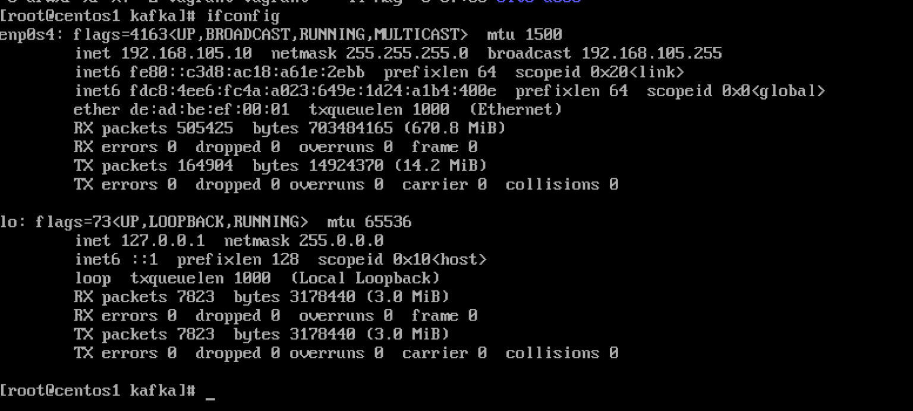

Continuing from where I left in the [blog]() before. If you are using looking to configure a static IP for your machines (may be your use case is similar to mine) this blog might be useful for you.

My system is a Apple M1 silicone and Virtualbox was not for me and I had to painfully find my way in the ocean.

> 💬 Have a look at [this](https://github.com/lima-vm/vde_vmnet) useful lib.

### Typical Usage

```text
> qemu-system-aarch64 ... -device virtio-net-pci,netdev=net0,mac=de:ad:be:ef:00:01 -netdev vde,id=net0,sock=/var/run/vde.ctl
```

> 💬 Steps I am using are mentioned [here](https://github.com/lima-vm/vde_vmnet#how-to-reserve-dhcp-addresses).

## Installation

- I built it from source so it was just following the steps mentioned in the `README.md`

```text
sudo make PREFIX=/opt/vde/ install
```

The PREFIX defines a path and can be any path to your liking, but the recommended one is `/opt/vde`

```text
> ls -als /opt/vde 
total 0
0 drwxr-xr-x   7 root  wheel  224 Aug 23 14:21 .
0 drwxr-xr-x  12 root  wheel  384 Aug 23 14:21 ..
0 drwxr-xr-x  15 root  wheel  480 Aug 24 14:48 bin
0 drwxr-xr-x   3 root  wheel   96 Aug 23 14:21 etc
0 drwxr-xr-x   7 root  wheel  224 Aug 24 14:48 include
0 drwxr-xr-x  19 root  wheel  608 Aug 24 14:48 lib
0 drwxr-xr-x   3 root  wheel   96 Aug 23 14:21 share
```

Install would two files of interest

- `/Library/LaunchDaemons/io.github.virtualsquare.vde-2.vde_switch.plist`
- `/Library/LaunchDaemons/io.github.lima-vm.vde_vmnet.plist`

My contents for `vde_vmnet.plist` are as under

```text
<!-- make install: yes -->
<plist version="1.0">
	<dict>
		<key>Label</key>
		<string>io.github.lima-vm.vde_vmnet.plist</string>
		<key>Program</key>
		<string>/opt/vde/bin/vde_vmnet</string>
		<key>ProgramArguments</key>
		<array>
			<string>/opt/vde/bin/vde_vmnet</string>
			<string>--vmnet-gateway=192.168.105.1</string>
			<string>/var/run/vde.ctl</string>
		</array>
		<key>StandardErrorPath</key>
		<string>/var/run/vde_vmnet.stderr</string>
		<key>StandardOutPath</key>
		<string>/var/run/vde_vmnet.stdout</string>
		<key>RunAtLoad</key>
		<true />
		<key>UserName</key>
		<string>root</string>
		<key>KeepAlive</key>
		<dict>
			<key>PathState</key>
			<dict>
				<key>/var/run/vde.pid</key>
				<true />
			</dict>
		</dict>
	</dict>
</plist>
```

By default the guest IP is assigned by the DHCP server provided for the Host, but the guest will be able to access the internet and will be accessible from the host.

### Reserve an IP

- Define a unique `MAC` address for the VM, e.g. `de:ad:be:ef:00:01`
- Select a reserved IP address, e.g. `192.168.105:10`
- Create a file `/etc/bootptab`

```text
%%
# hostname     hwtype  hwaddr              ipaddr          bootfile
centos1        1       de:ad:be:ef:00:01   192.168.105.10
centos2        1       de:ad:be:ef:00:02   192.168.105.20
centos3        1       de:ad:be:ef:00:03   192.168.105.30
```

- Reload the DHCP daemon

```text
sudo launchctl unload -w /System/Library/LaunchDaemons/bootps.plist
sudo launchctl load -w /System/Library/LaunchDaemons/bootps.plist
```

- Run the qemu machine with `-device virtio-net-pci,netdev=net0,mac=de:ad:be:ef:00:01`


