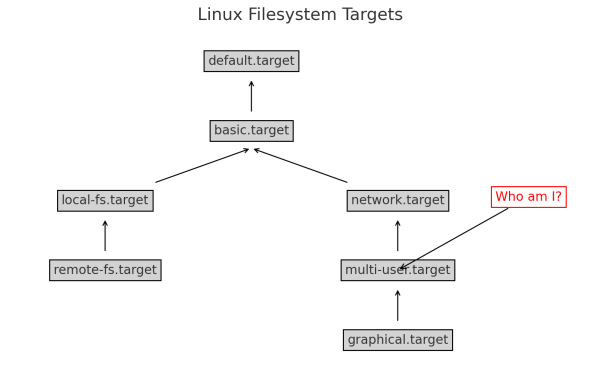
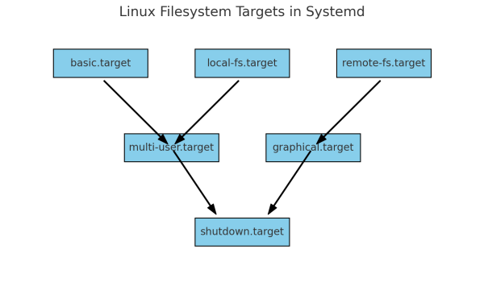

Linux, as an open-source operating system, has undergone significant transformations over the years. One of the critical components of modern Linux distributions is `systemd`, a system and service manager introduced to provide a more efficient and unified way of initializing and managing system resources. Central to systemd’s functionality are “targets,” which play a crucial role in orchestrating the boot process and managing system states. In this blog, we’ll explore the history of systemd targets, their usage, and how they function during the Linux boot process.

## Background

Before `systemd`, Linux systems primarily used the System V init (SysVinit) system for managing the boot process and system services. SysVinit relied on a series of scripts located in `/etc/rc.d` or `/etc/init.d` to start and stop services in a predefined sequence. However, SysVinit had several limitations, such as:

- **Lack of parallelism**: Services were started sequentially, leading to longer boot times.
- **Complex dependency management**: Dependencies between services were not handled efficiently, often requiring manual intervention.

To address these issues, systemd was introduced by Lennart Poettering and Kay Sievers in 2010. Systemd brought several improvements, including parallel service startup, on-demand service activation, and better dependency management. One of the innovative features of systemd is the concept of “targets.”

### What are Systemd Targets?

`Systemd` targets are special units that define system states and synchronization points. They are similar to `runlevels` in `SysVinit` but offer more flexibility and finer granularity. Targets group together units (services, mounts, sockets, etc.) and manage their activation to achieve a specific system state.

### Common `systemd` Targets

Some of the most commonly used systemd targets include:

- **`basic.target`**: The basic system target, which is a minimal environment with essential services.
- **`graphical.target`**: The target for systems with a graphical user interface, equivalent to `runlevel` 5 in SysVinit.
- **`multi-user.target`**: The target for non-graphical multi-user systems, equivalent to runlevel 3 in SysVinit.
- **`rescue.target`**: The target for single-user mode, used for system maintenance and recovery.
- **`shutdown.target`**: The target for shutting down the system.

#### Usage of Systemd Targets

Systemd targets are used to manage different states of the system, both during boot and while the system is running. They allow administrators to control which services and resources are available at any given time.

#### Listing All Targets

To list all available targets on a Linux system, you can use the following command:

```text
systemctl list-units --type=target --all
```

This command will display all active and inactive targets.

#### Starting a Specific Target

To switch to a specific target, such as `multi-user.target`, you can use the `systemctl isolate` command:

```text
sudo systemctl isolate multi-user.target
```

This command will stop all services not needed by the specified target and start the necessary ones.

#### Checking Dependencies

To view the units associated with a specific target, you can use the `list-dependencies` command:

```text
systemctl list-dependencies multi-user.target
```

This will display a tree of dependencies, showing which units are required by the target.



#### Systemd Targets in the Boot Process

During the Linux boot process, systemd uses targets to manage the transition from a powered-off state to a fully operational system. Here’s a simplified overview of how it happens:

1. **Initial Boot Phase**: When the system is powered on, the bootloader loads the Linux kernel into memory. The kernel then starts the initial ramdisk (`initramfs`), which prepares the system to mount the root filesystem.
2. **Systemd Initialization**: The kernel hands over control to systemd, which takes over the boot process. Systemd reads its configuration files and starts the necessary units to reach the initial target, typically `default.target`.
3. **Reaching `basic.target`**: Systemd first aims to reach `basic.target`, which includes essential services such as device management (`systemd-udevd`), file system mounts, and basic networking.
4. **Transition to `multi-user.target` or `graphical.target`**: Depending on the system configuration, systemd will then proceed to either `multi-user.target` for a non-graphical system or `graphical.target` for a graphical user interface. This involves starting additional services and units required for the specified target.
5. **Final System State**: Once the target is reached, the system is fully operational, and all necessary services are running. Users can log in and start using the system.
