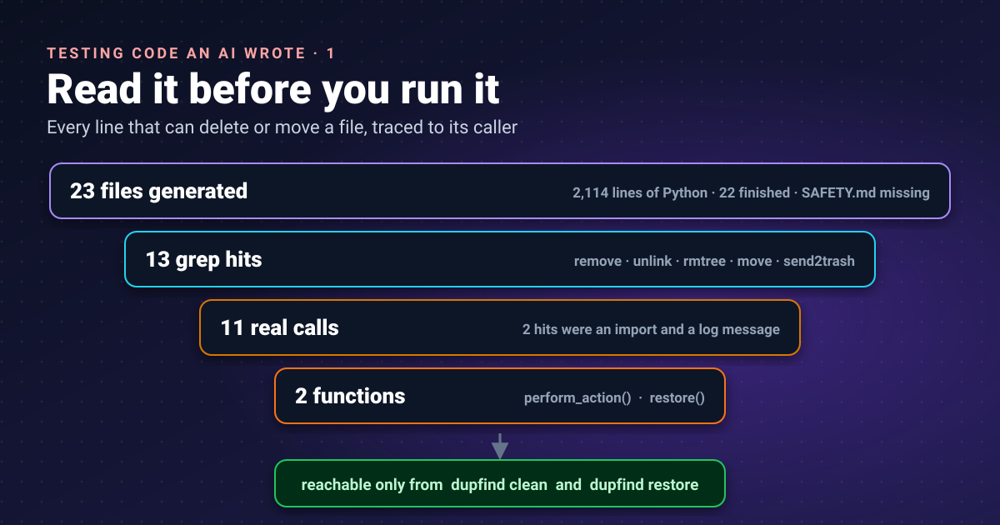
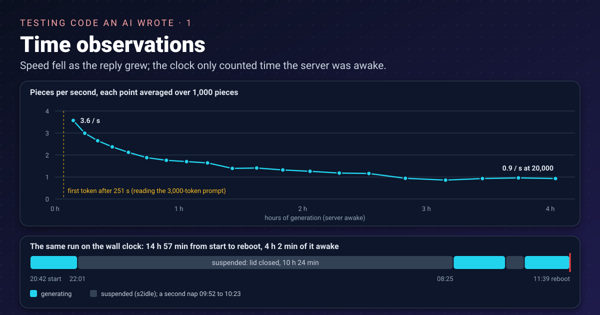


You would not plug in a USB stick you found in a car park. Code a model wrote for you deserves the same caution,
especially when its job is deleting files. Before running anything, I read the lines that can do damage.




## The app, and why it deserves suspicion

In [an earlier post]() I ran Qwen3-Coder 30B locally
through two engines, Colibri and Ollama. This time I gave it a bigger job: a 200-line specification for
**dupfind**, a command-line tool that finds duplicate and near-duplicate files and folders, then helps clean them up.
It has three commands:

| Command | What it does | Can it destroy anything? |
|---|---|---|
| `dupfind scan` | walks folders, hashes files, writes `report.json` and `report.html` | should not |
| `dupfind clean` | removes duplicates from a report: recycle bin, quarantine folder, or permanent delete | yes, by design |
| `dupfind serve` | a small local web page to tick which copies to remove and save a plan | should not |

The specification was strict about safety: dry-run by default, never remove the last copy, re-check every file
before acting, respect `--protect` patterns, never touch hard links, and refuse permanent deletion without
`--yes-really-delete`.

## How the code was made


No coding agent was involved. An agent such as Claude Code sends a preamble of about 19,500 tokens before your
question, and [on this hardware that alone took more than 84 minutes to read]().
Instead, the whole job was **one plain HTTP request**:

1. **The engine.** On a Linux server on my network (CPU only, 31 GB of RAM), Colibri 2.1 serves Qwen3-Coder 30B in
   its int4 build, listening on `127.0.0.1:8010` with a 40,960-token context, big enough for the 3,000-token
   specification plus a long reply. Colibri speaks the OpenAI-style API, so any HTTP client can talk to it.
2. **The client.** A 325-line Python script, `generate.py`, using only the standard library. It reads the
   specification, sends it as the only message, and appends each streamed piece to `raw.md` the moment it arrives,
   so a crash keeps everything received so far.
3. **Where it runs.** On the server too, next to the engine. I log in from my desktop with SSH, start it with
   `nohup` so closing the SSH window does not stop it, and watch the log with `tail -f`. An earlier attempt ran the
   client on my desktop; the desktop went to sleep and the reply was lost.

The request itself is small. This is what `generate.py` sends:

```python
body = {
    "model": "qwen3-coder-30b-a3b-colibri",
    "messages": [{"role": "user", "content": prompt}],   # the whole specification, once
    "max_tokens": 32000,
    "temperature": 0.2,
    "seed": 42,
    "stream": True,
    "stream_options": {"include_usage": True},
}
req = urllib.request.Request("http://127.0.0.1:8010/v1/chat/completions",
                             json.dumps(body).encode(), {"Content-Type": "application/json"})
```

With `"stream": True` the answer arrives as a long series of small `data:` lines, one piece of text each, instead of
one block at the end. Before the real run, a one-minute smoke test asked for a two-file project to prove the whole
pipeline: the engine answers, the context is big enough, the file markers come back, and the files extract.

### Time observations



The log prints a line every 250 pieces. A piece is one streamed chunk of text, usually about one token. These are
the numbers from the log:

| Observation | Value |
|---|---|
| Waiting for the first piece (the model reading the 3,000-token specification) | 251 s |
| Speed over the first 1,000 pieces | 3.6 pieces/s |
| Speed over the last 1,000 pieces | 0.9 pieces/s |
| Pieces when it stopped | about 20,000, in 22 complete files and 1 cut off |
| Generation time according to the log | 14,553 s, 4 h 3 min |
| Wall-clock time from start to reboot | 14 h 57 min |

Two things stand out.

**It slowed down as it wrote.** Every new token has to look back at everything before it, and the reply grew to
about 20,000 tokens on top of the prompt. By the end it wrote at a quarter of its opening speed. For comparison,
programs of about 2,000 tokens from the same model ran at about [3 tokens per second on my desktop]()
and a 1,500-token blog draft at [4.3 tokens per second on this server]().

**The log's clock skipped the nights.** The server is a laptop, and closing its lid suspended it twice: once from
22:01 to 08:25, and again for half an hour the next morning. The run survived both, because a suspended process is
frozen, not killed. The log's 4 hours matches the time the machine was actually awake (79 + 87 + 76 minutes), not
the 15 hours on the wall. That is because `generate.py` measures with Python's
[`time.perf_counter()`](https://docs.python.org/3/library/time.html), which on this server reads
`clock_gettime(CLOCK_MONOTONIC)`, and Linux documents that
[this clock "does not count time that the system is suspended"](https://man7.org/linux/man-pages/man2/clock_gettime.2.html).
Useful here, since it gives the true generation time, but worth knowing before you trust a duration in a log. The
run finally ended when the server was rebooted, with three files never started.

So I now had a folder of code I had never read, written by something that
[never says "I'm not sure"]().

## Before running anything

Running its tests would mean running its code. Test files are ordinary Python, with my permissions. So the first
step is not `pytest`. It is reading.

## Step 1: get the files out, safely

The model's reply is one long text file, `raw.md`, with each file between markers:

```text
=== FILE: dupfind/cleaner.py ===
...code...
=== END FILE ===
```

Counting the markers already tells a story:

```bash
grep -c "^=== FILE" raw.md        # 23 files started
grep -c "^=== END FILE" raw.md    # 22 files finished
```

The 23rd, `docs/DESIGN.md`, stops mid-sentence. The specification asked for 26 files, so three never started:
`docs/SAFETY.md`, `CHANGELOG.md` and a sample `dupfind.toml`. For a tool that deletes files, the missing one that
hurts is `SAFETY.md`: there is no written promise of what `clean` will and will not do. All the more reason to
read the code.

To turn the reply into files I used a 20-line script that only reads `raw.md` and only writes under `app/`:

```python
import pathlib, re

raw = pathlib.Path("raw.md").read_text()
pat = re.compile(r"^=== FILE: (.+?) ===\n(.*?)(?:^=== END FILE ===|(?=^=== FILE: )|\Z)", re.S | re.M)
for path, body in pat.findall(raw):
    p = pathlib.Path("app", path)
    if p.is_absolute() or ".." in p.parts:
        print("SKIPPED suspicious path:", path)
        continue
    p.parent.mkdir(parents=True, exist_ok=True)
    p.write_text(body)
    print("wrote", p)
```

The check on `..` and absolute paths matters. A reply could name a file `../../.bashrc`, and a naive extractor would
happily overwrite something outside the project. I ran it with `python3 -I extract.py`; the
[`-I` (isolated) option](https://docs.python.org/3/using/cmdline.html) keeps Python from loading modules from the
current folder or honouring `PYTHON*` environment variables, so a file in the folder cannot hijack an import.

Result: 23 files, no `SKIPPED` lines, and 2,114 lines of Python.

## Step 2: find every line that can delete or move a file

Python's standard library has a short list of calls that destroy or move files. Search for all of them:

```bash
grep -rnE "os\.remove|os\.unlink|\.unlink\(|rmtree|shutil\.move|os\.replace|os\.rename|send2trash" \
  --include=*.py .
```

| Call | Effect |
|---|---|
| `os.remove`, `os.unlink`, `Path.unlink` | deletes a file |
| `shutil.rmtree` | deletes a folder tree |
| `shutil.move`, `os.replace`, `os.rename` | moves a file, and can overwrite one |
| `send2trash` | sends a file to the recycle bin ([Send2Trash](https://pypi.org/project/Send2Trash/)) |

It found 13 lines:

```text
./tests/test_similar.py:24:        Path(temp_path1).unlink()
./tests/test_similar.py:25:        Path(temp_path2).unlink()
./tests/test_similar.py:42:        Path(temp_path1).unlink()
./tests/test_similar.py:43:        Path(temp_path2).unlink()
./tests/test_scan.py:101:        Path(temp_path).unlink()
./tests/conftest.py:13:    shutil.rmtree(temp_dir)
./dupfind/cleaner.py:210:                import send2trash
./dupfind/cleaner.py:211:                send2trash.send2trash(file_path)
./dupfind/cleaner.py:214:                logger.warning("send2trash not available, falling back to quarantine")
./dupfind/cleaner.py:218:                    shutil.move(file_path, dest)
./dupfind/cleaner.py:227:            shutil.move(file_path, dest)
./dupfind/cleaner.py:232:            os.remove(file_path)
./dupfind/cleaner.py:256:                    shutil.move(new_path, original_path)
```

Two are not actions at all: line 210 only imports the library and line 214 is a log message that mentions it. That
leaves **11 real calls**, six in the tests and five in the cleaner.

## Step 3: which function holds each call, and who calls that?

A delete is only as dangerous as the path that reaches it. First, list the functions and their starting lines:

```bash
grep -n "^def \|^    def " dupfind/cleaner.py
```

```text
15:def clean(
95:def process_group(
157:def select_keeper(files: List[Dict], policy: str) -> Dict:
184:def is_protected(path: str, protect_globs: List[str]) -> bool:
191:def perform_action(
243:def restore(log_file: str):
```

A line belongs to the last `def` above it, so lines 211 to 232 live in `perform_action` and line 256 in `restore`.
Then follow the callers upwards:

```bash
grep -rn "perform_action(\|restore(\|process_group(\|clean(" --include=*.py dupfind/
```

```text
dupfind/cli.py:126:        clean(
dupfind/cli.py:148:        restore(log_file=args.log)
dupfind/cleaner.py:72:            result = process_group(
dupfind/cleaner.py:146:        result = perform_action(
```

That is a clean chain, with nothing from the scanner, the reports or the web server joining it:

```text
command line (cli.py)
 ├─ clean()  →  process_group()  →  perform_action()  →  send2trash / move / remove
 └─ restore()                                          →  move back
```

The test deletes are safe for a different reason. The `temp_dir` fixture in `conftest.py` calls
[`tempfile.mkdtemp()`](https://docs.python.org/3/library/tempfile.html), which creates a fresh directory "readable,
writable, and searchable only by the creating user ID", and removes it with `rmtree` afterwards. The `unlink` calls
delete files the same test just created with `NamedTemporaryFile(delete=False)`. They only delete what they made.

## Step 4: anything else that runs, executes or phones home?

Deleting is not the only danger. Generated code could start other programs, run strings as code, or send your file
list somewhere. The specification said "no network calls, no telemetry", so check:

```bash
grep -rnE "subprocess|os\.system|os\.popen|eval\(|exec\(|urlopen|socket|requests\.|http\.client" \
  --include=*.py .
```

```text
./tests/test_web.py:39:            response = requests.get("http://127.0.0.1:8766/", timeout=1)
./tests/test_web.py:41:        except requests.exceptions.RequestException:
./dupfind/web.py:4:import socketserver
./dupfind/web.py:20:        """Handle GET requests."""
./dupfind/web.py:215:    with socketserver.TCPServer(("127.0.0.1", port), handler) as httpd:
```

The web server binds to `127.0.0.1`, and its test talks to that same address. Line 20 is my favourite: a docstring,
`Handle GET requests.`, matched the pattern `requests\.`. **grep matches text, not meaning.** It finds candidates;
you still look at each one.

## What this audit does not prove

A text search is a first filter, not a proof. It would miss `getattr(os, "rem" + "ove")`, a module imported under
another name, or a dependency that deletes things on the app's behalf. I accept that here because the author is a
model making honest mistakes, not an attacker hiding them. For code from a stranger, I would add a sandbox (a
container or a throwaway VM with no access to my files) on top of the reading.

It also says nothing about whether the deletes are *correct*. It only tells me where to look, and that it is safe
to install the app and run its tests inside temporary folders. That is part 2.

## Takeaways

- Treat generated code like a stranger's USB stick: read the destructive paths before running anything, tests included.
- Extract a model's reply with a script that refuses absolute paths and `..`, and run Python with `-I`.
- Run a long generation next to the engine, under `nohup`, with a client that saves each piece as it arrives; and
  check which clock a log uses before trusting its durations.
- Search for the short list of delete and move calls and trace each one up to its command; grep finds text, not
  intent, so expect false positives and treat a clean search as a filter, not a proof.
- A missing `SAFETY.md` is a finding in its own right for a tool that deletes files.

## References

- [Command line and environment: `-I`](https://docs.python.org/3/using/cmdline.html): Python documentation, what isolated mode removes from `sys.path` and the environment
- [tempfile: generate temporary files and directories](https://docs.python.org/3/library/tempfile.html): Python documentation, `mkdtemp()`, `TemporaryDirectory` and `NamedTemporaryFile(delete=False)` behaviour
- [time: time access and conversions](https://docs.python.org/3/library/time.html): Python documentation, `perf_counter()` uses the same clock as `monotonic()`, which is `clock_gettime(CLOCK_MONOTONIC)` on Linux
- [clock_gettime(2)](https://man7.org/linux/man-pages/man2/clock_gettime.2.html): Linux manual page, `CLOCK_MONOTONIC` does not count time the system is suspended; `CLOCK_BOOTTIME` does
- [Send2Trash](https://pypi.org/project/Send2Trash/): PyPI, what the recycle-bin library does and which platforms it supports
- [Qwen3-Coder](https://github.com/QwenLM/Qwen3-Coder): QwenLM on GitHub, the model family that wrote the app

Earlier on this site: [Ollama or Colibri? A beginner's comparison](),
[Colibri on my desk: a 30B model writes a network scanner]()
(the earlier speed measurements) and [Can a local 30B model write my blog?]().
