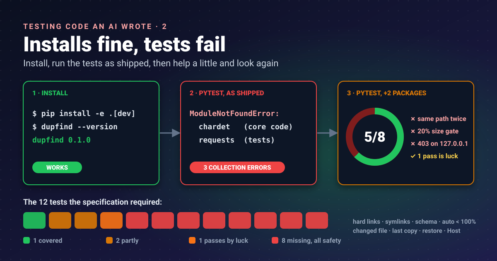


A recipe that forgets to list the eggs still reads well. You only find out when you start cooking. The app the model
wrote installed without a complaint; its own tests could not even start.




In [part 1]() I read every line of the generated
**dupfind** app that can delete or move a file, and found they are reachable only from its `clean` and `restore`
commands. That made it safe to install the app and run its tests, as long as everything happens in temporary folders.

## Step 1: a throwaway environment

A [virtual environment](https://docs.python.org/3/library/venv.html) is a private copy of Python's package folder.
Whatever the app installs lands there, not in the system Python, and deleting the folder undoes it all.

```bash
cd ~/lab/app
python3 -m venv .venv
. .venv/bin/activate
pip install -e ".[dev]"
dupfind --version
```

```text
dupfind 0.1.0
```

`-e` installs in editable mode (the package points at the source folder, so edits take effect without
reinstalling), and `[dev]` adds the project's development extra, which the model declared as `pytest` and `pylint`.
So far, so good.

## Step 2: run its own tests, exactly as shipped

```bash
pytest -q -p no:cacheprovider
```

```text
ERROR tests/test_scan.py
ERROR tests/test_similar.py
ERROR tests/test_web.py
!!!!!!!!!!!!!!!!!!! Interrupted: 3 errors during collection !!!!!!!!!!!!!!!!!!!!
```

No test ran. pytest imports each test file before running it ("collection"), and three imports failed:

```text
dupfind/similarity.py:7: in <module>
    import chardet
E   ModuleNotFoundError: No module named 'chardet'

tests/test_web.py:7: in <module>
    import requests
E   ModuleNotFoundError: No module named 'requests'
```

`pip` installs exactly what a project declares, nothing more. The
[`dependencies` list in `pyproject.toml`](https://packaging.python.org/en/latest/guides/writing-pyproject-toml/)
is the contract, and the model's version declares only one package, `send2trash`, and only on Windows:

```toml
dependencies = [
    "send2trash; sys_platform == 'win32'",
]
```

So `import chardet` in the core code and `import requests` in the tests worked on whatever machine the model
"remembers" from training, and nowhere else. It is the classic "works on my machine", from an author who has no
machine.

There is a second problem. The specification said, in bold, that core features use the **standard library only**,
and listed the modules allowed. `chardet` (a character-encoding guesser) is not one of them. The right fix is not to
add it to `dependencies`; it is to remove it.

## Step 3: help it a little, and look again

To see what the tests themselves say, I installed the two missing packages by hand. This is no longer "as
shipped", so I record both results separately.

```bash
pip install chardet requests
pytest -q -p no:cacheprovider -rA
```

```text
PASSED tests/test_clean.py::test_clean_dry_run
PASSED tests/test_folders.py::test_scan_folders
PASSED tests/test_scan.py::test_scan_exact_duplicates
PASSED tests/test_scan.py::test_hash_file
PASSED tests/test_similar.py::test_calculate_similarity
FAILED tests/test_scan.py::test_scan_same_name_different_content - assert 0 == 1
FAILED tests/test_similar.py::test_calculate_similarity_different - Assertion...
FAILED tests/test_web.py::test_web_serve - assert 403 == 200
3 failed, 5 passed in 0.25s
```

Each failure is a different kind of bug.

### Failure 1: a test that tests nothing

```python
file1 = temp_dir / "test.txt"
file2 = temp_dir / "test.txt"
file1.write_text("Hello world")
file2.write_text("Different content")
```

Two variables, one path. The second write overwrites the first, so there is only one file and no "same name,
different content" pair to find. The app is right to report zero groups; **the test is wrong**. Same-name files
have to live in different folders.

### Failure 2: the code and its test disagree

```text
assert result["method"] == "line-jaccard"
AssertionError: assert 'none' == 'line-jaccard'
```

The test compares two short text files, 25 and 31 bytes. Before measuring similarity, the code bails out if the
sizes differ by more than 20%:

```python
if abs(size1 - size2) > size1 * 0.2:
    return {"match_percent": 0, "name_percent": 0, "method": "none"}
```

Six bytes is 24% of 25, so the pair is skipped. Nothing in the specification asks for this shortcut; it defines
similarity by shared lines. Here **the code is wrong** for small files, and the test caught it.

### Failure 3: the app refuses its own address

```text
response = requests.get("http://127.0.0.1:8766/", timeout=1)
assert 403 == 200
```

The web server prints `Serving at http://127.0.0.1:8766`, and then refuses that exact address with 403 Forbidden.
Its "is this really localhost?" check is wrong in a way that matters for security too. That gets its own post, part 4.

## The passes deserve suspicion too

Five green results look reassuring until you compare them with what was asked for. The specification listed twelve
behaviours the tests must cover. Here is how the eight tests map onto them:

| Required by the specification | Covered? |
|---|---|
| exact duplicate groups found | yes |
| similar-file match % equals the definition for a known pair | partly (identical files only) |
| nested duplicate folders collapsed to the top pair | a folder test exists, nesting not checked |
| dry-run changes nothing, checked by hashing the tree | **passes, for the wrong reason** (part 3) |
| hard links not reclaimable | no |
| symlinks not followed by default | no |
| JSON report validates against the schema | no |
| auto mode refuses matches under 100% | no |
| a file changed after the scan is skipped | no |
| the last copy is never removed | no |
| quarantine then restore round-trips | no |
| `serve` rejects a foreign Host header | no (the test checks the opposite case, and fails) |

Every "no" is a safety behaviour. The tests the model chose to write are the easy, happy-path ones; the tests that
would protect my files are the ones it skipped.

## Takeaways

- Install generated code in a throwaway virtual environment; `pip install` succeeding proves very little.
- Run the test suite exactly as shipped first and record it, then record any help you give separately.
- Undeclared imports are the generated-code version of "works on my machine"; compare imports with `dependencies`.
- When a test fails, decide who is wrong: here one test, one piece of code, and one security check.
- Map tests to the specification, not to the code: the missing ones were all about safety.

## References

- [venv: creation of virtual environments](https://docs.python.org/3/library/venv.html): Python documentation, what a virtual environment isolates
- [Writing your pyproject.toml](https://packaging.python.org/en/latest/guides/writing-pyproject-toml/): Python Packaging User Guide, `dependencies` and `optional-dependencies` (extras)
- [How to use temporary directories and files in tests](https://docs.pytest.org/en/stable/how-to/tmp_path.html): pytest documentation, the `tmp_path` fixture as the standard way to give each test its own folder
- [Qwen3-Coder](https://github.com/QwenLM/Qwen3-Coder): QwenLM on GitHub, the model family that wrote the app

Previous part: [Read it before you run it]().
