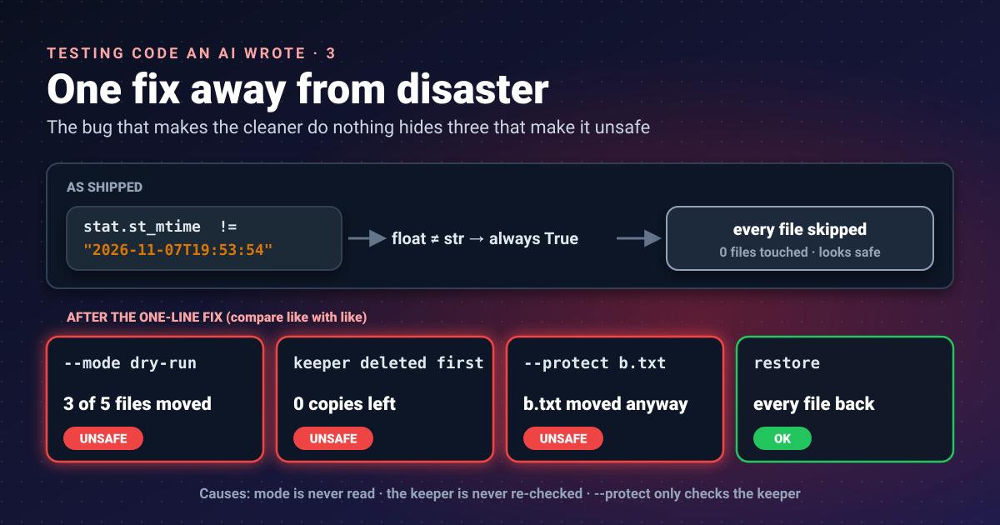


A smoke alarm with no battery never goes off, which looks a lot like a house that never catches fire. The cleaner
the model wrote has never deleted anything. That is not because it is safe.




In [part 2]() the generated **dupfind** app passed
5 of its 8 tests. One of the passes was `test_clean_dry_run`, which checks that `--mode dry-run`, the default,
changes nothing. This post is about why it passes.

## The comparison that is never true

Before acting on a file, the cleaner is supposed to re-check that it has not changed since the scan. That is a good
idea, and the specification asked for it. Here is the check, in `cleaner.py`:

```python
stat = file_path.stat()
if stat.st_size != file_info["size_bytes"]:
    logger.warning(f"File {file_path} size changed")
    continue
if stat.st_mtime != file_info["modified"]:
    logger.warning(f"File {file_path} modification time changed")
    continue
```

And here is how the scanner wrote `modified` into the report:

```python
"modified": time.strftime("%Y-%m-%dT%H:%M:%S", time.gmtime(file_path.stat().st_mtime)),
```

One side is [`st_mtime`](https://docs.python.org/3/library/os.html#os.stat_result), a float number of seconds such as
`1794081234.5521`. The other is a string such as `"2026-11-07T19:53:54"`. In Python a float never equals a string,
so the condition is always true and **every file is skipped**, whatever the mode.

I confirmed it with a real scan of a test folder followed by `--mode auto --action quarantine`: every file stayed
where it was, and the log said "modification time changed" for each one.

That also explains the passing test. `test_clean_dry_run` writes a made-up `"modified": "2023-01-01T00:00:00Z"`
into its report, the cleaner skips both files for having "changed", and the assertion "both files still exist"
holds. **The test passes because the code is broken, not because dry-run works.**

## Fix one line, then look again

Anyone using this tool would hit the bug on day one and fix it: compare like with like. To see what that fix would
reveal, I simulated it by writing each file's real `st_mtime` into the report, then ran probes, each in a fresh
temporary folder:

| Probe | What happened |
|---|---|
| `--mode dry-run` (the default) | **3 of 5 files moved to quarantine** |
| keeper deleted after the scan, then `--mode auto` | **every remaining copy moved; 0 copies left** |
| `--protect b.txt`, where `b.txt` is not the keeper | **`b.txt` moved anyway** |
| `--protect "*.cfg"`, where the keeper is a `.cfg` | group skipped (safe) |
| quarantine, then `dupfind restore` | every file back (works) |

Three of the specification's safety rules break at once. Each has a simple cause.

### Dry-run is not dry

The `process_group` function receives `mode` and never reads it. A quick way to find parameters like that is to ask
Python's own parser:

```python
import ast
tree = ast.parse(open("dupfind/cleaner.py").read())
for f in tree.body:
    if isinstance(f, ast.FunctionDef):
        used = {n.id for n in ast.walk(f) if isinstance(n, ast.Name)}
        print(f.name, [a.arg for a in f.args.args if a.arg not in used])
```

```text
process_group ['mode']
perform_action ['log_file']
```

A parameter that is accepted and never used is a promise the code does not keep. Here the promise is "dry-run
changes nothing".

### Nothing guards the last copy

The keeper is the copy the tool chooses to keep. The code skips it when acting on the others:

```python
if file_info["path"] == keeper["path"]:
    continue  # Skip keeper
```

It never checks that the keeper still exists. If you delete or move it after the scan, the cleaner removes every
other copy as well, and the file is gone from that folder tree. The specification said: "re-check that the file and
its keeper still exist".

### Protection only covers the keeper

```python
if is_protected(keeper["path"], protect_globs):
    logger.warning(f"Keeper {keeper['path']} is protected, skipping group")
    return action_log
```

That is the only call to `is_protected`. A protected file that is not the keeper is never checked. The
specification said: "`--protect GLOB` paths are never touched".

## What the fix looks like

None of this is hard. The loop over files needs three more checks and one honest dry-run:

```python
keeper_path = Path(keeper["path"])
if not keeper_path.exists() or not unchanged(keeper_path, keeper):
    logger.warning(f"Keeper {keeper_path} missing or changed, skipping group")
    return action_log

for file_info in files:
    if file_info["path"] == keeper["path"]:
        continue
    if is_protected(file_info["path"], protect_globs):
        continue                                  # protect every file, not just the keeper
    if not unchanged(Path(file_info["path"]), file_info):
        continue                                  # size, mtime_ns and (for exact groups) sha256
    if mode == "dry-run":
        print(f"would {action}: {file_info['path']}")
        continue                                  # really change nothing
    action_log.append(perform_action(...))
```

For the date itself, store [`st_mtime_ns`](https://docs.python.org/3/library/os.html#os.stat_result) (an integer of
nanoseconds) in the report and compare integers. A float can lose precision, and a string with whole seconds cannot
tell two edits a second apart. The specification also asked to re-hash both files for exact groups, which is the
check that cannot be fooled by a preserved date.

## The test that would have caught it

The specification described this test in one line: "dry-run changes nothing (compare a hash of the tree before and
after)". The model wrote a weaker one that only checks the files still exist. Here is the stronger version, using
pytest's [`tmp_path`](https://docs.pytest.org/en/stable/how-to/tmp_path.html) fixture:

```python
import hashlib, json, os, subprocess, sys
from pathlib import Path
from dupfind.cleaner import clean

def tree_hash(root: Path) -> str:
    h = hashlib.sha256()
    for p in sorted(root.rglob("*")):
        if p.is_file():
            h.update(str(p.relative_to(root)).encode())
            h.update(p.read_bytes())
    return h.hexdigest()

def run(tmp_path, fix_mtime):
    root = tmp_path / "tree"
    root.mkdir()
    for name in ("a.txt", "b.txt", "c.txt"):
        (root / name).write_text("same content\n" * 50)
    out = tmp_path / "out"
    subprocess.run([sys.executable, "-m", "dupfind", "scan", str(root), "--out", str(out)],
                   check=True, capture_output=True)
    report = json.loads((out / "report.json").read_text())
    if fix_mtime:                                 # simulate the one-line fix
        for group in report["file_groups"]:
            for f in group["files"]:
                f["modified"] = os.stat(f["path"]).st_mtime
    used = out / "used.json"
    used.write_text(json.dumps(report))
    before = tree_hash(root)
    clean(report_path=str(used), mode="dry-run", action="quarantine",
          quarantine_dir=str(tmp_path / "quarantine"))
    assert tree_hash(root) == before, "dry-run changed the tree"

def test_dry_run_as_shipped(tmp_path):
    run(tmp_path, fix_mtime=False)

def test_dry_run_after_mtime_fix(tmp_path):
    run(tmp_path, fix_mtime=True)
```

```text
FAILED test_dry_run_hash.py::test_dry_run_after_mtime_fix - AssertionError: dry-run changed the tree
1 failed, 1 passed in 0.18s
```

Hashing names and contents catches any change, whether a file was moved, deleted, renamed or edited. The test does
not care *how* dry-run went wrong, only that the folder is not byte-for-byte the same. That is the kind of test to
write for any command that promises to change nothing.

## Takeaways

- A destructive tool that never acts is not safe; it is broken in a way that hides other bugs.
- When a bug disables a dangerous path, simulate the obvious fix and test again before trusting anything.
- Look for parameters that are accepted and never used: each one is a promise the code may not keep.
- Test "changes nothing" by hashing the whole tree before and after, not by checking that a few files exist.
- Compare file times as integers (`st_mtime_ns`), and re-hash when it matters.

## References

- [os.stat_result](https://docs.python.org/3/library/os.html#os.stat_result): Python documentation, `st_mtime` (float seconds) and `st_mtime_ns` (integer nanoseconds)
- [ast: abstract syntax trees](https://docs.python.org/3/library/ast.html): Python documentation, parsing source to find unused parameters
- [How to use temporary directories and files in tests](https://docs.pytest.org/en/stable/how-to/tmp_path.html): pytest documentation, the `tmp_path` fixture used in the test

Previous parts: [Read it before you run it]() and
[It installs fine, but its own tests fail]().
