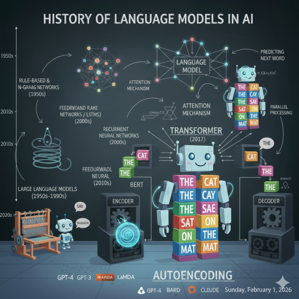

## A Brief History

The story of modern language models is like watching a family tree grow, with each new generation learning from the triumphs and mistakes of those who came before. Let’s trace this fascinating journey from 2017 to today.

## **2017: The Transformer Revolution**

The story begins with a research paper titled “Attention Is All You Need.” Google researchers introduced the transformer architecture; that attention mechanism we talked about [here](). This was the foundation, the fertile soil from which two very different family trees would grow.

## **2018: The Split – [Two Families]() Emerge**

### **The GPT Family (Auto-Regressive Line)**

In June 2018, OpenAI introduced **GPT** (Generative Pre-trained Transformer). This was Gen’s family; the auto-regressive storytellers. GPT learned by predicting the next word, making it naturally gifted at writing and generation.

- **GPT-2** (2019): Bigger and more capable, so good at generating text that OpenAI initially hesitated to release it publicly
- **GPT-3** (2020): A massive leap; 175 billion parameters, could write convincingly human-like text
- **ChatGPT** (2022): GPT-3.5 with conversational training, the model that brought AI into mainstream consciousness
- **GPT-4** (2023): Multimodal, more capable, more reliable

### **The BERT Family (Auto-Encoding Line)**

Six months later, in October 2018, Google dropped a bombshell: **BERT** (Bidirectional Encoder Representations from Transformers). This was Bert’s family; the auto-encoding comprehension experts.

BERT was revolutionary because it could read in both directions simultaneously. Unlike GPT, which only saw words to the left, BERT saw the entire sentence. This made it phenomenal at understanding context.

**The impact:** BERT didn’t just improve AI research; it transformed Google Search overnight, helping it understand the nuances of billions of queries.

## **2019: The BERT Dynasty Expands**

BERT’s success sparked a gold rush. Researchers around the world asked: “How can we make BERT even better?” This led to an explosion of variants:

### **RoBERTa** (July 2019) – “BERT, But Optimized”

Facebook AI (now Meta) realized BERT’s training could be improved. **RoBERTa** (Robustly optimized BERT approach) kept the same architecture but trained longer, with more data, larger batches, and removed BERT’s “next sentence prediction” task that turned out to be unnecessary.

**The result:** RoBERTa outperformed BERT on almost every benchmark. It was like taking the same student and giving them a better curriculum.

### **XLNet** (June 2019) – “The Best of Both Worlds”

Researchers at Carnegie Mellon and Google Brain thought: “What if we could combine auto-regressive and auto-encoding?”

**XLNet** introduced “**permutation language modeling**“—imagine shuffling the order of words during training, so the model learns to predict words in all possible orders, not just left-to-right or with random masks.

**The innovation:** XLNet could capture bidirectional context (like BERT) while using auto-regressive training (like GPT). It outperformed BERT on many tasks, though it was more complex to train.

### **ALBERT** (September 2019) – “BERT on a Diet”

Google Research asked: “Can we make BERT smaller and faster without losing performance?”

**ALBERT** (A Lite BERT) used clever tricks like sharing parameters across layers and factorizing embeddings. It achieved similar performance to BERT but was much lighter—crucial for running on devices with limited resources.

### **Sentence-BERT / SBERT** (August 2019) – “BERT for Similarity”

Researchers realized BERT had a weakness: it was slow at comparing sentences. If you wanted to find similar documents among thousands, BERT would need to compare each pair individually; computationally expensive.

**SBERT** modified BERT to create meaningful sentence embeddings; numerical representations of entire sentences. This made it lightning-fast at finding similar content.

**Real-world use:** SBERT powers semantic search engines, **plagiarism detection**, recommendation systems, and any application where you need to find “things like this.”

### **DistilBERT** (October 2019) – “BERT for Your Phone”

Hugging Face created a student that learned from BERT as a teacher. **DistilBERT** retained 97% of BERT’s performance while being 40% smaller and 60% faster.

**Why it matters:** This made BERT practical for mobile apps and real-time applications.

## **2020-2021: The Scaling Era**

The field realized: bigger is often better. Models grew exponentially:

- **T5** (Text-to-Text Transfer Transformer): Google unified all NLP tasks as text-to-text problems
- **GPT-3**: Showed that scale alone could unlock impressive capabilities
- **ELECTRA**: More efficient training by predicting which tokens are real vs. generated
- **DeBERTa**: Microsoft’s improved BERT with disentangled attention

## **2022-2023: The Generative AI Explosion**

The auto-regressive family (GPT line) took center stage:

- **ChatGPT** made AI conversational and accessible to everyone
- **GPT-4** brought multimodal understanding
- **Claude**, **Gemini**, **LLaMA** joined the conversation

## **Why BERT’s Family Still Matters**

Here’s the interesting part: while ChatGPT and generative models dominate headlines, BERT’s descendants still quietly power much of the internet:

- **Search engines** use BERT-family models to understand queries
- **Email filters** use them to detect spam
- **Customer service bots** use them to route questions
- **Content moderation** systems use them to flag problematic content
- **Recommendation engines** use SBERT to find similar content

## **The Current Landscape**

Today’s AI ecosystem is diverse:

**For Generation (Creating Content):**

- GPT-4, Claude, Gemini, LLaMA; auto-regressive models that write, converse, and create

**For Understanding (Analyzing Content):**

- RoBERTa, DeBERTa, SBERT; auto-encoding models that read, classify, and comprehend

**For Everything:**

- T5, BART, newer unified models that can both understand and generate

## **The Lesson**

Each model in this family tree taught us something valuable:

- **BERT** showed us bidirectional understanding matters
- **RoBERTa** proved that training details matter as much as architecture
- **XLNet** demonstrated you can merge different approaches
- **ALBERT & DistilBERT** showed that efficiency matters for real-world deployment
- **SBERT** reminded us that specialized adaptations solve specific problems
- **GPT** proved that generation at scale unlocks emergent capabilities

The race continues. Every few months, a new model pushes the boundaries further. But they all stand on the shoulders of that 2017 transformer paper and the two families; Gen and Bert – who learned language in their own unique ways.

And that’s how we got from “Attention Is All You Need” to AI that can write blogs, analyze sentiment, translate languages, and have conversations that feel remarkably human.
