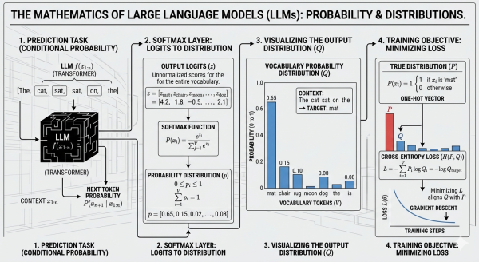

From "what is autocomplete?" to the full mathematics powering Claude Sonnet 4.6; with history, intuition, worked examples and cheatsheet.

## Language is just very smart autocomplete

You already use this technology every day. When you type "Happy birth" on your phone, the keyboard suggests "day." It learned, from billions of messages, that "birthday" almost always follows "Happy birth." That's the seed of every language model ever built; **predict the most likely next word given everything that came before.**

ChatGPT, Gemini, Claude - all of them are doing this same thing, just at a staggering scale: a vocabulary of ~100,000 possible tokens, probability computed 30-100 times per second, across thousands of words of context. The difference between your phone keyboard and Claude isn't the concept, it's the depth of the learned patterns.

### The weighted dice mental model

Imagine a bag of 100,000 dice, each labeled with a different word. Before each roll, the model adjusts the weight of every die based on what came before. If the previous words are "The Eiffel Tower is located in", the die labeled "Paris" gets very heavy. The die labeled "banana" gets almost weightless. Then the model rolls - and that's your next word.


**Key insight:** The model never "knows" the answer - it only knows the statistical distribution of likely continuations. "Paris" wins not because the model looked it up, but because in training data, "Paris" followed "Eiffel Tower is in" the vast majority of the time.


---


**Real numbers from Claude Sonnet 4.6:** When generating responses, Claude is sampling from a distribution over its vocabulary at every single step. A typical response of 300 words involves ~300 such draws from distributions with ~100k candidates each. That's 30 million probability evaluations per response.

