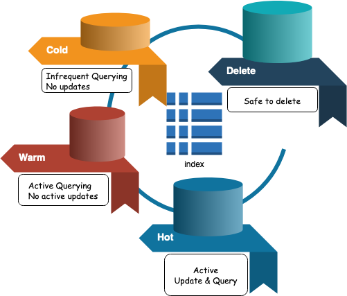
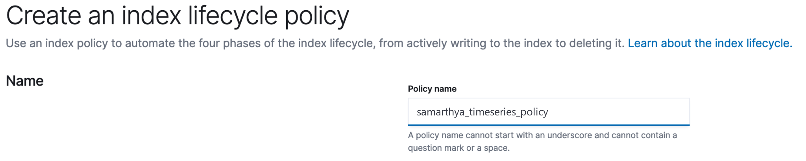
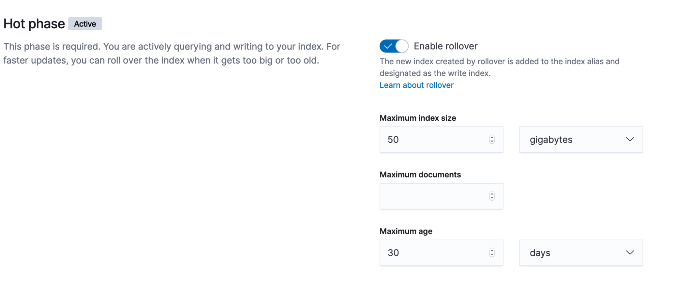
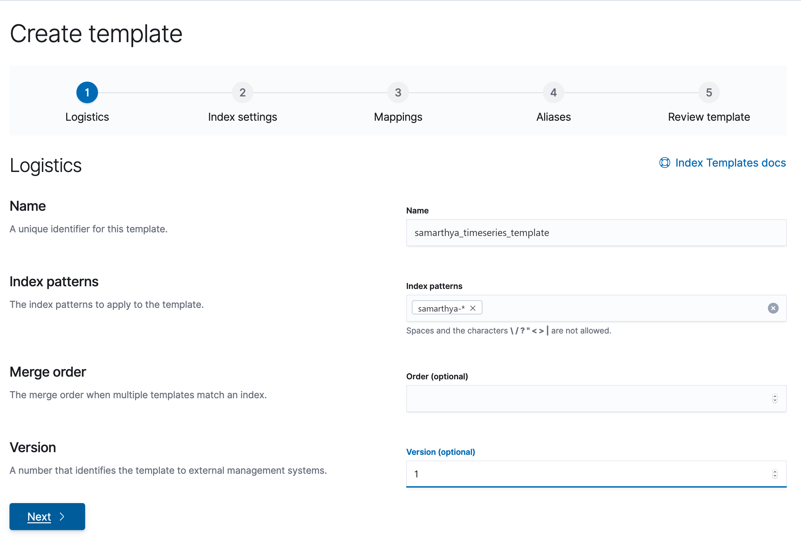
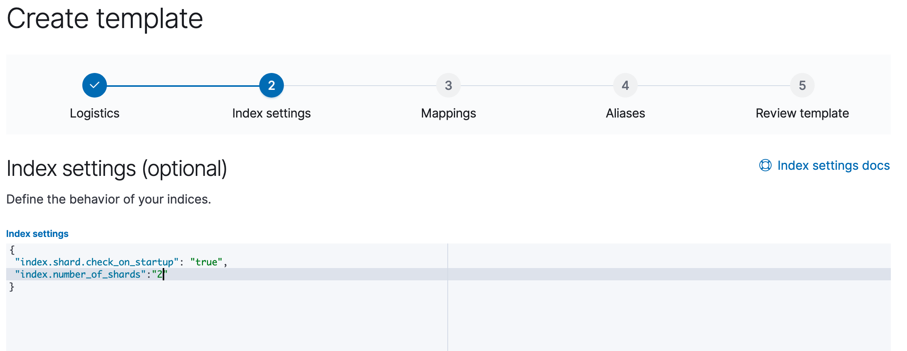
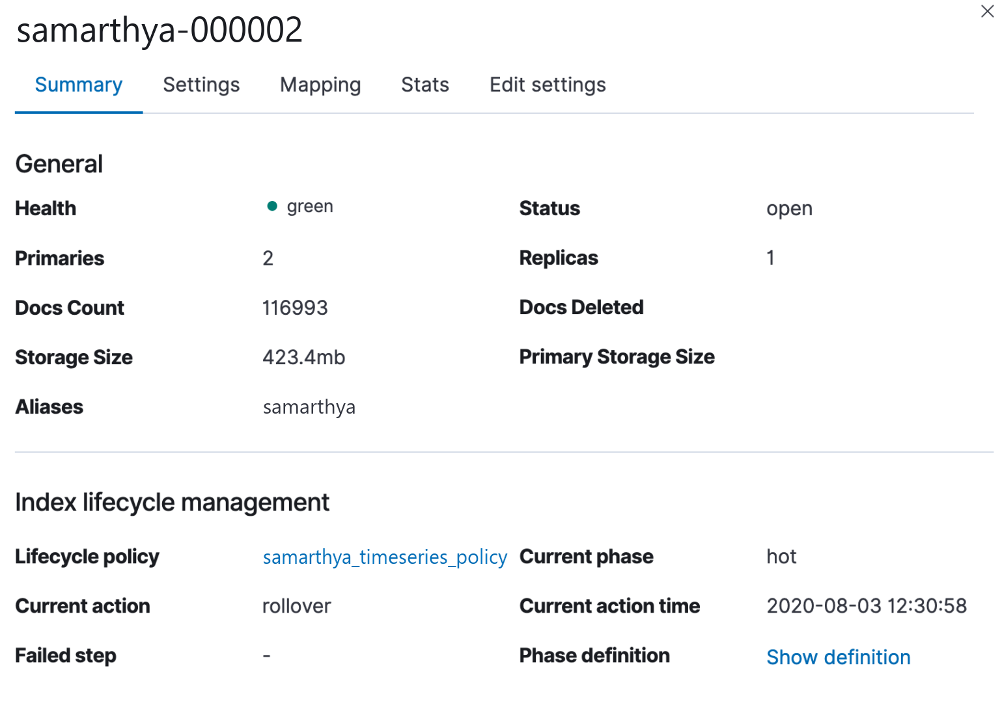

Timeseries is a data stream that is defined for a set of fields over a time period. Some examples may include, daily attendance register for an organization, wherein people punching in every-morning will be different, missing mostly for weekends or on planned and unplanned leaves.

In the context of `elasticsearch` timeseries data can be a `filebeat` index, continually pumping in system logs, which record all the active processes activity.

> Shard allocation is the process of allocating shards to nodes.

If a index is used for long time and the `ingestion rate` is heavy, it might be large and in-effective way of data storage, fortunately in `elasticsearch` there are many recommendations that when followed allow to keep data and search optimized.

> To meet your indexing and search performance requirements and manage resource usage, you write to an index until some threshold is met and then create a new index and start writing to it instead.

ILM - Index Lifecycle Management allows an admin or a user of `elasticsearch` define policies to manage indices according to performance, resiliency, and retention requirements. ILM facilitates easier management of indices in hot-warm-cold architectures. Some of the actions that can be refined are

- The `maximum shard size`, `number of documents`, or `age` at which you want to roll over to a new index.
- The point at which the `index` is no longer being updated and the number of primary shards can be reduced.
- The point at which the index can be moved to less performant hardware.
- When the `index` can be safely deleted.

Three components of ILM are

- Index Lifecycle
- Rollover &
- Policy updates

Which I will discuss in detail in subsequent sections.

## Index Lifecycle

Every index has 4 phases as explained below



Each phase shown above has a defined `age` associated with it (by default if not specified is zero)

ILM moves indices through the `lifecycle` according to their age. To control the timing of these transitions, you set a *minimum age* for each phase.

For an index to move to the next phase, all actions in the current phase must be complete and the index must be older than the minimum age of the next phase.

Index lifecycle policy defines which phase is active and what actions to take in each phase and while transitioning.


You can manually apply a lifecycle policy when you create an index.


ILM supports following actions in each phase

| **Actions** | **Phase** |
| --- | --- |
| SetPriority | Hot, Warm, Cold |
| Unfollow | Hot, Warm, Cold |
| Rollover | Hot |
| Read-Only | Warm |
| Allocate | Warm, Cold |
| Shrink | Warm |
| Force Merge | Warm |
| Freeze | Cold |
| Wait For Snapshot | Delete |
| Delete | Delete |

## Rollover

Rollover is a strategy that allows you to optimize your index, storage strategy. It relies on

- Index Template
- Index Alias
- Active-write Index.

Using rollover indices enables

- Optimize high ingestion rate for an index on a designated `hot` and performant nodes.
- Optimize search performances on `warm` nodes.
- Shift older and infrequent access data to `cold` nodes.
- Delete irrelevant and old data.


When a rollover is triggered, a new index is created, the write alias is updated to point to the new index, and all subsequent updates are written to the new index.


Rolling over to a new index based on size, document count, or age is preferable to time-based rollovers.

## Policy updates

Policy allows you to control how to manage the lifecycle of an index or collection of rolling indices.


To ensure that policy updates don’t put an index into a state where it can’t exit the current phase, the phase definition is cached in the index metadata when it enters the phase. This cached definition is used to complete the phase.


When the index advances to the next phase, it uses the phase definition from the updated policy.

When the policy is updated it is not immediately visible to the executing phase, and till the point the current phase using the cached definition from the previous policy is completed.

## Example


When you continuously index timestamped documents into Elasticsearch, you typically use an index alias so you can periodically roll over to a new index.


Let's try and create a sample ILM strategy for my index. I have `elasticsearch` 7.6.2 installed on my local box, and will define only two phases Hot - Where data will be indexed actively with max age 5-days, and straightaway Delete phase - which will delete any older than 10 days rolled over data.

By default the index once created enters in hot phase.


The `min_age` defaults to `0ms`, so new indices enter the `hot` phase immediately


### Step 1 - Create Policy



A `lifecycle` is about actions to take for the defined 4 phases.

- hot
- warm
- cold
- delete

### Defining Hot Phase



For out example I have defined for the rollover strategy

| Maximum Size | 2 GB |
| --- | --- |
| Maximum Documents | 1000 |
| Maximum Age | 5 days |

If any of the above conditions are met, rollover will be triggered.

I am leaving the priority default - 100.



For `delete` phase the `min_age` is 10 days.


The same policy cab be applied as under using HTTP request.

```text
PUT _ilm/policy/samarthya_timeseries_policy
{
  "policy": {
    "phases": {
      "hot": {
        "actions": {
          "rollover": {
            "max_age": "5d",
            "max_size": "2gb",
            "max_docs": 1000
          },
          "set_priority": {
            "priority": 100
          }
        }
      },
      "delete": {
        "min_age": "10d",
        "actions": {
          "delete": {}
        }
      }
    }
  }
}
```

### Step 2 - Create index template

Will define Index Pattern, Index Alias & Index Settings.



Equivalent API representation

```text
PUT _template/samarthya_timeseries_template
{
  "version": 1,
  "index_patterns": [
    "samarthya-*"
  ],
  "settings": {
    "index.shard.check_on_startup": "true",
    "index.number_of_shards": "2",
    "index.lifecycle.name": "samarthya_timeseries_policy",
    "index.lifecycle.rollover_alias": "samarthya"
  },
  "mappings": {
    "_source": {
      "enabled": true,
      "includes": [],
      "excludes": []
    },
    "_meta": {},
    "_routing": {
      "required": false
    },
    "dynamic": true,
    "numeric_detection": false,
    "date_detection": true,
    "dynamic_date_formats": [
      "strict_date_optional_time",
      "yyyy/MM/dd HH:mm:ss Z||yyyy/MM/dd Z"
    ],
    "dynamic_templates": [],
    "properties": {}
  }
}
```



Bootstrapping initial index

```text
PUT samarthya-000001
{
  "aliases": {
    "samarthya": {
      "is_write_index": true
    }
  }
}
```

When the rollover conditions as defined by us are met, it will create a new index `samarthya-000001` and as it matches the pattern `samarthya-*` the template settings will be applied.

```text
"index_patterns": [
    "samarthya-*"
  ],
```

Once it `rollsover` the new index will be designated as the write index and will make the bootstrap index read-only.

### How to search over multiple indices?

The index rollover process continues which results in multiple indices being created, to perform query you can use the alias `samarthya` that was defined

```text
GET samarthya/_search
{
  "size": 2, 
  "query": {
    "match_all": {}
  }
}
```



To get the progress you can use

```text
GET samarthya-*/_ilm/explain
```

```text
{
  "indices" : {
    "samarthya-000002" : {
      "index" : "samarthya-000002",
      "managed" : true,
      "policy" : "samarthya_timeseries_policy",
      "lifecycle_date_millis" : 1596440456186,
      "age" : "14.02m",
      "phase" : "hot",
      "phase_time_millis" : 1596437459578,
      "action" : "complete",
      "action_time_millis" : 1596440464037,
      "step" : "complete",
      "step_time_millis" : 1596440464037,
      "phase_execution" : {
        "policy" : "samarthya_timeseries_policy",
        "phase_definition" : {
          "min_age" : "0ms",
          "actions" : {
            "rollover" : {
              "max_size" : "2gb",
              "max_age" : "5d",
              "max_docs" : 1000
            },
            "set_priority" : {
              "priority" : 100
            }
          }
        },
        "version" : 1,
        "modified_date_in_millis" : 1596436324287
      }
    },
    "samarthya-000001" : {
      "index" : "samarthya-000001",
      "managed" : true,
      "policy" : "samarthya_timeseries_policy",
      "lifecycle_date_millis" : 1596437456261,
      "age" : "1.06h",
      "phase" : "hot",
      "phase_time_millis" : 1596436325786,
      "action" : "complete",
      "action_time_millis" : 1596437463537,
      "step" : "complete",
      "step_time_millis" : 1596437463537,
      "phase_execution" : {
        "policy" : "samarthya_timeseries_policy",
        "phase_definition" : {
          "min_age" : "0ms",
          "actions" : {
            "rollover" : {
              "max_size" : "2gb",
              "max_age" : "5d",
              "max_docs" : 1000
            },
            "set_priority" : {
              "priority" : 100
            }
          }
        },
        "version" : 1,
        "modified_date_in_millis" : 1596436324287
      }
    },
    "samarthya-000003" : {
      "index" : "samarthya-000003",
      "managed" : true,
      "policy" : "samarthya_timeseries_policy",
      "lifecycle_date_millis" : 1596440456259,
      "age" : "14.02m",
      "phase" : "hot",
      "phase_time_millis" : 1596440459817,
      "action" : "rollover",
      "action_time_millis" : 1596441058670,
      "step" : "check-rollover-ready",
      "step_time_millis" : 1596441058670,
      "phase_execution" : {
        "policy" : "samarthya_timeseries_policy",
        "phase_definition" : {
          "min_age" : "0ms",
          "actions" : {
            "rollover" : {
              "max_size" : "2gb",
              "max_age" : "5d",
              "max_docs" : 1000
            },
            "set_priority" : {
              "priority" : 100
            }
          }
        },
        "version" : 1,
        "modified_date_in_millis" : 1596436324287
      }
    }
  }
}
```

You can look at some basic differences in the 3 indices in the example above

#### For 00001 and 000002

```text
      "phase_time_millis" : 1596437459578,
      "action" : "complete",
      "action_time_millis" : 1596440464037,
      "step" : "complete",
      "step_time_millis" : 1596440464037,
```

#### For 000003

```text
      "phase_time_millis" : 1596440459817,
      "action" : "rollover",
      "action_time_millis" : 1596441058670,
      "step" : "check-rollover-ready",
      "step_time_millis" : 1596441058670,
```

## References

- https://www.elastic.co/guide/en/elasticsearch/reference/current/index-rollover.html
- https://www.elastic.co/guide/en/elasticsearch/reference/7.6/recovery-prioritization.html
- https://www.elastic.co/guide/en/elasticsearch/reference/7.6/shards-allocation.html
- https://www.elastic.co/guide/en/elasticsearch/reference/7.6/index-modules.html#index-modules-settings
