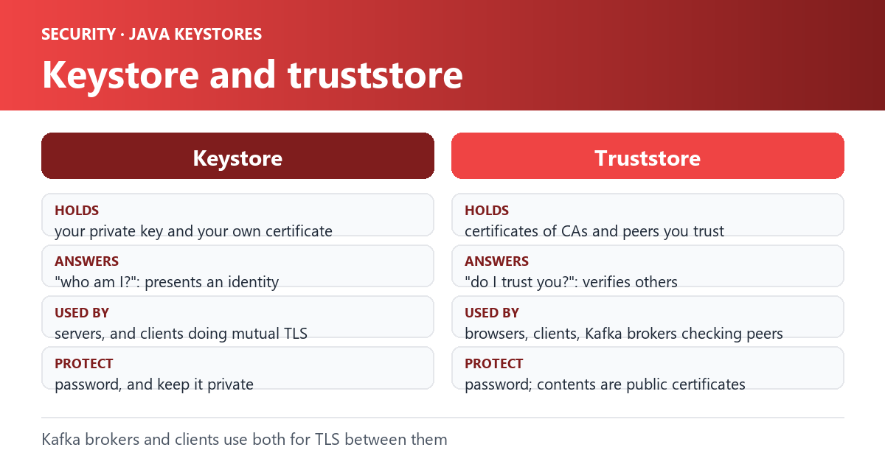

In `Apache Kafka`, `trust store` and `keystore` are essential components for ensuring secure communication between brokers, clients, and other services. In this blog post, we will discuss the concept of trust store and keystore in detail, their importance, and why we use them in Apache Kafka.

## Keystore

A keystore is a secure storage location for private keys and certificates. It is used to store the private keys and corresponding public certificates that are used for authentication and encryption. Keystore plays a crucial role in ensuring secure communication between Kafka clients and brokers, as well as for encrypting sensitive data during transit. The private keys stored in the keystore are used to create digital signatures that authenticate the sender and ensure the integrity of the data being transmitted.

## Example of Keystore

To create a `keystore`, you need to generate a private key and a public certificate. You can use the `keytool` utility, which is included with the Java Development Kit (JDK), to create the keystore.

Here is an example command to create a keystore:

```text
keytool -genkey -alias mykey -keystore keystore.jks
```

This command generates a private key and a public certificate, and stores them in a file named `keystore.jks`.

## Truststore

A `truststore` is a secure storage location for `trusted root certificates` that are used to verify the authenticity of a remote party. It is used to store the trusted certificates that are used to establish trust between Kafka clients and brokers, as well as for verifying the identity of clients connecting to the broker.

## Example of Truststore

To create a `truststore`, you need to obtain the root certificate from a trusted certificate authority (CA) and store it in a file.

Here is an example command to create a `truststore`:

```text
keytool -importcert -alias myca -file myca.crt -keystore truststore.jks
```

This command imports the root certificate from a file named `myca.crt` and stores it in a file named `truststore.jks` with an alias of myca.

## Why we use them in Apache Kafka?

The use of a `keystore` and `truststore` in Apache Kafka is critical for establishing secure communication and protecting sensitive data. By implementing SSL/TLS encryption and proper authentication, organizations can ensure the confidentiality, integrity, and availability of their data, and safeguard against potential security breaches.

In addition to ensuring secure communication, `keystore` and `truststore` are also used to enable `SSL/TLS` encryption for Kafka communication. This is especially important for organizations that handle sensitive data, as SSL/TLS provides an additional layer of security and protects against eavesdropping and data tampering.

In summary, the use of a `keystore` and `truststore` in `Apache Kafka` is crucial for establishing secure communication and protecting sensitive data. By configuring both keystore and truststore, organizations can ensure secure communication, prevent unauthorized access, and safeguard against potential security breaches.

## Process details

In Apache Kafka, SSL/TLS encryption is used to establish secure communication between `brokers`, `clients`, and other services. SSL/TLS ensures that data is encrypted and transmitted securely over the network, and that the identity of the remote party is verified.

To verify the identity of a remote party, the `truststore` is used. The `truststore` contains **`trusted root certificates`** that are used to verify the authenticity of the public certificates presented by the remote party.

When a client or broker attempts to establish a connection, it presents its public certificate to the remote party. The remote party then uses its `truststore` to verify the authenticity of the public certificate by checking if it was signed by a trusted certificate authority (CA).

If the public certificate is trusted, the connection is established, and secure communication can begin. If the public certificate is not trusted, the connection is rejected, and secure communication cannot be established.

This verification process ensures that only trusted parties can establish a connection and that data is transmitted securely over the network. It also prevents unauthorized access and potential security vulnerabilities.

In summary, the `truststore` is used to verify the authenticity of the public certificate presented by a remote party during the SSL/TLS handshake. By verifying the identity of the remote party, the truststore ensures that only trusted parties can establish a connection, and that data is transmitted securely over the network.
