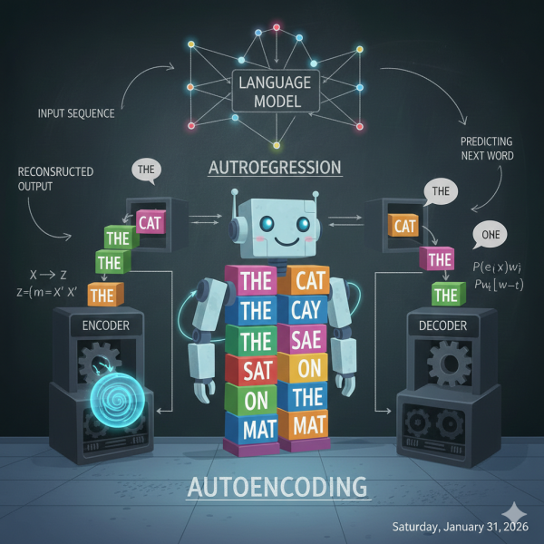

Remember how we compared a language model to an advanced autocomplete system? Well, here’s where the story gets interesting. Not all language models learn the same way. Imagine two students sitting in the same classroom, both brilliant, but each taught to master language through completely different methods. One becomes an incredible writer, the other becomes an exceptional reader. This is the tale of auto-regressive and auto-encoding models.

## Meet the Writer: Auto-Regressive Models

Picture a student—let’s call her `Gen`—who learns to write by practicing one word at a time, always moving forward, never looking back at what she’s about to write next.

**Her training method:** Every day, Gen’s teacher gives her the beginning of a story and asks, “What word comes next?”

“The dog ran across the…” – Gen guesses “street.”  
“The chef carefully added the…” – Gen guesses “salt.”  
“After years of practice, she finally…” – Gen guesses “succeeded.”

Day after day, Gen practices this game millions of times. She never gets to see the end of the sentence when she’s making her guess—she only sees what came before. She’s learning to write like a novelist who puts down one word after another, building momentum, letting each word lead naturally to the next.

**What Gen becomes amazing at:** Over time, Gen becomes a phenomenal storyteller and writer. Ask her to write you an email, draft a story, explain a concept, or even write code; she excels at all of it. She’s learned the rhythm of language, how ideas flow, how to keep a conversation going naturally.

**Her secret power:** Generation. Gen can create new content from scratch. She’s the AI behind tools like ChatGPT, Google’s Gemini, and Claude. When you ask them a question, they’re generating their response word by word, just like Gen learned to do—predicting what should come next based on everything that came before.

**Her limitation:** Because Gen only learned to look backward, she sometimes has to commit to a direction before seeing where the sentence ends. She can’t peek ahead to see how a thought completes before deciding how to start it.

## Meet the Reader: Auto-Encoding Models

Now meet Bert—yes, named after the famous BERT model—who learns language in a completely different way.

**His training method:** Bert’s teacher gives him a different challenge. Instead of predicting the next word, she shows him complete sentences with random words hidden:

“The \_\_\_\_ jumped over the moon.”  
“I love drinking \_\_\_\_ in the morning.”  
“The movie was absolutely \_\_\_\_.”

But here’s the key difference: Bert can see the ENTIRE sentence, both before and after the blank. When he sees “I love drinking \_\_\_\_ in the morning,” he notices “morning” at the end and thinks “probably coffee or tea.” When he sees “The \_\_\_\_ jumped over the moon,” he sees “moon” and knows it’s probably “cow” from the nursery rhyme.

Bert learns by playing this fill-in-the-blank game millions of times, becoming exceptionally good at understanding context from all directions.

**What Bert becomes amazing at:** Bert becomes a master of comprehension and analysis. He’s incredible at:

- Reading a document and answering questions about it
- Determining if a review is positive or negative
- Classifying emails as spam or not spam
- Translating between languages (because he understands the full meaning)
- Finding specific information in large texts

**His secret power:** Deep understanding. Because Bert can look in both directions—backward AND forward – he grasps context better than Gen. He’s like a detective who can examine all the clues at once.

**His limitation:** Bert wasn’t trained to write stories or generate new content from scratch. Ask him to write you a creative email, and he’ll struggle. He’s a reader and analyzer, not a writer.

## Why You Know Gen Better Than Bert

Here’s the plot twist: when you hear about “Generative AI” taking the world by storm – ChatGPT, Claude, AI writing assistants, AI that can code – you’re hearing about Gen’s family. Auto-regressive models have become the face of the AI revolution because they can **create**.

Bert and his auto-encoding cousins work behind the scenes. They’re powering:

- The spam filter in your email
- Search engines understanding what you really mean
- Customer service systems routing your question to the right department
- Translation apps converting your words accurately

**Gen creates. Bert comprehends.**

## The Teaching Methods That Made Them

Why do these different training methods matter? Because they shape what each model can do:

**Gen (Auto-Regressive)** learned by always moving forward, so she’s brilliant at generation—writing, conversing, creating. This is why modern chatbots feel so natural. They’re continuing a conversation the same way they were trained: one word at a time, building on what came before.

**Bert (Auto-Encoding)** learned by seeing the full picture, so he’s brilliant at understanding—reading, analyzing, classifying. When you need to extract meaning or find patterns, Bert-style models are your answer.

## The Future: Best of Both Worlds

The exciting part? Modern AI systems are learning to combine both talents. Some systems use Bert’s reading comprehension to deeply understand your question, then switch to Gen’s generation abilities to write you a perfect response.

It’s like having both students in the same room – one who truly understands what you’re asking, and another who can articulate the answer beautifully. Together, they create the AI experiences that feel almost magical.

So next time you chat with an AI and it writes you a thoughtful response, remember: you’re talking to Gen, the auto-regressive storyteller, who learned language one word at a time and became humanity’s most articulate writing partner.
