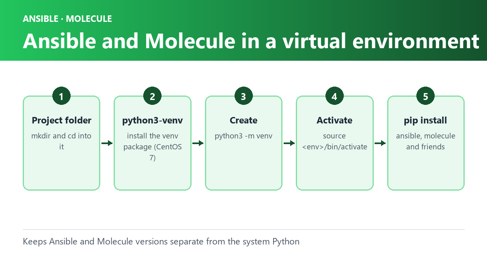

Ansible and Molecule are popular tools for configuration management and testing in the world of DevOps. To avoid conflicts between different projects and their dependencies, it is recommended to use a virtual environment for each project. In this blog post, we’ll show you how to set up and use a virtual environment using Python’s built-in `venv` module on `macOS` and `CentOS 7`.

## Pre-requisites

Before we begin, you’ll need the following:

- Python 3 installed on your system
- `pip` installed on your system
- Basic knowledge of the command line interface

## On Centos7

1. Open a terminal window and create a directory for your project:
   - `mkdir my-ansible-project`
   - `cd my-ansible-project`
2. Install the `python3-venv` package:
   - `sudo yum install python3-venv`
3. Create a new virtual environment:
   - `python3 -m venv venv` 
     - This will create a new directory named `venv` in your project directory, which contains the virtual environment.
4. Activate the virtual environment:
   - `source venv/bin/activate`
5. Install Ansible and Molecule:
   - `pip install ansible molecule`
6. Verify that Ansible and Molecule are installed:
   - `ansible --version`
   - `molecule --version` 
     - This should display the version of Ansible and Molecule installed in the virtual environment.
7. When you’re done working with Ansible and Molecule, you can deactivate the virtual environment:
   - `deactivate`

## On OSX

1. Open a terminal window and create a directory for your project:
   - `mkdir my-ansible-project`
   - `cd my-ansible-project`
2. Create a new virtual environment:
   - `python3 -m venv venv` 
     - This will create a new directory named `venv` in your project directory, which contains the virtual environment.
3. Activate the virtual environment:
   - `source venv/bin/activate`
4. Install Ansible and Molecule:
   - `pip install ansible molecule`
5. Verify that Ansible and Molecule are installed:
   - `ansible --version`
   - `molecule --version` 
     - This should display the version of Ansible and Molecule installed in the virtual environment.
6. When you’re done working with Ansible and Molecule, you can deactivate the virtual environment:
   - `deactivate`

## Using the Virtual Environment

To use Ansible and Molecule inside the virtual environment, you need to activate the environment first.

This is done with the `source` command:

```text
source venv/bin/activate
```

Once the virtual environment is activated, you can use Ansible and Molecule as you normally would. When you’re done, you can deactivate the virtual environment with the `deactivate` command:

```text
deactivate
```

## Conclusion

In this blog post, we showed you how to set up and use a virtual environment using Python’s built-in `venv` module on macOS and CentOS 7 for Ansible and Molecule. Using a virtual environment helps keep your projects isolated and avoids conflicts between different dependencies.
