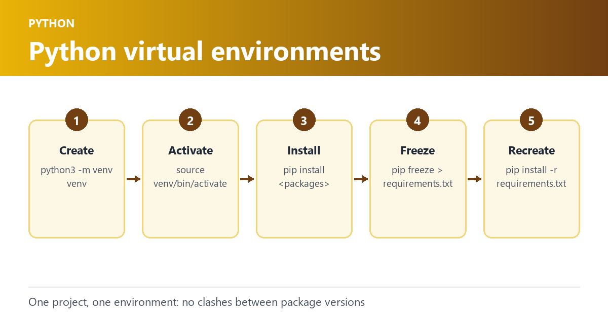

```text
Using a virtual environment like venv is a best practice when working with Python-based projects like Ansible, Molecule, and Playbooks.
```

Continuing from the [blog](), `Virtual environments` are isolated Python environments that allow you to manage dependencies separately for each project, providing a controlled and reproducible environment for development, testing, and production.

Here are some examples of how to use venv for Ansible, Molecule, and Playbook development:

### Creating a virtual environment

You can create a virtual environment using the `venv` module that comes with Python. To create a new virtual environment, open your terminal and run the following command:

```text
python3 -m venv myenv
```

This will create a new virtual environment named `myenv` in the current directory.

### Activating a virtual environment

Once you have created a virtual environment, you need to activate it before you can use it. To activate the `myenv` environment, run the following command:

```text
source myenv/bin/activate
```

This will activate the virtual environment and you will see the name of your environment in the terminal prompt.

### Installing dependencies

To install dependencies in the virtual environment, you can use pip. For example, to install the `ansible` package, run the following command:

```text
pip install ansible
```

This will install the `ansible` package in the `myenv` virtual environment.

### Freezing packages

To freeze the list of installed packages in your virtual environment, you can use the `pip freeze` command. This will generate a list of installed packages and their versions that can be used to recreate the same environment on another machine.

To generate a `requirements.txt` file containing the list of installed packages, run the following command:

```text
pip freeze > requirements.txt
```

This will create a `requirements.txt` file in the current directory containing the list of installed packages.

## Example Contents

```text
ansible==6.7.0
ansible-compat==3.0.1
ansible-core==2.13.8
arrow==1.2.3
attrs==22.2.0
binaryornot==0.4.4
certifi==2022.12.7
cffi==1.15.1
chardet==5.1.0
charset-normalizer==3.0.1
click==8.1.3
click-help-colors==0.9.1
cookiecutter==2.1.1
cryptography==39.0.1
distro==1.8.0
docker==6.0.1
enrich==1.2.7
idna==3.4
importlib-resources==5.12.0
Jinja2==3.1.2
jinja2-time==0.2.0
jsonschema==4.17.3
markdown-it-py==2.2.0
MarkupSafe==2.1.2
mdurl==0.1.2
molecule==4.0.4
molecule-docker==2.1.0
packaging==23.0
pkgutil_resolve_name==1.3.10
pluggy==1.0.0
pycparser==2.21
Pygments==2.14.0
pyrsistent==0.19.3
python-dateutil==2.8.2
python-slugify==8.0.1
PyYAML==6.0
requests==2.28.2
resolvelib==0.8.1
rich==13.3.1
six==1.16.0
subprocess-tee==0.4.1
text-unidecode==1.3
typing_extensions==4.5.0
urllib3==1.26.14
websocket-client==1.5.1
zipp==3.15.0
```

### Using a `requirements.txt` file

To install the packages listed in a `requirements.txt` file, run the following command:

```text
pip install -r requirements.txt
```

This will install all the packages listed in the `requirements.txt` file in the current virtual environment.

### Conclusion

By isolating your project’s dependencies, you can ensure that your code works consistently and avoid compatibility issues with different versions of packages. It also makes it easy to manage dependencies and maintain a consistent development environment. Freezing packages and using a `requirements.txt` file are useful techniques for recreating the same environment on different machines or sharing the environment with other developers.
