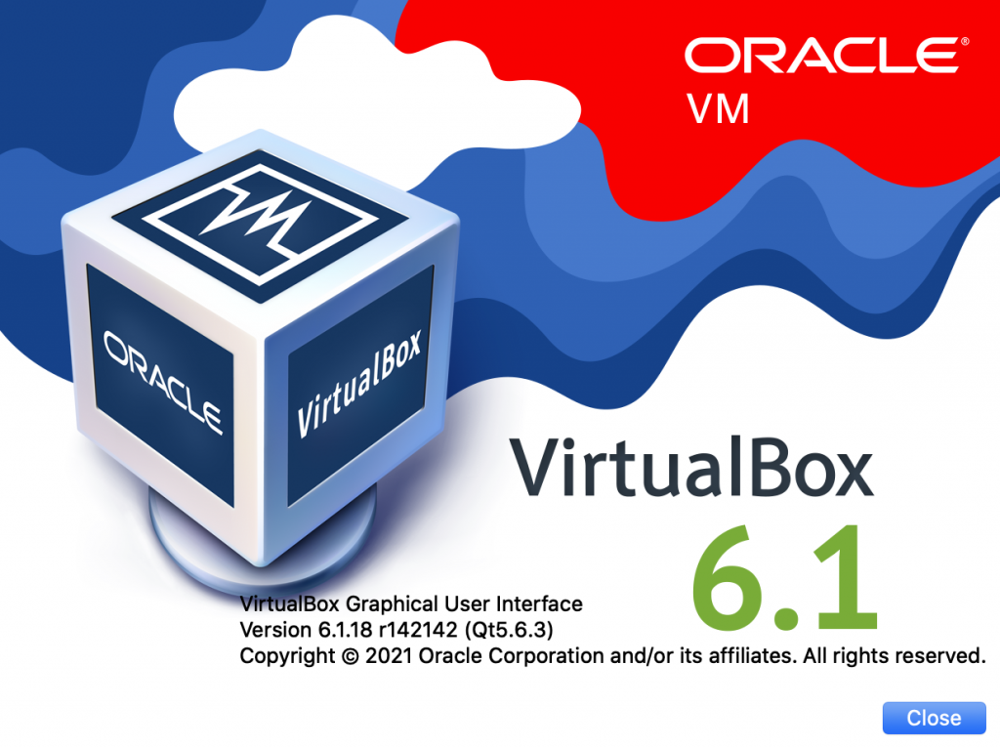
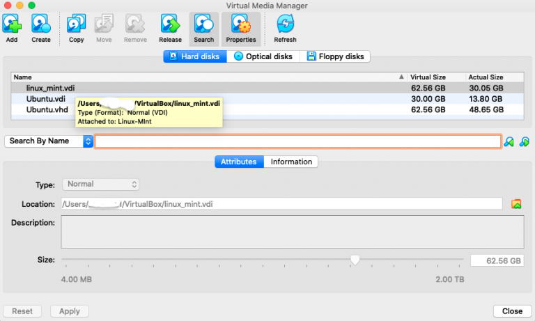
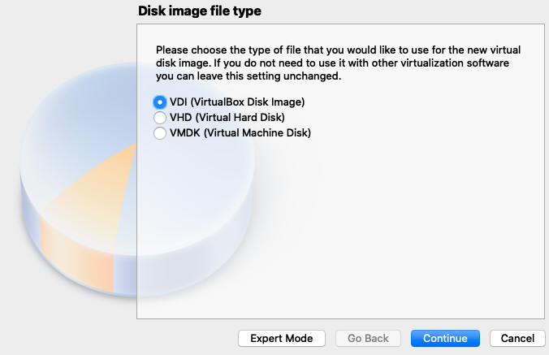
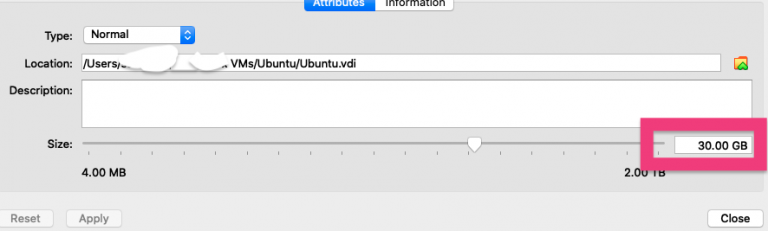
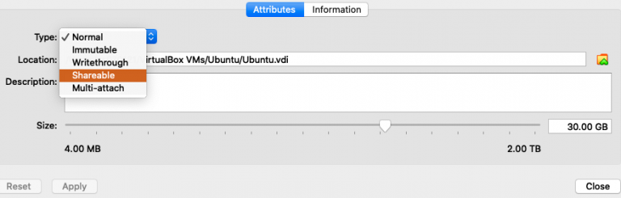
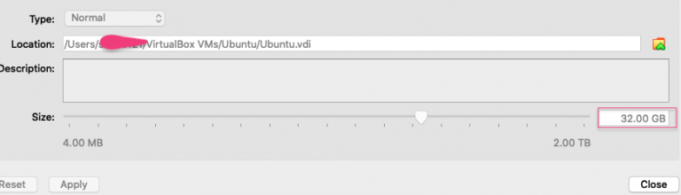
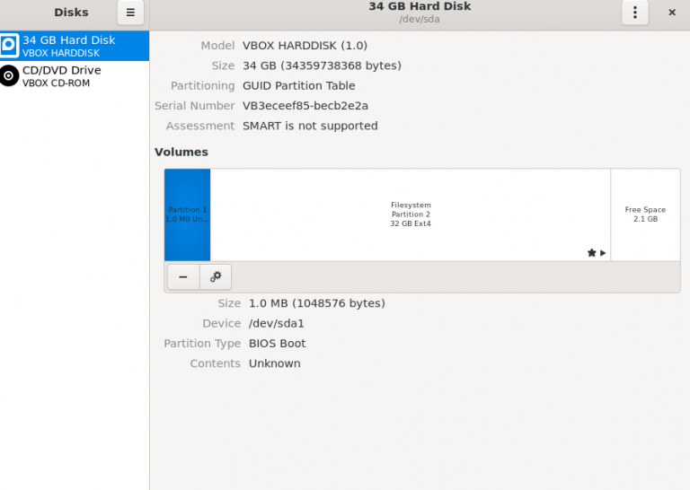
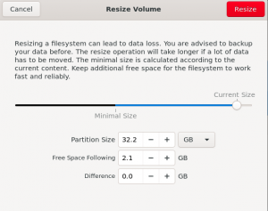

I am using Virtual Box 6.1 and will use it to expand the disk space for one my VBox Ubuntu image which was almost full.

Click on **File** > **Virtual Media Manager**

You can see the `linux mint vdi` this is the disk which I increased size for using simple steps.

## Step-1 : Clone the disk

It is always recommended to ensure you have a copy that you can maintain in case of any irrecoverable failures.

- Click on Copy
- Follow the steps in the wizard

## Step - 2 Modify the attributes

Select the copy of the disk you just created and

I will increase by 2 GB

## Step 3: Resize

Boot up the machine and you can see some free space which you can adjust using any disk tool of you choice

You can click the gear for selected filesystem and increase the size.

