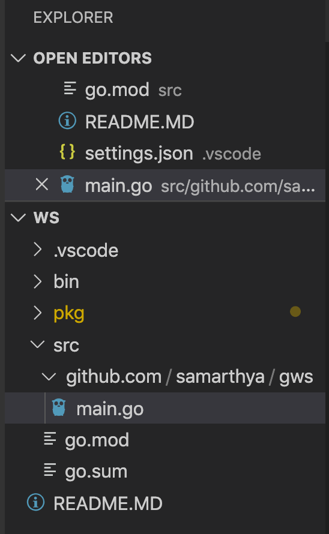
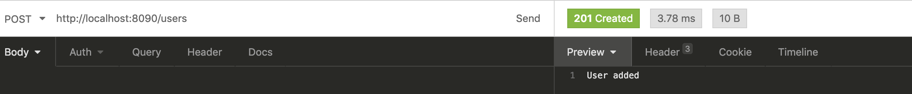

Having practiced creating loads of `Console based` programs of `golang`, it is now time to try something new - A Web Service.

In this blog, I will try and create a Web Service (RESTful) that will be built entirely on Go.

## Weapons of choice

- Visual studio code (I like it)
- GO - 1.14

As I write the code I will touch upon the various building blocks that are used. If I miss something, please do comment and let me know.

### Source Code

Source code is available [here](https://github.com/samarthya/gws).

## Remember

You might come across an empty interface `type interface{}` and just to give you a heads up.

### What is Empty interface?

> The `interface{}` (empty interface) type describes an interface with zero methods. Every Go type implements at least zero methods and therefore satisfies the empty interface.

Some examples are as under

```text
var i interface{}
i = "a string"
i = 3.14
```

```text
var f interface{}
err := json.Unmarshal(b, &f)
```

With interface explained time to get started with the cod. First thing first I will create a workspace and initialize a module.



## Module: init

```text
Samarthya:ws> go mod init github.com/samarthya/gws
```

It creates a file go.mod as under

### File [go. mod]

Creating package

```text
module github.com/samarthya/gws

go 1.14
```

## main.go

Now workspace defined, I will quickly stub my dummy code in the file to check it compiles ok.

```text
package main

import (
	"fmt"
)

func main() {
	fmt.Printf(" Webservice.\n")
}
```

The `go lang` package that we will be using is `net/http` (details available [here](https://golang.org/pkg/net/http/)).

> HTTP package provide client server implementation that we will be using to write a sample code and expose it as an rest end point.

The primary functions that people use are

- [Handle](https://golang.org/pkg/net/http/#Handle) : (From official documentation) **Handle** registers the handler for the given pattern in the DefaultServeMux. The documentation for ServeMux explains how patterns are matched.
- [HandleFunc](https://golang.org/pkg/net/http/#HandleFunc) : **HandleFunc** registers the handler function for the given pattern in the DefaultServeMux.
- [ServeMux](https://golang.org/pkg/net/http/#ServeMux): **ServeMux** is an HTTP request multiplexer. It matches the URL of each incoming request `against a list of registered patterns` and calls the handler for the pattern that most closely matches the URL.

#### Adding the HTTP-request handlers

Now, instead of simple defining a Hello World messge, I thought of using a counter. In my version the counter is incremented each time an endpoint is hit and incremented value is displayed back.

Added some **handler** code for `/count`.

```text
package main

import (
	"fmt"
	"log"
	"net/http"
	"sync"
)

// CountHandler Handles the count
type CountHandler struct {
	sync.Mutex // guards n
	n  int
}

func (h *CountHandler) ServeHTTP(w http.ResponseWriter, r *http.Request) {
	h.Lock()
	defer h.Unlock()
	h.n++
	fmt.Fprintf(w, "count is %d\n", h.n)
}

func main() {
	fmt.Printf(" Webservice.\n")
	http.Handle("/count", new(CountHandler))
	log.Fatal(http.ListenAndServe(":8090", nil))
}
```

### CountHandler

A struct type which has a numeric variable to store the number of times the request was made and a mutex (`sync.mutex`) to ensure parallel requests processing.

### http.Handle

Handle registers the handler for the given pattern. If a handler already exists for pattern, Handle panics.

> func (mux \*[ServeMux](https://golang.org/pkg/net/http/#ServeMux)) Handle(pattern [string](https://golang.org/pkg/builtin/#string), handler [Handler](https://golang.org/pkg/net/http/#Handler))

- In our example we are listening on `"/count"` that is the pattern
- [Handler](https://golang.org/pkg/net/http/#Handler): It is an interface (the second argument), that responds to the HTTP request.

```text
type Handler interface {
    ServeHTTP(ResponseWriter, *Request)
}
```

In our case we are using CountHandler as an argument which implements the function `ServeHTTP`.

```text
func (h *CountHandler) ServeHTTP(w http.ResponseWriter, r *http.Request) {
	h.Lock()
	defer h.Unlock()
	h.n++
	fmt.Fprintf(w, "count is %d\n", h.n)
}
```

- [ResponseWriter](https://golang.org/pkg/net/http/#ResponseWriter)
  - It is an interface, used to create HTTP response.
- [Request](https://golang.org/pkg/net/http/#Request)
  - A Request represents an HTTP request received by a server or to be sent by a client.

### ServeHTTP

### main()

The entry point to the code

- **ListenAndServe** starts an HTTP server with a given address and handler.
  - In our sample we are listening on 8090 & localhost.
  - The handler is usually `nil`, which means to use DefaultServeMux.
  - **Handle** and **HandleFunc** add handlers to **[DefaultServeMux](https://golang.org/pkg/net/http/#ServeMux)**

### JSON

One of the crucial pieces of building is JSON, which can be an input to a web-request and an output from a web-request.

> JSON is an data interchange format.

To allow easier handling of Web-Requests go provides a package

```text
import "encoding/json"
```

Official documentation can be found [here](https://golang.org/pkg/encoding/json/#pkg-overview) & another helpful link is available [here](https://blog.golang.org/json).

Package `json` implements encoding and decoding of JSON.

- [Marshal](https://golang.org/pkg/encoding/json/#Marshal) : Marshal returns the JSON encoding of an object
  - `Marshal traverses the values in the object recursively & if an encountered value implements the Marshaler interface and is not a nil pointer, Marshal calls its MarshalJSON method to produce JSON.`
- [Unmarshal](https://golang.org/pkg/encoding/json/#Unmarshal) : Unmarshal parses the JSON-encoded data and stores the result in the argument passed.

### Example

Let's define a type that we can use to validate.

```text
type User struct {
	Name string `json:"firstName"`
	Middlename string `json:"middleName"`
	Surname string `json:"lastName"`
	Email string `json:"userName"`
	Address string `json:"address"`
}
```

The encoding of each struct field `can be customized by the format string stored under the "json" key` in the struct field's tag.

```text
`json:"middleName"`
```

The format string gives the name of the field, possibly followed by a comma-separated list of options. The name may be empty in order to specify options without overriding the default field name.

The "omitempty" option specifies that the field should be omitted from the encoding if the field has an empty value, defined as false, 0, a nil pointer, a nil interface value, and any empty array, slice, map, or string.

```text
`json:"middleName,omitempty"`
```

If I try and invoke `Marshal` on it, the output looks like below.

```text
var user User = User{ 
		Name: "Samarthya", 
		Middlename: "",
		Surname: "Doe", 
		Email: "samarthya@samarthya.me", 
		Address: "Auzzieland",
	}
```

```text
u, err := json.Marshal(user)
	if err != nil {
		log.Println(err)
	} else {
		fmt.Println(" User: ", string(u))
	}
```

The `Marshal` returns `[] byte & error` which we assign to `u` and `err`.

```text
func Marshal(v interface{}) ([]byte, error)
```

#### Output

```text
User: {"firstName":"Samarthya","middleName":"","lastName":"Doe","userName":"samarthya@samarthya.me","address":"Auzzieland"}
```

Let me add some some more attributes like the `omitempty`

```text
//User Stores the information about a user
type User struct {
	Name string `json:"firstName"`
	Middlename string `json:"middleName,omitempty"`
	Surname string `json:"lastName"`
	Email string `json:"userName"`
	Address string `json:"address"`
}
```

Running the same code will return

```text
User:  {"firstName":"Samarthya","lastName":"Doe","userName":"samarthya@samarthya.me","address":"Auzzieland"}
```

You can see the empty `Middlename` has been ignored.

Unmarshalling, is a way you can use a `byte []` and create an object from it.

```text
unc Unmarshal(data []byte, v interface{}) error
```

```text
var newUser User

e := json.Unmarshal(u, &newUser)

if e == nil {
	fmt.Println(" Name : ", newUser.Name, " ", newUser.Surname)
}
```

Output looks like

```text
User:  {"firstName":"Samarthya","lastName":"Doe","userName":"samarthya@samarthya.me","address":"Auzzieland"}
 Name :  Samarthya
```

Having understood the Handlers and `Marshaling` let's add some actual code.

> Helpful [link](https://golang.org/doc/effective_go.html#initialization)

```text
// userList Slice of users that will be returned for the GET Rest call.
var userList []User

// init Initialized
func init() {
	userList = []User{
		{
			Name:       "Samarthya",
			Middlename: "",
			Surname:    "Doe",
			Email:      "samarthya@samarthya.me",
			Address:    "Auzzieland",
		},
		{
			Name:       "Gaurav",
			Middlename: "M",
			Surname:    "Doe",
			Email:      "iam@gaurav.me",
			Address:    "Swaziland",
		},
		{
			Name:       "Bhanuni",
			Middlename: "",
			Surname:    "Doe",
			Email:      "bhanuni@bhanuni.in",
			Address:    "Papaland",
		},
	}
}
```

Each source file can define its own niladic `init` function to set up whatever state is required. (Actually each file can have multiple `init` functions.) And finally `init` is called after all the variable declarations in the package have evaluated their initializers, and those are evaluated only after all the imported packages have been initialized.

I will now define a Handler that will process the HTTP methods (GET and POST) for a defined pattern.

```text
// handleUsers Will expose this API to handle user commands
func handleUsers(w http.ResponseWriter, r *http.Request) {
	// Handlers can handle request with multiple request methods.

	// Every request has a method a simple string
	switch r.Method {
	case http.MethodGet:
		log.Println(" GET: called")
		b, err := json.Marshal(userList)
		if err != nil {
			// Error while unmarshaling
			w.WriteHeader(http.StatusInternalServerError)
			return
		}
                w.WriteHeader(http.StatusOK)
		w.Header().Add("Content-Type", "application/json")
		w.Write(b)
		
		return

	case http.MethodPost:
		log.Println(" POST: called")
	default:
		log.Println(" Not supported")
	}

}
```

From the source code

```text
type Request struct {
    // Method specifies the HTTP method (GET, POST, PUT, etc.).
    // For client requests, an empty string means GET.
    //
    // Go's HTTP client does not support sending a request with
    // the CONNECT method. See the documentation on Transport for
    // details.
    Method string
```

I am reading the `METHOD` in the switch and if it GET I will return the `userList`.

```text
b, err := json.Marshal(userList)
if err != nil {
	// Error while unmarshaling
	w.WriteHeader(http.StatusInternalServerError)
	return
}
```

As shown above we simply `Marshal` the userList that we have initialized and in case of any error we will return the `StatusInternalServerError` otherwise

```text
w.WriteHeader(http.StatusOK)
w.Header().Add("Content-Type", "application/json")
w.Write(b)
return
```

We define the Header & write the `byte []` and return.

```text
HTTP/1.1 200 OK
Content-Type: application/json
Date: Sat, 16 May 2020 11:06:44 GMT
Content-Length: 308
```

the Response body

```text
[

    {
        "firstName": "Samarthya",
        "lastName": "Doe",
        "userName": "samarthya@samarthya.me",
        "address": "Auzzieland"
    },
    {
        "firstName": "Gaurav",
        "middleName": "M",
        "lastName": "Doe",
        "userName": "iam@gaurav.me",
        "address": "Swaziland"
    },
    {
        "firstName": "Bhanuni",
        "lastName": "Doe",
        "userName": "bhanuni@bhanuni.in",
        "address": "Papaland"
    }

]
```

Let's modify some code and handle other methods.

```text
func handleUsers(w http.ResponseWriter, r *http.Request) {
	// Handlers can handle request with multiple request methods.

	// Every request has a method a simple string
	switch r.Method {
	case http.MethodGet:
		log.Println(" GET: called")
		b, err := json.Marshal(userList)
		if err != nil {
			// Error while unmarshaling
			w.WriteHeader(http.StatusInternalServerError)
			return
		}
		w.WriteHeader(http.StatusOK)
		w.Header().Add("Content-Type", "application/json")
		w.Write(b)

	case http.MethodPost:
		log.Println(" POST: called")
		w.WriteHeader(http.StatusCreated)
		w.Header().Add("Content-Type", "application/json")
		w.Write([]byte("User added"))

	default:
		log.Printf(" Method: %s\n", r.Method)
		w.WriteHeader(http.StatusMethodNotAllowed)
		w.Header().Add("Content-Type", "application/json")
		w.Write([]byte("method not supported"))
		log.Println(" Not supported")
	}

}
```

Let's try sending a `PUT` request

```text
> PUT /users HTTP/1.1
> Host: localhost:8090
> User-Agent: insomnia/7.1.1
> Accept: */*
> Content-Length: 0

< HTTP/1.1 405 Method Not Allowed
< Date: Sat, 16 May 2020 11:21:40 GMT
< Content-Length: 20
< Content-Type: text/plain; charset=utf-8
```

Sending a POST request

```text
> POST /users HTTP/1.1
> Host: localhost:8090
> User-Agent: insomnia/7.1.1
> Accept: */*
> Content-Length: 0

< HTTP/1.1 201 Created
< Date: Sat, 16 May 2020 11:27:13 GMT
< Content-Length: 10
< Content-Type: text/plain; charset=utf-8
```



### Post: To add

I have added on the structure and Post handler to add a user passed along with the request.

```text
type User struct {
	Id         int    `json:"id"`
	Name       string `json:"firstName"`
	Middlename string `json:"middleName,omitempty"`
	Surname    string `json:"lastName"`
	Email      string `json:"userName"`
	Address    string `json:"address"`
}
```

You can see I have added a new field `Id`, and also have modified the `POST` handler.

Added a JSON converter utility function as under

```text
// JSON representation of a user.
func jsonUser(user User) []byte {
	b, err := json.Marshal(user)
	if err != nil {
		// Error while unmarshaling
		return []byte("")
	}
	return b
}
```

Now modifying for post in the `switch`

```text
case http.MethodPost:
		log.Println(" POST: called")
		var newUser User
		e, er := ioutil.ReadAll(r.Body)
		if er != nil {
			w.WriteHeader(http.StatusBadRequest)
			return
		}

		er = json.Unmarshal(e, &newUser)
		if er != nil {
			// Error unmarsheling the data
			w.WriteHeader(http.StatusBadRequest)
		}

		fmt.Printf(" User : %s", newUser.Email)

		userList = append(userList, newUser)
		w.WriteHeader(http.StatusCreated)
		w.Header().Add("Content-Type", "application/json")
		w.Write(jsonUser(newUser))
```

Few additions

- I am using `ioutil.ReadAll` to read the request body
  - In case of error I return a `Bad Request` error.
- Unmarshal the `byte []` to a new user
- This `newUser` is added to the slice.
- I return the `newUser` along with the `Status Created` code.

```text
> POST /users HTTP/1.1
> Host: localhost:8090
> User-Agent: insomnia/7.1.1
> Content-Type: application/json
> Accept: */*
> Content-Length: 159

| { 
| 	"id" : 6,
| 	"firstName": "Samarthya",
| 	"middlename": "Samarthya",
| 	"lastName":    "Doe",
| 	"userName":      "sam@samarthya.me",
| 	"address":    "Angletére"
| }

* upload completely sent off: 159 out of 159 bytes

< HTTP/1.1 201 Created
< Date: Sat, 16 May 2020 13:12:48 GMT
< Content-Length: 127
< Content-Type: text/plain; charset=utf-8
```

#### -- THE - END --
