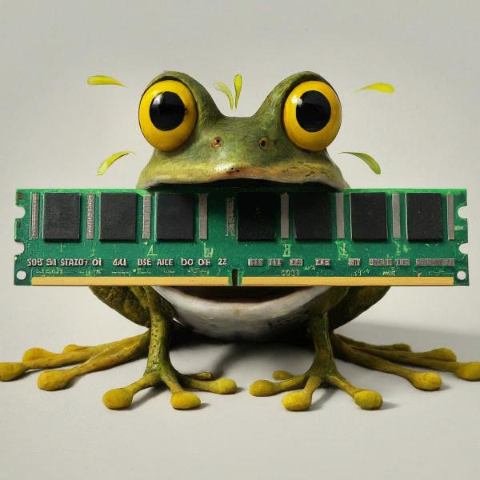

The `/etc/profile.d` directory, though seemingly simple, plays a vital role in the smooth operation of your Linux system. But how did this unassuming directory come to be, and how has it evolved over time? Let’s embark on a journey through the history of this essential component.

### Early days

In the early days of Linux, managing environment variables was a manual affair. Users often edited system-wide files like `/etc/profile` or their individual shell configuration files (e.g., `.bashrc`) to define necessary variables. This approach, while functional, lacked organization and could lead to conflicts when multiple applications attempted to modify the same file.

### **The Rise of Modularity**

As Linux distributions matured and the number of applications requiring specific environment variables grew, the need for a more modular approach became evident. The introduction of the `/etc/profile.d` directory around the late 1990s addressed this need.

This directory provided a dedicated space for storing individual scripts, each responsible for setting environment variables specific to a particular application or system configuration. These scripts, typically named with leading numbers for ordered execution, offered several advantages:

- **Organization:** Kept the core `/etc/profile` file `clean` and focused on essential functionalities.
- **Flexibility:** Allowed adding or removing scripts without modifying the main profile, making configuration management easier.
- **Isolation:** Ensured application-specific configurations remained separate, preventing conflicts.

**Modern Day: A Standardized Approach**

Today, the `/etc/profile.d` directory remains a cornerstone of environment variable management in most Linux distributions. The concept has become widely adopted, ensuring consistency and simplifying configuration across different systems.

However, the evolution hasn’t stopped there. Modern distributions often employ additional tools and mechanisms alongside `/etc/profile.d` to further enhance environment variable management. These include:

- **Systemd services:** Can manage environment variables specific to system services.
- **User-specific configuration files:** Allow users to define personal environment variables in their home directories.
- **Application-specific configuration files:** Some applications provide dedicated configuration files for setting their own environment variables.

Today this directory is and can be used for

- Storing shell-specific configuration scripts that are executed when a new shell session starts.
- Allows for modular and centralized management of environment variables for different applications and system-wide settings.
- Keeps the `/etc/profile` file clean and focused on core functionalities.
- The `/etc/profile` file, a system-wide startup script, sources all scripts within the `/etc/profile.d` directory during login or when a new shell is launched.
- Scripts in this directory typically have names starting with numbers (e.g., `01-my-script.sh`) to control their execution order (lower numbers run first).
- These scripts can:
  - Set environment variables specific to applications or system configurations.
  - Load additional shell functions or aliases.
  - Perform other shell-related tasks.
