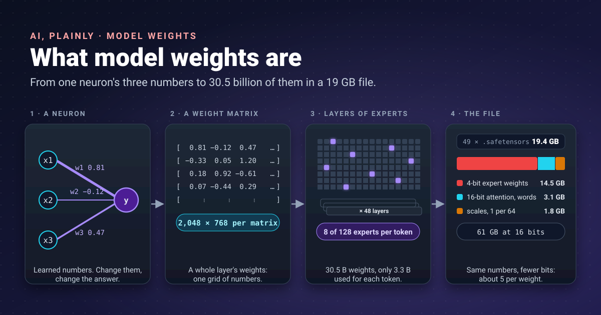


A recipe is a list of quantities: 200 g of flour, 3 eggs, 180 °C. Change the numbers and you get a different cake.
A model's weights are its quantities, about 30 billion of them in the model I have been running, and the
19 GB file I downloaded is nothing more than that list, written down.




In [my comparison of Ollama and Colibri]() I wrote
"weights" a dozen times without saying what they are. This post fills that gap. Every number in it is either from
a primary source or something I measured by opening the files on my own disk.

## One neuron, three weights

I described the starting point in [The Core Divide](): a model begins as a
formula with blanks in it.

```text
y = w1·x1 + w2·x2 + w3·x3 + b
```

The `x` values are the input. The **weights** (`w1`, `w2`, `w3`) say how much each input matters, and the **bias**
(`b`) shifts the result. Training is the search for the values of `w` and `b` that make `y` right as often as
possible. Once training ends, those values are fixed, and they *are* the learned part of the model. The formula is
the recipe card; the weights are the quantities written on it.

A **parameter** is any number the model learned. Weights are most of them; biases and normalisation values are the
rest. When a model is described as "30B", it means 30 billion parameters.

## From a neuron to a model

One neuron is not useful. A layer has thousands of them, each with a weight for every input, so a layer's weights
form a grid of numbers, a **weight matrix**. Running the layer means multiplying the input by that matrix, which is
why [GPUs, built for matrix multiplication](), matter so much.
A large language model stacks dozens of layers, each holding several matrices.

The numbers for Qwen3-Coder 30B, from its [model card](https://huggingface.co/Qwen/Qwen3-Coder-30B-A3B-Instruct)
and the `config.json` that ships with it:

| What | Value |
|---|---|
| Parameters in total | 30.5 billion |
| Parameters used per token | 3.3 billion |
| Layers | 48 |
| Experts per layer | 128, of which 8 are used per token |
| Hidden size (numbers per token inside the model) | 2,048 |
| Precision of the original release | BF16 (16 bits per weight) |

You can rebuild the 30.5 billion from the config yourself, which is a good way to make the idea concrete:

| Part | Calculation | Parameters |
|---|---|---|
| Experts | 48 layers × 128 experts × 3 matrices × 2,048 × 768 | 28.99 B |
| Attention | 48 layers × (2,048 × 4,096 × 2 + 2,048 × 512 × 2) | 0.91 B |
| Word embeddings and output layer | 2 × 151,936 words × 2,048 | 0.62 B |
| Expert routers | 48 × 2,048 × 128 | 0.01 B |
| **Total** | | **30.5 B** |

Almost 95% of this model is experts. Hold that thought.

## What is in the file

A weights file stores every matrix by name, with its shape and number type, followed by the raw numbers. Two
formats cover most of what a beginner will download.

**Safetensors** is Hugging Face's format. Its [specification](https://github.com/huggingface/safetensors) is short:
the first 8 bytes give the length of a JSON header, the header lists each tensor's `dtype`, `shape` and byte
offsets, and the rest of the file is the numbers. It was designed to be safe, since unlike Python's pickle format
it cannot run code when you load it, and fast, since a program can map the file and read only the tensors it needs.

You can read a header with nothing but the standard library:

```python
import json
import struct
import sys

with open(sys.argv[1], "rb") as f:
    size = struct.unpack("<Q", f.read(8))[0]       # 8 bytes: header length, little-endian
    header = json.loads(f.read(size))

header.pop("__metadata__", None)
for name, info in list(header.items())[:5]:
    print(name, info["dtype"], info["shape"])
print(len(header), "tensors in this file")
```

Run against the first of the 49 files in Colibri's copy of Qwen3-Coder, it prints names such as
`model.layers.0.mlp.experts.0.qs`, which is layer 0, expert 0. Across all 49 files there are 12,723 tensors.

**GGUF** is the format of the llama.cpp family, which Ollama uses. Its
[specification](https://github.com/ggml-org/ggml/blob/master/docs/gguf.md) packs everything into one file: a header,
then metadata as key-value pairs, then a table of tensors, then the data. The spec's own words: "all information
needed to load a model is contained in the model file". I opened the small `qwen3.5:0.8b` model in my Ollama store:
the file starts with the bytes `GGUF`, holds 536 tensors and 52 metadata entries, and records its own size as
`general.parameter_count = 873438784`.

| | Safetensors | GGUF |
|---|---|---|
| Who uses it | Hugging Face libraries, many others | llama.cpp, Ollama |
| Files per model | Often many shards plus `config.json` and tokenizer files | One |
| Header | JSON | Typed key-value metadata |
| Quantised weights | Possible, depends on the tool | Built in (`Q4_K_M`, `Q8_0` and others) |

## How big will it be on disk?

The rule of thumb is simple: **parameters × bits per weight ÷ 8 = bytes**. Hugging Face's
[quantisation guide](https://huggingface.co/docs/transformers/main/en/quantization/overview) gives the same
arithmetic for an 8B model: about 16 GB in bf16, 8 GB at 8 bits and 4 to 5 GB at 4 bits.

For Qwen3-Coder 30B:

| Precision | Calculation | Size |
|---|---|---|
| BF16, as released | 30.5 B × 16 ÷ 8 | 61 GB |
| 8 bits | 30.5 B × 8 ÷ 8 | 30.5 GB |
| 4 bits, the naive estimate | 30.5 B × 4 ÷ 8 | 15.3 GB |
| What I actually downloaded | | **19.4 GB** |

The 4 GB gap is where it gets interesting. Adding up the tensors by type in the real files gave this:

| In the file | Type | Size |
|---|---|---|
| Expert weights, two 4-bit numbers per byte | `U8` | 14.5 GB |
| Attention and embeddings, kept at 16 bits | `F16` | 3.1 GB |
| Scales: one number for every 64 weights | `F32` | 1.8 GB |
| **Total** | | **19.4 GB** |

So the converter squeezed only the experts to 4 bits, kept the smaller, more sensitive parts at 16 bits, and stored
a scale for each group of 64 weights, which works out to about 5 bits per parameter on average. Ollama's `Q4_K_M`
copy of the same model is 18 GB, also well above the naive estimate. When you estimate, add 20 to 25% to the naive 4-bit number.

## What quantisation costs

**Quantisation** stores each weight in fewer bits. Four bits allow only 16 different values, so the converter
splits the weights into small groups, records a scale for each group, and stores each weight as one of 16 steps
of that scale. The [Hugging Face guide](https://huggingface.co/docs/transformers/main/en/quantization/overview) puts
the cost plainly: fewer bits cost some accuracy, and each method trades memory, speed and accuracy differently.

In practice that means:

- **You gain** a model that fits: 19 GB instead of 61 GB, so it runs on a desktop at all.
- **You gain** speed when memory is the bottleneck, because there are fewer bytes to read for every token.
- **You lose** some accuracy. How much depends on the method and the number of bits, so check the model card or
  test with your own prompts.

## Experts: why some weights can stay on disk

A **mixture-of-experts** (MoE) layer replaces one large block of weights with many small ones, the experts, plus a
small router that picks a few of them for each token. The idea comes from
[Shazeer and colleagues in 2017](https://arxiv.org/abs/1701.06538): "a trainable gating network determines a sparse
combination of these experts to use for each example."

For Qwen3-Coder that means 8 of 128 experts per layer for each token, which is why only 3.3 billion of its
30.5 billion parameters do any work at a time. You can check it against the table above: 8/128 of the 28.99 B expert
parameters, plus the attention and embeddings, comes to about 3.3 B.

This is the whole trick behind [Colibri](https://github.com/JustVugg/colibri). If a token touches only a few
experts, the rest do not need to be in memory: they can wait on disk and be read when the router asks for them.
The weights file is split into named experts, so the engine can fetch exactly the one it needs.

## Open weights is not open source

When a company "releases a model", it usually means you can download the weights. That is **open weights**:
the numbers, often under a licence such as Apache 2.0 for Qwen3-Coder.

The Open Source Initiative's
[Open Source AI Definition 1.0](https://opensource.org/ai/open-source-ai-definition) asks for more. It defines
weights as "the set of learned parameters that overlay the model architecture to produce an output from a given
input", and says open source models and weights "must include the data information and code used to derive those
parameters". In recipe terms: open weights gives you the quantities; open source also gives you how they were
worked out.

| | Open weights | Open source AI, per the OSI definition |
|---|---|---|
| Download and run the model | Yes | Yes |
| The weights themselves | Yes | Yes |
| Code used to train it | Not necessarily | Yes |
| Information about the training data | Not necessarily | Yes |

## Takeaways

- A weight is a learned number. A model is a fixed architecture plus billions of them; "30B" counts them.
- A weights file is a table of named matrices and their raw numbers. Safetensors keeps a JSON header; GGUF keeps
  everything, including metadata, in one file.
- Estimate size as parameters × bits ÷ 8, then add 20 to 25% for scales and the parts kept at higher precision.
- In a mixture-of-experts model most weights are experts and only a few are used per token. That is what lets
  Colibri leave some on disk.
- Open weights means you get the numbers. Open source, by the OSI definition, also means the code and data
  information that produced them.

## References

- [Qwen3-Coder-30B-A3B-Instruct](https://huggingface.co/Qwen/Qwen3-Coder-30B-A3B-Instruct): Qwen on Hugging Face, parameter counts, layers, experts, precision and licence
- [huggingface/safetensors](https://github.com/huggingface/safetensors): GitHub, the safetensors file format and why it is safe
- [Safetensors documentation](https://huggingface.co/docs/safetensors/index): Hugging Face, what the format is for
- [GGUF specification](https://github.com/ggml-org/ggml/blob/master/docs/gguf.md): ggml on GitHub, the GGUF file layout
- [Quantization overview](https://huggingface.co/docs/transformers/main/en/quantization/overview): Hugging Face Transformers, bytes per parameter and the cost of fewer bits
- [Outrageously Large Neural Networks: The Sparsely-Gated Mixture-of-Experts Layer](https://arxiv.org/abs/1701.06538): Shazeer et al., arXiv 2017, the mixture-of-experts layer
- [The Open Source AI Definition 1.0](https://opensource.org/ai/open-source-ai-definition): Open Source Initiative, what open source AI requires
- [JustVugg/colibri](https://github.com/JustVugg/colibri): GitHub, keeping experts on disk
- The file measurements (tensor counts, sizes by type, GGUF header) are my own, from the model files on my machine.
