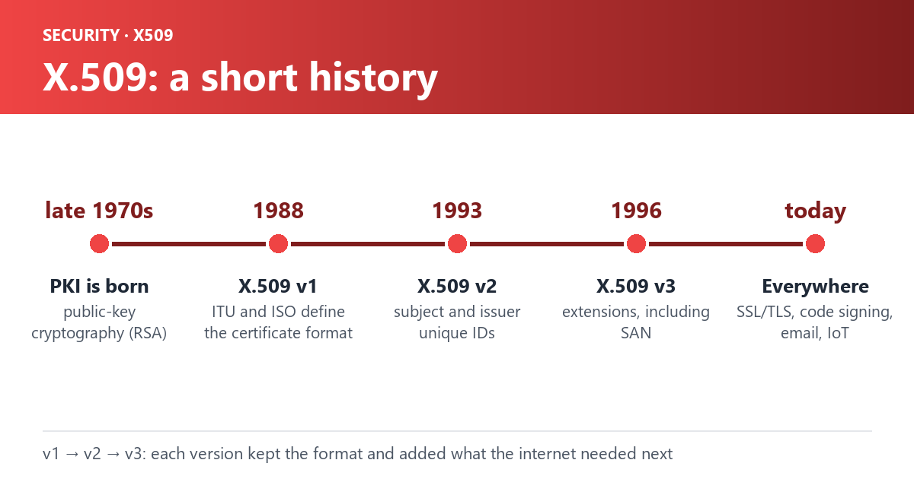

X.509 certificates have become a fundamental component of secure communication on the internet. They provide authentication, encryption, and integrity for various applications and protocols. In this blog post, we will delve into the intriguing history of X.509 certificates, tracing their origins, evolution, and significant milestones.

1. `Birth of Public Key Infrastructure (PKI)`: The need for a robust framework to authenticate and secure electronic communication led to the development of Public Key Infrastructure. In the late 1970s, researchers at RSA Laboratories and CCITT (now ITU-T) started working on developing a standard for digital certificates.
2. `Introduction of X.509 Standard`: In 1988, the International Telecommunication Union (ITU) and ISO jointly published the X.509 standard. This standard defined the format and structure of digital certificates, including key elements like subject, issuer, public key, and signature. X.509 initially focused on directory services, providing a basis for implementing secure communication.
3. `X.509 Version 2`: The release of X.509 Version 2 in 1993 introduced significant enhancements. This version added support for subject and issuer unique identifiers, enabling better tracking and management of certificates.
4. `Evolution to X.509 Version 3`: X.509 Version 3, released in 1996, introduced extensions, which revolutionized the capabilities of X.509 certificates. Extensions provided a flexible mechanism to include additional information within a certificate, such as subject alternative names, key usage, and enhanced key usage. These extensions paved the way for broader application of X.509 certificates in various domains.
5. `SSL/TLS and X.509`: The introduction of Secure Sockets Layer (SSL) and subsequent Transport Layer Security (TLS) protocols drove the widespread adoption of X.509 certificates. SSL/TLS protocols utilize X.509 certificates to authenticate servers and encrypt communication, ensuring secure connections for web browsing, online banking, e-commerce, and more.
6. `X.509 in Code Signing`: As the importance of software integrity grew, X.509 certificates found their way into code signing. Code signing certificates, based on X.509, enable developers and software vendors to digitally sign their software, establishing trust and integrity.
7. `X.509 in Email Encryption`: To address email security challenges, X.509 certificates became instrumental in email encryption and digital signatures. By incorporating X.509 certificates into email clients and servers, users can exchange encrypted emails, protecting the confidentiality and authenticity of their messages.
8. `X.509 and IoT Security`: With the rise of the Internet of Things (IoT), X.509 certificates gained prominence in securing IoT ecosystems. They play a crucial role in device authentication, secure communication between devices, and ensuring data privacy in IoT deployments.

The journey of X.509 certificates from their inception to their diverse applications in modern communication systems showcases their vital role in establishing trust, ensuring privacy, and securing digital interactions. As technology evolves, X.509 certificates will continue to be a cornerstone of secure communication in an increasingly interconnected world.

1. X.509 Version 1 (1988):
   - X.509 Version 1 was released, defining the basic structure of X.509 certificates.
   - However, SAN extensions were not introduced in this version.
2. X.509 Version 2 (1993):
   - X.509 Version 2 introduced support for subject and issuer unique identifiers.
   - SAN extensions were not yet introduced in this version.
3. X.509 Version 3 (1996):
   - X.509 Version 3 brought significant enhancements to X.509 certificates.
   - It introduced extensions, including the Subject Alternative Name (SAN) extension.
   - The SAN extension allowed certificates to specify additional subject identities, such as email addresses, IP addresses, domain names, and more.
   - This extension expanded the capabilities and flexibility of X.509 certificates, enabling them to support a broader range of use cases.
4. Present Day:
   - SAN extensions remain a vital component of X.509 certificates and are widely used in various applications.
   - They are commonly utilized in SSL/TLS certificates for securing websites with multiple domain names or subdomains.
   - SAN extensions are also used in email certificates, code signing certificates, and other scenarios where multiple identities need to be associated with a single certificate.
